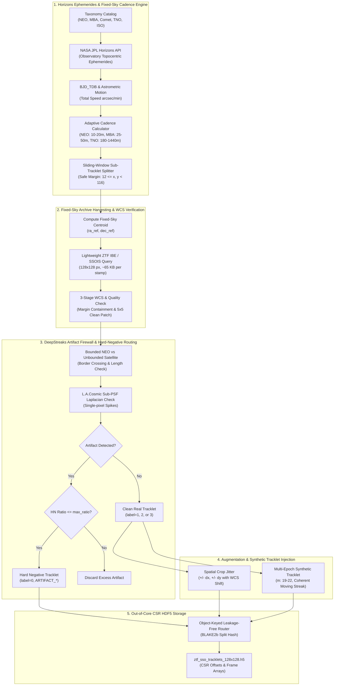
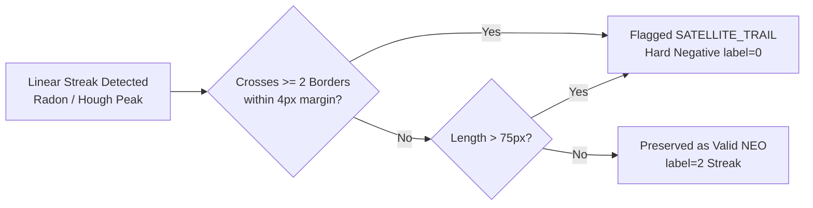

# Project LUMIA: Solar System Object Data-Mining & Augmentation Pipeline Architectural Blueprint

* **Document Version:** 2.0.0
* **Status:** Production Architecture Blueprint
* **System Target:** Project LUMIA Data-Mining Subsystem (`src/LUMIA/data_mining/`)
* **Core Domains:** Orbital Dynamics, Fixed-Sky Variable-Length Tracklet Crawling, WCS Astrometric Verification, Artifact Hard-Negative Routing, In-Memory D4 Augmentation, Multi-Epoch Synthetic Injections, and Compressed CSR HDF5 Serialization
* **Surveys & Infrastructure:** Zwicky Transient Facility (ZTF), Pan-STARRS (PS1/PS2), NASA JPL Horizons, CADC SSOIS, DeepStreaks Architecture

---

## 1. Executive Summary & Pipeline Topology

Detecting and classifying faint solar system bodies—Near-Earth Objects (NEOs), faint Main Belt Asteroids (MBAs), Trans-Neptunian Objects (TNOs), Comets with extended dust comas, and Interstellar Objects (ISOs)—requires high-fidelity, multi-epoch training data. Single-frame image classifications fail to capture the temporal coherence of real moving objects and frequently produce false positives caused by satellite trails, airplane strobes, cosmic rays, optical reflections, and subtraction dipoles.

The **LUMIA Data-Mining & Augmentation Subsystem (v2.0)** adopts the **Tracklet** as its fundamental data unit: a time-ordered sequence of $N \ge 2$ observations (typically $3-8$ frames, and supporting long arcs of $10-20+$ frames) of the same solar system body.

### Seven Core Subsystem Refinements:
1. **Variable-Length Tracklets & Fixed-Sky Centering:** Frames within a tracklet share a single fixed-sky coordinate centroid $(\alpha_{\text{ref}}, \delta_{\text{ref}})$. Background stars remain stationary while the object visibly traverses the field. A sliding-window algorithm automatically splits long or fast trajectories into overlapping sub-tracklets ($N_i \ge 2$) whenever angular motion exceeds the safe stamp margin.
2. **Standard $128 \times 128$ Resolution & WCS Quality Verification:** Cutouts are standardized to $128 \times 128$ pixels ($\sim 130'' \times 130''$ at ZTF's $1.012''/\text{px}$ scale) using lightweight server-side IPAC ZTF IBE queries (~65 KB per stamp). Every cutout undergoes strict 3-stage validation: margin containment ($12 \le x, y < 116$), local WCS parameters, and finite $5 \times 5$ neighborhood inspection (rejection of NaNs and masked CCD gaps).
3. **Astrophysically Calibrated Cadence Windows:** Cadence spacing is adapted dynamically based on instantaneous orbital speed and taxonomy class. Notably, distant TNOs ($0.01 - 0.05''/\text{min}$) use extended baselines of $180 - 1440\text{ min}$ ($3 - 24\text{ hours}$) to guarantee detectable displacement ($\ge 3\text{ pixels}$) beyond seeing fluctuations.
4. **Hard-Negative Quarantine & Balanced Routing:** Instead of discarding detected artifacts, the pipeline categorizes them (`ARTIFACT_SATELLITE`, `ARTIFACT_AIRPLANE`, `ARTIFACT_COSMIC_RAY`, `ARTIFACT_GHOST`) and injects them as Hard Negatives (`label = 0`) into `data/ground_truth/ztf_sso_tracklets_128x128.h5` bounded by `max_hard_negative_ratio = 0.35`.
5. **Fast-NEO vs. Satellite Trail Disambiguation:** Resolves the streak ambiguity for high-speed NEOs ($> 30''/\text{min}$): linear streaks are only flagged as satellites if unbounded (crossing $\ge 2$ outer borders or extreme length/intensity); bounded streaks starting and terminating within the interior are preserved as valid NEO candidates.
6. **Decoupled $D_4$ In-Memory Augmentation & Spatial Crop Jitter:** Dihedral $D_4$ symmetries ($8\times$) are applied exclusively in-memory during PyTorch `DataLoader` batch generation, preventing $8\times$ disk inflation and WCS coordinate corruption. On disk, original tracklets are augmented via spatial crop jittering ($\pm \Delta x, \Delta y$) and multi-epoch faint synthetic streak injections.
7. **Variable-Length CSR HDF5 Storage:** The HDF5 archive (`ztf_sso_tracklets_128x128.h5`) uses Compressed Sparse Row (CSR) offset indexing (`tracklet_offsets`, `tracklet_lengths`, `tracklet_labels`, etc.). Tracklets of arbitrary frame length ($N \ge 2$) are stored contiguously and sliced in $O(1)$ time without zero-padding or memory waste, maintaining zero-leakage cryptographic hashing on `object_id`.



---

## 2. Target Object Taxonomy & Ephemeris Integration

### 2.1 Dynamic Taxonomy & Cadence Calibration

Solar system populations exhibit widely divergent angular speeds ($\dot{\theta}$) and light-curve behaviors:

| Class Code | Astrophysical Category | Examples | Typical Speed ($\dot{\theta}$) | Cadence ($\Delta t$) | Morphological Profile |
| :--- | :--- | :--- | :--- | :--- | :--- |
| `NEO` | Near-Earth Objects (Atens, Apollos, Amors, Atiras) | Apophis, Bennu, 2024 YR4 | $1.0 - 50.0''/\text{min}$ | $10 - 20\text{ min}$ | Trailed linear streak during $30\text{s}$ exposure; fast displacement across frames. |
| `MBA` | Main Belt Asteroids (Inner, Central, Outer, Trojans) | Ceres, Vesta, 1999 JM8 | $0.2 - 0.8''/\text{min}$ | $25 - 50\text{ min}$ | Compact point source; intra-exposure trailing $< 0.4''$ (negligible). |
| `COMET` | Comets (Jupiter Family, Halley-type, Long Period) | 67P, C/2020 F3 (NEOWISE) | $0.1 - 5.0''/\text{min}$ | $20 - 45\text{ min}$ | Compact central nucleus with diffuse $1/\rho$ dust coma and tail. |
| `TNO` | Trans-Neptunian Objects (KBOs, Plutinos, Sednoids) | Pluto, Eris, Arrokoth | $0.01 - 0.05''/\text{min}$ | $180 - 1440\text{ min}$ | Ultra-slow motion ($< 1\text{ px/hr}$). Requires $3-24\text{ hours}$ to resolve. |
| `ISO` | Interstellar Objects (Hyperbolic eccentricity $e > 1$) | 1I/'Oumuamua, 2I/Borisov | $0.5 - 15.0''/\text{min}$ | $15 - 40\text{ min}$ | Variable light curves, potential faint cometary coma. |

### 2.2 Mathematical Cadence Optimization

The baseline $\Delta t$ in minutes is computed as:
$$\Delta t_{\text{ideal}} = \frac{3 \times \text{FWHM}_{\text{seeing}}}{\dot{\theta}}$$
subject to class boundaries:
* **NEO:** $\Delta t = \text{clip}(\Delta t_{\text{ideal}}, 10.0, 30.0)$ minutes.
* **MBA:** $\Delta t = \text{clip}(\Delta t_{\text{ideal}}, 25.0, 50.0)$ minutes.
* **COMET:** $\Delta t = \text{clip}(\Delta t_{\text{ideal}}, 20.0, 45.0)$ minutes.
* **TNO:** $\Delta t = \text{clip}(\Delta t_{\text{ideal}}, 180.0, 1440.0)$ minutes ($3 - 24\text{ hours}$).
* **ISO:** $\Delta t = \text{clip}(\Delta t_{\text{ideal}}, 15.0, 40.0)$ minutes.

### 2.3 Barycentric Timing Correction ($BJD_{TDB}$)

For all observations, start timestamps are converted to mid-exposure times $t_{\text{mid}} = t_{\text{start}} + 0.5 \, t_{\text{exp}}$, then corrected for geometric light travel time across the solar system barycenter:
$$BJD_{TDB} = JD_{UTC} + \Delta t_{\text{clock}} + \frac{\vec{r}_{\text{obs-bary}} \cdot \hat{n}_{\text{target}}}{c} + \Delta t_{\text{einstein}} + \Delta t_{\text{shapiro}}$$

---

## 3. Fixed-Sky Frame Extraction & Sliding-Window Partitioning

### 3.1 Fixed-Sky Centering Principle

In single-frame pipelines, cutouts are centered on the moving object, causing background stars to appear to drift in reverse across epochs. Project LUMIA enforces **Fixed-Sky Centering**:
* For a sub-tracklet of $N$ points, the shared center $(\alpha_{\text{ref}}, \delta_{\text{ref}})$ is the spherical spatial midpoint:
  $$\vec{R}_{\text{mid}} = \frac{1}{N} \sum_{i=1}^N \begin{pmatrix} \cos\delta_i \cos\alpha_i \\ \cos\delta_i \sin\alpha_i \\ \sin\delta_i \end{pmatrix}$$
  $$\alpha_{\text{ref}} = \text{atan2}(R_y, R_x) \pmod{360^\circ}, \quad \delta_{\text{ref}} = \text{atan2}\left(R_z, \sqrt{R_x^2 + R_y^2}\right)$$
* In this frame, all background stars, diffraction spikes, and subtraction residuals remain static at fixed detector pixels $(x, y)$, while the moving solar system body physically moves along a continuous tracklet vector across epochs.

### 3.2 Sliding-Window Sub-Tracklet Partitioning

If a target object traverses an angular distance exceeding the interior of a $128 \times 128$ cutout ($1.012''/\text{px}$, margin $12\text{ px}$, safe span $52\text{ px} \approx 52.6''$ from center):
* The trajectory points are partitioned using a sliding window:
  1. Initialize $i_{\text{start}} = 0$.
  2. Find the maximal $i_{\text{end}} \le i_{\text{start}} + 12$ such that all points in `points[start:end]` fall within safe half-span:
     $$\Delta \theta_{\text{max}} = \sqrt{(\Delta\alpha \cos\delta_{\text{ref}})^2 + (\Delta\delta)^2} \le 52.6''$$
  3. Ensure each partitioned sub-tracklet satisfies $N_{\text{sub}} \ge 2$.
  4. Step forward with an overlap of 1 frame: $i_{\text{start}} \leftarrow \max(1, i_{\text{end}} - 1)$.
  5. Any remaining tail points ($< 2$) are appended to the final window or combined into the last 2-frame sub-tracklet.

### 3.3 Server-Side IBE Queries & 3-Stage WCS Verification

Rather than downloading 40 MB full CCD frames:
1. **Server-Side IBE Cutout URL:** Construct lightweight IPAC IRSA requests:
   `https://irsa.ipac.caltech.edu/ibe/data/ztf/products/sci/exp_sci.fits?center=RA,Dec&size=130arcsec&gzip=false`
2. **3-Stage WCS Containment Check:**
   - **Margin Containment:** Verifies that $12 \le x_{\text{target}}, y_{\text{target}} < 116$ pixels.
   - **Local WCS Metadata:** Stores exact $(CRPIX_1, CRPIX_2)$, $(CRVAL_1, CRVAL_2)$, and the $2 \times 2$ CD matrix $(CD_{11}, CD_{12}, CD_{21}, CD_{22})$.
   - **Neighborhood Cleanliness:** The $5 \times 5$ pixel patch centered on $(x_{\text{target}}, y_{\text{target}})$ across all 3 channels must contain 100% finite values (no NaNs, infinite values, or masked CCD dead columns).

---

## 4. DeepStreaks Artifact Firewall & Hard-Negative Routing

### 4.1 Bounded NEO Streak vs. Unbounded Satellite Trail

Fast-moving NEOs ($> 30''/\text{min}$) produce linear streaks that can be misclassified as satellite trails. The subsystem implements physical boundary discrimination:
* **Unbounded Satellite Trails:** Satellites move at orbital speeds of degrees per second. A satellite trail crosses the entire field of view, intersecting $\ge 2$ outer borders of the $128 \times 128$ stamp (within `border_margin_px = 4`). Furthermore, its integrated length exceeds `max_bounded_streak_px = 75` pixels.
* **Bounded Fast-NEO Streaks:** Even for fast NEOs, a $30\text{s}$ exposure produces a trail length of $L = \dot{\theta} \times t_{\text{exp}} / 60 \approx 5 - 40$ pixels. A streak whose start and end coordinates terminate strictly within the safe interior of the frame is **preserved as a genuine NEO** and is NOT quarantined as a satellite.



### 4.2 L.A.Cosmic Sub-PSF Laplacian Analysis

Cosmic rays deposit charge directly onto CCD pixels, bypassing the optical point-spread function:
1. Difference stamp $I$ is convolved with Laplacian kernel $\nabla^2 I$.
2. Noise model $\sigma(I)$ incorporates Poisson variance and read noise.
3. Contrast ratio $S = (\nabla^2 I) / (2 \sigma(I))$ is evaluated.
4. Single-pixel spikes with $S > 4.8$ and transverse width $< 0.75 \times \text{FWHM}_{\text{seeing}}$ are quarantined as `COSMIC_RAY`.

### 4.3 Hard-Negative Quarantine & Quota Routing

Detected artifacts are not discarded; they are converted into high-value **Hard Negatives** (`label = 0`):
* `SATELLITE_TRAIL` $\rightarrow$ `ARTIFACT_SATELLITE`
* `AIRPLANE_PATH` $\rightarrow$ `ARTIFACT_AIRPLANE`
* `COSMIC_RAY` $\rightarrow$ `ARTIFACT_COSMIC_RAY`
* `OPTICAL_GHOST` $\rightarrow$ `ARTIFACT_GHOST`

To avoid skewing class balances, the pipeline enforces a maximum hard negative quota:
$$\frac{N_{\text{hard\_negative}}}{N_{\text{hard\_negative}} + N_{\text{real}}} \le \text{max\_hard\_negative\_ratio} \quad (0.35)$$

---

## 5. Augmentation & Faint Synthetic Moving-Object Injections

### 5.1 Decoupled $D_4$ In-Memory Transformations

Applying the 8 operations of the dihedral group $D_4$ to disk storage inflates HDF5 file size by $8\times$ and complicates WCS astrometric headers. Therefore:
* **Disk Storage:** Stores strictly the original, canonical tracklets, spatial crop jitterings, and synthetic tracklets.
* **In-Memory PyTorch DataLoader:** $D_4$ transforms are executed on-the-fly inside worker threads:
  1. Identity ($op=0$).
  2. Rotate $90^\circ$ CCW ($op=1$): $x' = y, \quad y' = s - x$.
  3. Rotate $180^\circ$ ($op=2$): $x' = s - x, \quad y' = s - y$.
  4. Rotate $270^\circ$ CCW ($op=3$): $x' = s - y, \quad y' = x$.
  5. Horizontal Flip ($op=4$): $x' = s - x, \quad y' = y$.
  6. Vertical Flip ($op=5$): $x' = x, \quad y' = s - y$.
  7. Transpose ($op=6$): $x' = y, \quad y' = x$.
  8. Anti-Transpose ($op=7$): $x' = s - y, \quad y' = s - x$.
  where $s = \text{stamp\_size} - 1$. Sub-pixel target coordinates $(x, y)$ are transformed via `transform_coordinates_d4`.

### 5.2 Spatial Crop Jittering

To make CNN architectures invariant to slight centering shifts, the pipeline generates spatial crop jitter copies:
* Sub-pixel shift $(\Delta x, \Delta y) \in [-4, +4]$ pixels applied uniformly across all $N$ frames of a tracklet.
* Target coordinates updated: $x_{\text{new}} = x_{\text{target}} - \Delta x$, $y_{\text{new}} = y_{\text{target}} - \Delta y$.
* WCS reference pixel adjusted: $CRPIX_{\text{new}} = CRPIX - (\Delta x, \Delta y)$.

### 5.3 Multi-Epoch Coherent Faint Synthetic Tracklet Injection

To populate low-SNR training distributions ($m = 19.5 - 21.5$):
1. Select $N$ verified clean sky noise background cutouts.
2. Define a linear trajectory passing through the interior:
   $$x_i = x_0 + i \cdot \Delta x_{\text{frame}}, \quad y_i = y_0 + i \cdot \Delta y_{\text{frame}}$$
3. Inject flux onto Science (Ch 0) and Difference (Ch 2) channels using 2D seeing PSF convolution and Poisson noise; Reference (Ch 1) remains unperturbed.
4. If speed $> 4.0\text{ px/frame}$, inject a trailed linear streak (`label = 2`); otherwise, inject a moving point source (`label = 1`).

---

## 6. Out-of-Core Variable-Length HDF5 Architecture (`ztf_sso_tracklets_128x128.h5`)

### 6.1 Compressed Sparse Row (CSR) Indexing

Because astronomical tracklets have variable lengths ($N = 2, 3, 5, 8, 20+$ frames), storing them in fixed-rank tensors requires zero-padding or truncation. Project LUMIA implements a **CSR Offset Schema**:
* Frame datasets (`triplets`, `bjd_tdb`, `ra_deg`, `dec_deg`, `target_x`, `target_y`, `wcs_crpix`, `wcs_crval`, `wcs_cd`, `snr`) store all frames flat and contiguously.
* Tracklet index datasets (`tracklet_offsets`, `tracklet_lengths`, `tracklet_labels`, `tracklet_taxonomy`, `tracklet_object_ids`, `tracklet_ids`) index each tracklet.
* **$O(1)$ Slicing:** Any tracklet $i$ is sliced directly via:
  $$\text{frame\_slice} = \text{slice}(\text{tracklet\_offsets}[i], \, \text{tracklet\_offsets}[i] + \text{tracklet\_lengths}[i])$$
  yielding a $(N_i, 3, 128, 128)$ tensor with zero memory waste.

```text
ztf_sso_tracklets_128x128.h5
├── @schema_version            : "2.0.0"
├── @stamp_size                : 128
├── @channel_order             : ["science", "reference", "difference"]
├── @created_at_utc            : "2026-11-10T00:00:00Z"
├── @split_seed                : 42
│
└── splits/
    ├── train/                 (80% of unique objects)
    │   ├── tracklet_offsets   : int64,   shape (T,),         chunk (4096,),  lzf
    │   ├── tracklet_lengths   : int32,   shape (T,),         chunk (4096,),  lzf
    │   ├── tracklet_labels    : int32,   shape (T,),         chunk (4096,),  lzf
    │   ├── tracklet_taxonomy  : S32,     shape (T,),         chunk (4096,),  lzf
    │   ├── tracklet_object_ids: S64,     shape (T,),         chunk (4096,),  lzf
    │   ├── tracklet_ids       : S64,     shape (T,),         chunk (4096,),  lzf
    │   │
    │   ├── triplets           : float32, shape (F, 3, S, S), chunk (16, 3, S, S), lzf, shuffle
    │   ├── bjd_tdb            : float64, shape (F,),         chunk (4096,),  lzf
    │   ├── ra_deg             : float64, shape (F,),         chunk (4096,),  lzf
    │   ├── dec_deg            : float64, shape (F,),         chunk (4096,),  lzf
    │   ├── target_x           : float32, shape (F,),         chunk (4096,),  lzf
    │   ├── target_y           : float32, shape (F,),         chunk (4096,),  lzf
    │   ├── wcs_crpix          : float32, shape (F, 2),       chunk (4096, 2), lzf
    │   ├── wcs_crval          : float64, shape (F, 2),       chunk (4096, 2), lzf
    │   ├── wcs_cd             : float64, shape (F, 2, 2),    chunk (4096, 2, 2), lzf
    │   ├── snr                : float32, shape (F,),         chunk (4096,),  lzf
    │   ├── mag_apparent       : float32, shape (F,),         chunk (4096,),  lzf
    │   ├── epoch_index        : int32,   shape (F,),         chunk (4096,),  lzf
    │   ├── tracklet_id        : S64,     shape (F,),         chunk (4096,),  lzf
    │   ├── is_synthetic       : bool,    shape (F,),         chunk (4096,),  lzf
    │   └── provenance_survey  : S32,     shape (F,),         chunk (4096,),  lzf
    ├── val/                   (10% of unique objects)
    └── test/                  (10% of unique objects)
```

### 6.2 Target Classification Labels

| Label | Semantic Class | Description |
| :---: | :--- | :--- |
| `0` | `BOGUS_ARTIFACT` | Satellite trail, airplane strobe, cosmic ray spike, or optical reflection ghost. |
| `1` | `REAL_POINT_SOURCE` | Faint or bright compact moving object (MBA, TNO, slow NEO, ISO). |
| `2` | `REAL_STREAK` | Fast moving object exhibiting linear intra-exposure trailing (fast NEO, ISO). |
| `3` | `REAL_COMET_COMA` | Active comet exhibiting extended diffuse non-stellar coma or tail profile. |

### 6.3 Leakage-Free Object-Keyed Partitioning

To prevent data leakage between train, validation, and test splits:
* Multi-epoch tracklets of the same physical body share physical properties, phase curves, and similar background contexts.
* **Cryptographic Split Routing:** The partition is computed via cryptographic hashing:
  $$h = \text{BLAKE2b}(\text{object\_id} \,\|\, \text{seed}) \pmod{10000} / 10000.0$$
* Train: $h < 0.80$, Val: $0.80 \le h < 0.90$, Test: $h \ge 0.90$.
* All observations, jittered copies, and synthetic tracklets derived from the same object are strictly confined to the same split.

### 6.4 Multi-Survey SODA Cutout Ingestion Architecture

Project LUMIA integrates cross-survey harvesting across wide-field optical ground and space facilities:
* **IVOA SODA / Server-Side Cutout Mandate:** Full detector frame downloads (30–140 MB per exposure) are strictly prohibited to protect network bandwidth and SSD storage. Crawlers query Server-Side Operations for Data Access (SODA) or STScI fitscut endpoints (`build_soda_cutout_url`, `build_panstarrs_cutout_url`).
* **Spooled In-Memory Streaming:** Cutout payloads are streamed directly into memory via `tempfile.SpooledTemporaryFile` buffers with a 10 MB RAM spooling threshold before touching disk.
* **Calibrated Pixel Scales (`SURVEY_PIXEL_SCALES`):**
  - **ZTF:** $1.012''/\text{pixel}$
  - **Pan-STARRS:** $0.250''/\text{pixel}$
  - **Vera C. Rubin (LSST):** $0.200''/\text{pixel}$

### 6.5 Worker-Partitioned Storage & Concurrency Architecture

To eliminate Windows NTFS mandatory file locking violations (`PermissionError: [WinError 32: The process cannot access the file because it is being used by another process]`) during high-throughput multiprocessing:
* **Partitioned Ingestion:** Crawler workers never write directly to a shared store or shard index. Instead, each worker writes exclusively to an isolated per-worker directory (`store/worker_{worker_id}.zarr`).
* **Sequential Offline Compaction:** A centralized compaction pipeline (`compact_worker_stores`) iterates through completed worker partitions, merging, de-duplicating, and building unified multi-dimensional index arrays without concurrency contention.
* **Compatibility:** Retains full bidirectional compatibility with HDF5 CSR and Zarr v3 chunked array backends.

### 6.6 Active DIA Optical Subtraction Artifact Mining

Difference Imaging Analysis (DIA) produces transient optical artifacts that mimic solar system bodies:
* **`DIAArtifactMiner`:** Scans difference frames using local maximum filtering and spatial suppression (`distance >= stamp_size / 2`) to extract false positives.
* **Taxonomy & Detector Filters:**
  - `BLEEDING_COLUMN`: Saturated CCD charge bleed columns spanning vertically across the cutout.
  - `DIPOLE`: Coupled positive and negative PSF lobes resulting from astrometric misregistration or PSF mismatch.
  - `DIFFRACTION_SPIKE`: Linear optical diffraction spikes extending along cardinal axes from bright stars.
* **Two-Stream Adaptation Head (`TwoStreamAdaptationHead`):** Processes Stream A spatial morphology ($48 \times 48$) and Stream B temporal flux consistency across epochs, convolving synthetic faint sources ($1.5\sigma \le SNR < 5.0\sigma$) while enforcing the AST architectural firewall.

---

## 7. Python Subpackage Implementation Architecture

The complete system is organized under `src/LUMIA/data_mining/`:

| Module | Core Responsibilities & Interfaces |
| :--- | :--- |
| [`taxonomy.py`](file:///D:/Programming/Python/ProjectLUMIA/src/LUMIA/data_mining/taxonomy.py) | Dynamic taxonomy categories, NASA JPL Horizons REST client, BJD_TDB timing conversions, adaptive cadence scheduler. |
| [`archive_crawler.py`](file:///D:/Programming/Python/ProjectLUMIA/src/LUMIA/data_mining/archive_crawler.py) | Fixed-sky midpoint calculation, sliding-window sub-tracklet partitioning, server-side ZTF IBE and SODA cutout query generation (Pan-STARRS, Rubin), `SpooledTemporaryFile` streaming, 3-stage WCS quality verification. |
| [`artifact_filter.py`](file:///D:/Programming/Python/ProjectLUMIA/src/LUMIA/data_mining/artifact_filter.py) | DeepStreaks firewall and `DIAArtifactMiner`: bounded NEO vs. unbounded satellite disambiguation, L.A.Cosmic Laplacian edge filter, dipole detection, bleeding column detection, diffraction spike detection, hard-negative mining. |
| [`augmentation.py`](file:///D:/Programming/Python/ProjectLUMIA/src/LUMIA/data_mining/augmentation.py) | Exact spatial $D_4$ dihedral group coordinate transformations, coherent multi-epoch spatial crop jittering, and multi-epoch faint synthetic moving-object injection ($19 \le m \le 22$). |
| [`storage.py`](file:///D:/Programming/Python/ProjectLUMIA/src/LUMIA/data_mining/storage.py) | Out-of-core CSR HDF5 storage manager (`ztf_sso_tracklets_128x128.h5`), $O(1)$ variable-length tracklet slicing, `WorkerPartitionedZarrStore` worker partitioning, and offline compaction preventing Windows NTFS file locking. |
| [`dataset.py`](file:///D:/Programming/Python/ProjectLUMIA/src/LUMIA/data_mining/dataset.py) | Out-of-core PyTorch `ZTFTrackletDataset`, on-the-fly $D_4$ dihedral augmentations, and custom sequence collate function (`ztf_tracklet_collate_fn`). |
| [`pipeline.py`](file:///D:/Programming/Python/ProjectLUMIA/src/LUMIA/data_mining/pipeline.py) | Production coordinator orchestrating sliding-window sub-tracklet splitting, multi-survey SODA cutout harvesting, hard-negative routing, synthetic injection, and CSR HDF5 / Zarr serialization. |
| [`__init__.py`](file:///D:/Programming/Python/ProjectLUMIA/src/LUMIA/data_mining/__init__.py) | Clean public exports and interface declarations. |
