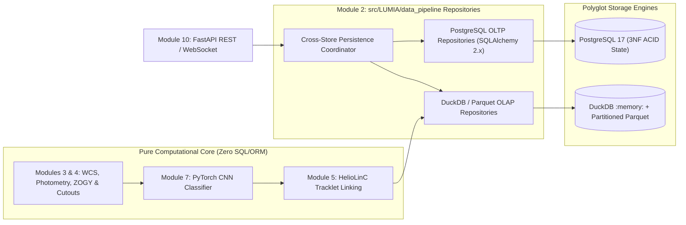
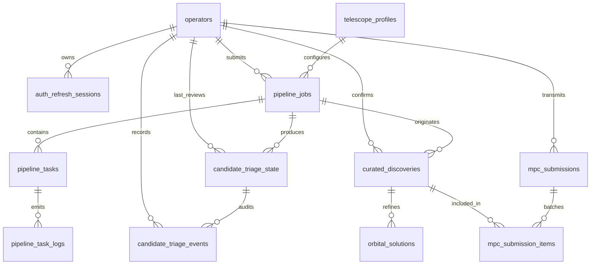

# Project LUMIA: Production Database Schema Blueprint

* **Document Version:** 1.0
* **Date:** 2026-11-07
* **Status:** Approved Architectural Blueprint
* **Governing Standards:**
  * `docs/adr/0001-module-boundaries-and-numbering.md` (**ADR-0001**: Canonical 10-Module Layout & Layering)
  * `docs/adr/0002-strict-pydantic-contracts.md` (**ADR-0002**: Strict Pydantic v2 Contracts)
  * `docs/adr/0003-duckdb-vs-postgresql-persistence.md` (**ADR-0003**: Dual-Database Polyglot Persistence)
  * `docs/lastenheft.md` (Section 3: SSD Write-Endurance Protection & Section 4.2: Polyglot Persistence)

---

## 1. Architectural Overview

Project LUMIA separates persistence into two purpose-built storage planes encapsulated strictly behind **Module 2** (`src/LUMIA/data_pipeline/`) repository interfaces:

1. **PostgreSQL OLTP Plane (Transactional State, Security, Triage & Curated Discoveries):**
   * Enforces **Third Normal Form (3NF)**, ACID row-level isolation, and strict foreign-key/check constraints via SQLAlchemy 2.x connection pooling.
   * Owns mutable lifecycle state: Prefect/API jobs and task retries, JWT operator authentication, human Active Learning candidate triage dispositions, and long-term verified orbital elements and Minor Planet Center (MPC) submission histories.
2. **DuckDB + Apache Parquet OLAP Plane (Vectorized Wide-Field Analytics & Triage):**
   * Optimized for read-heavy columnar scans, spatial sky-box filtering (including `0°/360°` ICRS meridian wrap-around), multi-criteria CNN/SNR ranking, and zero-copy NumPy/Arrow tensor hydration.
   * Executes transient pipeline workloads inside `:memory:` DuckDB instances and persists finalized nights/fields as immutable, Zstandard (`ZSTD`)-compressed, Hive-partitioned **Apache Parquet** files to protect host NVMe/SSD write endurance.



---

## 2. PostgreSQL OLTP Schema (Transactional & State Plane)

### 2.1 Normalization & Integrity Design (Strict 3NF)
All PostgreSQL operational tables adhere to **Third Normal Form (3NF)**:
* **1NF:** Every attribute holds an atomic scalar value; repeating groups (such as multi-epoch task logs, disposition audit histories, refined orbital solutions, and multi-object MPC submission batches) are decomposed into child or junction tables.
* **2NF:** Every non-key column in composite-key tables (`mpc_submission_items`) depends on the entire composite primary key.
* **3NF:** No non-key column transitively depends on another non-key column. Hardware optical parameters are normalized into `telescope_profiles` rather than repeated across `pipeline_jobs`; operator credentials/roles live solely in `operators`; and mutable current triage state (`candidate_triage_state`) is cleanly separated from the immutable audit log (`candidate_triage_events`).

### 2.2 PostgreSQL Entity-Relationship Diagram



### 2.3 Relational DDL Specifications

#### A. Operator & JWT Authentication Tables

```sql
CREATE TABLE operators (
    operator_id       UUID PRIMARY KEY,
    username          VARCHAR(64)  NOT NULL UNIQUE,
    email             VARCHAR(255) NOT NULL UNIQUE,
    password_hash     VARCHAR(255) NOT NULL, -- Argon2id encoded hash
    role              VARCHAR(32)  NOT NULL
                      CHECK (role IN ('admin', 'astronomer', 'reviewer', 'service')),
    is_active         BOOLEAN      NOT NULL DEFAULT TRUE,
    created_at_utc    TIMESTAMPTZ  NOT NULL DEFAULT NOW(),
    updated_at_utc    TIMESTAMPTZ  NOT NULL DEFAULT NOW()
);

CREATE TABLE auth_refresh_sessions (
    session_id        UUID PRIMARY KEY,
    operator_id       UUID         NOT NULL
                      REFERENCES operators (operator_id) ON DELETE CASCADE,
    token_jti_hash    CHAR(64)     NOT NULL UNIQUE, -- SHA-256 hex digest of JWT jti claim
    issued_at_utc     TIMESTAMPTZ  NOT NULL DEFAULT NOW(),
    expires_at_utc    TIMESTAMPTZ  NOT NULL,
    revoked_at_utc    TIMESTAMPTZ  NULL,
    client_ip         INET         NULL,
    user_agent        VARCHAR(512) NULL,
    CHECK (expires_at_utc > issued_at_utc)
);

CREATE INDEX idx_auth_sessions_operator_active
    ON auth_refresh_sessions (operator_id, expires_at_utc)
    WHERE revoked_at_utc IS NULL;
```

#### B. Telescope Profiles & Pipeline Job Lifecycle Tables

```sql
CREATE TABLE telescope_profiles (
    profile_id              VARCHAR(64)      PRIMARY KEY
                            CHECK (profile_id ~ '^[A-Za-z0-9_.-]+$'),
    name                    VARCHAR(128)     NOT NULL UNIQUE,
    mpc_code                CHAR(3)          NULL CHECK (mpc_code ~ '^[A-Za-z0-9]{3}$'),
    pixel_scale_arcsec      DOUBLE PRECISION NOT NULL CHECK (pixel_scale_arcsec > 0.0),
    gain_e_per_adu          DOUBLE PRECISION NOT NULL CHECK (gain_e_per_adu > 0.0),
    read_noise_e            DOUBLE PRECISION NOT NULL CHECK (read_noise_e >= 0.0),
    saturation_limit_adu    DOUBLE PRECISION NOT NULL CHECK (saturation_limit_adu > 0.0),
    dark_current_e_per_s    DOUBLE PRECISION NOT NULL DEFAULT 0.0 CHECK (dark_current_e_per_s >= 0.0),
    latitude_deg            DOUBLE PRECISION NOT NULL CHECK (latitude_deg BETWEEN -90.0 AND 90.0),
    longitude_deg           DOUBLE PRECISION NOT NULL CHECK (longitude_deg BETWEEN -180.0 AND 180.0),
    elevation_m             DOUBLE PRECISION NOT NULL CHECK (elevation_m BETWEEN -500.0 AND 10000.0),
    aperture_diameter_m     DOUBLE PRECISION NULL CHECK (aperture_diameter_m > 0.0),
    focal_length_m          DOUBLE PRECISION NULL CHECK (focal_length_m > 0.0),
    created_at_utc          TIMESTAMPTZ      NOT NULL DEFAULT NOW()
);

CREATE TABLE pipeline_jobs (
    job_id                       VARCHAR(128)     PRIMARY KEY
                                 CHECK (job_id ~ '^[A-Za-z0-9_.-]+$'),
    submitted_by_operator_id     UUID             NULL
                                 REFERENCES operators (operator_id) ON DELETE SET NULL,
    profile_id                   VARCHAR(64)      NULL
                                 REFERENCES telescope_profiles (profile_id) ON DELETE RESTRICT,
    target_field_id              VARCHAR(128)     NOT NULL
                                 CHECK (target_field_id ~ '^[A-Za-z0-9_.-]+$'),
    observation_night_utc        DATE             NOT NULL,
    ra_min_deg                   DOUBLE PRECISION NOT NULL CHECK (ra_min_deg >= 0.0 AND ra_min_deg < 360.0),
    ra_max_deg                   DOUBLE PRECISION NOT NULL CHECK (ra_max_deg >= 0.0 AND ra_max_deg <= 360.0),
    dec_min_deg                  DOUBLE PRECISION NOT NULL CHECK (dec_min_deg BETWEEN -90.0 AND 90.0),
    dec_max_deg                  DOUBLE PRECISION NOT NULL CHECK (dec_max_deg BETWEEN -90.0 AND 90.0),
    max_mag                      DOUBLE PRECISION NOT NULL,
    prefect_flow_run_id          UUID             NULL UNIQUE,
    status                       VARCHAR(32)      NOT NULL DEFAULT 'queued'
                                 CHECK (status IN ('queued', 'running', 'completed', 'failed', 'cancelled')),
    matched_catalog_sources      INTEGER          NULL CHECK (matched_catalog_sources >= 0),
    brightest_catalog_mag_g      DOUBLE PRECISION NULL,
    parquet_partition_uri        VARCHAR(1024)    NULL,
    error_summary                TEXT             NULL,
    submitted_at_utc             TIMESTAMPTZ      NOT NULL DEFAULT NOW(),
    started_at_utc               TIMESTAMPTZ      NULL,
    completed_at_utc             TIMESTAMPTZ      NULL,
    CHECK (dec_min_deg <= dec_max_deg)
);

CREATE INDEX idx_pipeline_jobs_status_submitted
    ON pipeline_jobs (status, submitted_at_utc DESC);
CREATE INDEX idx_pipeline_jobs_night_field
    ON pipeline_jobs (observation_night_utc, target_field_id);

CREATE TABLE pipeline_tasks (
    task_run_id           UUID             PRIMARY KEY,
    job_id                VARCHAR(128)     NOT NULL
                          REFERENCES pipeline_jobs (job_id) ON DELETE CASCADE,
    task_name             VARCHAR(128)     NOT NULL,
    module_number         SMALLINT         NOT NULL CHECK (module_number BETWEEN 1 AND 10),
    prefect_task_run_id   UUID             NULL UNIQUE,
    status                VARCHAR(32)      NOT NULL DEFAULT 'pending'
                          CHECK (status IN ('pending', 'running', 'retrying', 'completed', 'failed', 'skipped')),
    attempt_count         INTEGER          NOT NULL DEFAULT 1 CHECK (attempt_count >= 1),
    max_retries           INTEGER          NOT NULL DEFAULT 3 CHECK (max_retries >= 0),
    backoff_factor_s      DOUBLE PRECISION NOT NULL DEFAULT 1.0 CHECK (backoff_factor_s >= 0.0),
    next_retry_at_utc     TIMESTAMPTZ      NULL,
    started_at_utc        TIMESTAMPTZ      NULL,
    finished_at_utc       TIMESTAMPTZ      NULL
);

CREATE INDEX idx_pipeline_tasks_job_status
    ON pipeline_tasks (job_id, status);

CREATE TABLE pipeline_task_logs (
    log_id                BIGSERIAL    PRIMARY KEY,
    task_run_id           UUID         NOT NULL
                          REFERENCES pipeline_tasks (task_run_id) ON DELETE CASCADE,
    attempt_number        INTEGER      NOT NULL CHECK (attempt_number >= 1),
    severity              VARCHAR(16)  NOT NULL
                          CHECK (severity IN ('DEBUG', 'INFO', 'WARNING', 'ERROR', 'CRITICAL')),
    event_code            VARCHAR(64)  NULL,
    message               TEXT         NOT NULL,
    logged_at_utc         TIMESTAMPTZ  NOT NULL DEFAULT NOW()
);

CREATE INDEX idx_task_logs_run_logged
    ON pipeline_task_logs (task_run_id, logged_at_utc ASC);
```

#### C. Human Active Learning Triage Disposition Tables

```sql
CREATE TABLE candidate_triage_state (
    candidate_id              VARCHAR(128)     PRIMARY KEY
                              CHECK (candidate_id ~ '^[A-Za-z0-9_.-]+$'),
    job_id                    VARCHAR(128)     NOT NULL
                              REFERENCES pipeline_jobs (job_id) ON DELETE RESTRICT,
    field_id                  VARCHAR(128)     NOT NULL
                              CHECK (field_id ~ '^[A-Za-z0-9_.-]+$'),
    disposition               VARCHAR(32)      NOT NULL DEFAULT 'unreviewed'
                              CHECK (disposition IN ('unreviewed', 'confirmed_real', 'follow_up', 'flagged_bogus')),
    reviewed_by_operator_id   UUID             NULL
                              REFERENCES operators (operator_id) ON DELETE SET NULL,
    cnn_score_at_review       DOUBLE PRECISION NULL
                              CHECK (cnn_score_at_review BETWEEN 0.0 AND 1.0),
    model_version_at_review   VARCHAR(128)     NULL,
    hdf5_export_batch_id      VARCHAR(128)     NULL, -- Populated when exported to Module 8 HDF5 archive
    updated_at_utc            TIMESTAMPTZ      NOT NULL DEFAULT NOW()
);

CREATE INDEX idx_triage_state_disposition_unexported
    ON candidate_triage_state (disposition, updated_at_utc)
    WHERE hdf5_export_batch_id IS NULL
      AND disposition IN ('confirmed_real', 'flagged_bogus');

CREATE TABLE candidate_triage_events (
    triage_event_id           BIGSERIAL    PRIMARY KEY,
    candidate_id              VARCHAR(128) NOT NULL
                              REFERENCES candidate_triage_state (candidate_id) ON DELETE CASCADE,
    operator_id               UUID         NOT NULL
                              REFERENCES operators (operator_id) ON DELETE RESTRICT,
    previous_disposition      VARCHAR(32)  NOT NULL
                              CHECK (previous_disposition IN ('unreviewed', 'confirmed_real', 'follow_up', 'flagged_bogus')),
    new_disposition           VARCHAR(32)  NOT NULL
                              CHECK (new_disposition IN ('unreviewed', 'confirmed_real', 'follow_up', 'flagged_bogus')),
    notes                     TEXT         NULL,
    decided_at_utc            TIMESTAMPTZ  NOT NULL DEFAULT NOW()
);

CREATE INDEX idx_triage_events_candidate_time
    ON candidate_triage_events (candidate_id, decided_at_utc DESC);
```

#### D. Curated Asteroid Discoveries, Orbital Elements & MPC Submissions

```sql
CREATE TABLE curated_discoveries (
    discovery_id              UUID             PRIMARY KEY,
    tracklet_id               VARCHAR(128)     NOT NULL UNIQUE
                              CHECK (tracklet_id ~ '^[A-Za-z0-9_.-]+$'),
    internal_designation      VARCHAR(64)      NOT NULL UNIQUE, -- e.g. 'LUMIA-2026-00042'
    mpc_provisional_desig     VARCHAR(32)      NULL UNIQUE,     -- e.g. '2026 VQ12'
    discovery_job_id          VARCHAR(128)     NOT NULL
                              REFERENCES pipeline_jobs (job_id) ON DELETE RESTRICT,
    confirmed_by_operator_id  UUID             NOT NULL
                              REFERENCES operators (operator_id) ON DELETE RESTRICT,
    dynamical_class           VARCHAR(32)      NOT NULL DEFAULT 'Unknown'
                              CHECK (dynamical_class IN ('NEA', 'MBA', 'Trojan', 'Centaur', 'TNO', 'Comet', 'Unknown')),
    first_obs_bjd_tdb         DOUBLE PRECISION NOT NULL,
    last_obs_bjd_tdb          DOUBLE PRECISION NOT NULL,
    discovered_at_utc         TIMESTAMPTZ      NOT NULL DEFAULT NOW(),
    CHECK (last_obs_bjd_tdb >= first_obs_bjd_tdb)
);

CREATE TABLE orbital_solutions (
    orbit_id                  UUID             PRIMARY KEY,
    discovery_id              UUID             NOT NULL
                              REFERENCES curated_discoveries (discovery_id) ON DELETE CASCADE,
    is_current                BOOLEAN          NOT NULL DEFAULT TRUE,
    epoch_tdb_jd              DOUBLE PRECISION NOT NULL,
    semi_major_axis_au        DOUBLE PRECISION NOT NULL CHECK (semi_major_axis_au > 0.0),
    eccentricity              DOUBLE PRECISION NOT NULL CHECK (eccentricity >= 0.0),
    inclination_deg           DOUBLE PRECISION NOT NULL CHECK (inclination_deg BETWEEN 0.0 AND 180.0),
    lon_asc_node_deg          DOUBLE PRECISION NOT NULL CHECK (lon_asc_node_deg >= 0.0 AND lon_asc_node_deg < 360.0),
    arg_perihelion_deg        DOUBLE PRECISION NOT NULL CHECK (arg_perihelion_deg >= 0.0 AND arg_perihelion_deg < 360.0),
    mean_anomaly_deg          DOUBLE PRECISION NOT NULL CHECK (mean_anomaly_deg >= 0.0 AND mean_anomaly_deg < 360.0),
    earth_moid_au             DOUBLE PRECISION NULL CHECK (earth_moid_au >= 0.0),
    abs_mag_h                 DOUBLE PRECISION NULL,
    albedo_pv                 DOUBLE PRECISION NULL CHECK (albedo_pv BETWEEN 0.0 AND 1.0),
    rms_residual_arcsec       DOUBLE PRECISION NOT NULL CHECK (rms_residual_arcsec >= 0.0),
    n_observations_used       INTEGER          NOT NULL CHECK (n_observations_used >= 3),
    orbit_computer            VARCHAR(64)      NOT NULL, -- e.g. 'OpenOrb-5.x'
    computed_at_utc           TIMESTAMPTZ      NOT NULL DEFAULT NOW()
);

-- Guarantee at most one active current orbital solution per curated discovery
CREATE UNIQUE INDEX uq_orbital_solutions_current
    ON orbital_solutions (discovery_id)
    WHERE is_current = TRUE;

CREATE TABLE mpc_submissions (
    submission_id             UUID         PRIMARY KEY,
    submitted_by_operator_id  UUID         NOT NULL
                              REFERENCES operators (operator_id) ON DELETE RESTRICT,
    submission_format         VARCHAR(16)  NOT NULL
                              CHECK (submission_format IN ('ADES_PSV', 'ADES_XML', 'OBS80')),
    mpc_ack_reference         VARCHAR(128) NULL UNIQUE,
    mpec_citation             VARCHAR(64)  NULL,
    status                    VARCHAR(32)  NOT NULL DEFAULT 'draft'
                              CHECK (status IN ('draft', 'transmitted', 'acknowledged', 'published_mpec', 'rejected')),
    payload_sha256            CHAR(64)     NOT NULL,
    created_at_utc            TIMESTAMPTZ  NOT NULL DEFAULT NOW(),
    transmitted_at_utc        TIMESTAMPTZ  NULL,
    acknowledged_at_utc       TIMESTAMPTZ  NULL
);

CREATE TABLE mpc_submission_items (
    submission_id             UUID         NOT NULL
                              REFERENCES mpc_submissions (submission_id) ON DELETE CASCADE,
    discovery_id              UUID         NOT NULL
                              REFERENCES curated_discoveries (discovery_id) ON DELETE RESTRICT,
    tracklet_id_submitted     VARCHAR(128) NOT NULL,
    n_astrometric_measurements INTEGER     NOT NULL CHECK (n_astrometric_measurements >= 1),
    PRIMARY KEY (submission_id, discovery_id)
);
```

---

## 3. DuckDB & Apache Parquet OLAP Schema (Analytical & Triage Plane)

### 3.1 Columnar Table & Parquet Dataset Schemas

#### A. Wide-Field Reference Stellar Catalog (`stellar_catalog`)
Designed for sub-millisecond cone and sky-box queries (Module 2, Module 3 zero-point photometry, and Module 10 catalog visualization).

| Column | DuckDB / Parquet Type | Nullable | Constraints & Astrophysical Semantics |
| :--- | :--- | :--- | :--- |
| `dec_zone` | `SMALLINT` (`INT16`) | `NOT NULL` | Hive partition key: `CAST(FLOOR(dec_deg) AS SMALLINT)` in `[-90, 90]`. |
| `healpix_ipix` | `BIGINT` (`INT64`) | `NOT NULL` | Nested HEALPix index (`NSIDE = 64`) for spatial locality clustering. |
| `source_id` | `BIGINT` (`INT64`) | `NOT NULL` | Unique catalog source identifier (e.g., Gaia DR3 `source_id`, `>= 0`). |
| `ra_deg` | `DOUBLE` (`FLOAT64`) | `NOT NULL` | ICRS Right Ascension in `[0.0, 360.0)` degrees. |
| `dec_deg` | `DOUBLE` (`FLOAT64`) | `NOT NULL` | ICRS Declination in `[-90.0, 90.0]` degrees. |
| `mag_g` | `DOUBLE` (`FLOAT64`) | `NOT NULL` | Calibrated G-band apparent magnitude. |
| `mag_g_err` | `FLOAT` (`FLOAT32`) | `NULL` | 1-sigma G-band photometric uncertainty (`>= 0.0`). |
| `mag_bp` | `FLOAT` (`FLOAT32`) | `NULL` | Optional Gaia BP magnitude for color-term calibration. |
| `mag_rp` | `FLOAT` (`FLOAT32`) | `NULL` | Optional Gaia RP magnitude for color-term calibration. |
| `pm_ra_mas_yr` | `FLOAT` (`FLOAT32`) | `NULL` | Proper motion $\mu_{\alpha*}$ (`mas/yr`) for epoch propagation. |
| `pm_dec_mas_yr` | `FLOAT` (`FLOAT32`) | `NULL` | Proper motion $\mu_{\delta}$ (`mas/yr`) for epoch propagation. |
| `ref_epoch_jy` | `FLOAT` (`FLOAT32`) | `NULL` | Catalog astrometric reference epoch in Julian years (e.g., `2016.0`). |

* **Meridian Wrap-Around Query Pattern:** When `ra_min_deg <= ra_max_deg`, DuckDB executes `ra_deg BETWEEN ? AND ?`. When `ra_min_deg > ra_max_deg` (straddling `0° / 360°`), the repository executes `(ra_deg >= ? OR ra_deg <= ?)` while pruning row groups via `dec_zone BETWEEN FLOOR(?) AND FLOOR(?)` and `mag_g <= ?`.

#### B. Bulk Single-Epoch Candidate Detections (`candidate_detections`)
Aligned directly with the canonical `CandidateDetection` contract (`src/LUMIA/core/schemas.py`) and `CandidateDetectionRepository` (`src/LUMIA/data_pipeline/repositories.py`), extended with partition metadata and photometric flux provenance.

```sql
CREATE TABLE IF NOT EXISTS candidate_detections (
    candidate_id                    VARCHAR PRIMARY KEY,
    job_id                          VARCHAR NOT NULL,
    observation_night               DATE    NOT NULL,
    field_id                        VARCHAR NOT NULL,
    ra_deg                          DOUBLE  NOT NULL, -- [0.0, 360.0)
    dec_deg                         DOUBLE  NOT NULL, -- [-90.0, 90.0]
    bjd_tdb                         DOUBLE  NOT NULL, -- Light-time corrected BJD (TDB)
    x_centroid_px                   DOUBLE  NULL,     -- Sub-pixel detector column (Module 4)
    y_centroid_px                   DOUBLE  NULL,     -- Sub-pixel detector row (Module 4)
    net_flux_adu                    DOUBLE  NULL,     -- Background-subtracted flux (Module 3)
    flux_err_adu                    DOUBLE  NULL,     -- 1-sigma flux error >= 0 (Module 3)
    mag                             DOUBLE  NULL,     -- Calibrated apparent magnitude
    mag_err                         DOUBLE  NULL,     -- 1-sigma magnitude error >= 0
    snr                             DOUBLE  NULL,     -- Matched-filter / aperture SNR >= 0
    cnn_score                       DOUBLE  NULL,     -- Module 7 Real probability in [0.0, 1.0]
    model_version                   VARCHAR NULL,     -- Module 7 provenance version tag
    astrometric_uncertainty_arcsec  DOUBLE  NOT NULL, -- Module 3 single-epoch 1-sigma error >= 0
    astrometric_residual_arcsec     DOUBLE  NULL,     -- Module 5 fitted tracklet residual >= 0
    tracklet_id                     VARCHAR NULL      -- Populated if linked into a valid Tracklet
);
```

#### C. Multi-Epoch Candidate Cutout Stamps (`candidate_cutout_stamps`)
Aligned with `CandidateCutoutStampRecord` and `CandidateCutoutRepository` (`src/LUMIA/data_pipeline/repositories.py`) for odd-sized `31x31` or `51x51` 3-channel blink-loop inspection.

```sql
CREATE TABLE IF NOT EXISTS candidate_cutout_stamps (
    candidate_id      VARCHAR  NOT NULL,
    epoch_index       INTEGER  NOT NULL,
    observation_night DATE     NOT NULL,
    field_id          VARCHAR  NOT NULL,
    cutout_size       SMALLINT NOT NULL CHECK (cutout_size IN (31, 51)),
    bjd_tdb           DOUBLE   NOT NULL,
    mag               DOUBLE   NOT NULL,
    mag_err           DOUBLE   NOT NULL,
    target_x_px       DOUBLE   NOT NULL,
    target_y_px       DOUBLE   NOT NULL,
    science_pixels    FLOAT[][] NOT NULL, -- Native nested FLOAT list in Parquet (JSON in embedded fallback)
    reference_pixels  FLOAT[][] NULL,
    difference_pixels FLOAT[][] NULL,
    PRIMARY KEY (candidate_id, epoch_index)
);
```

#### D. Multi-Epoch Tracklets, Velocity-Space Projections & Analytical Views
Aligned with `SpaceVelocityState` and `Tracklet` in `src/LUMIA/physics/linking.py`:

```sql
CREATE TABLE IF NOT EXISTS space_velocity_states (
    job_id                     VARCHAR NOT NULL,
    observation_night          DATE    NOT NULL,
    field_id                   VARCHAR NOT NULL,
    source_candidate_id        VARCHAR NOT NULL,
    target_candidate_id        VARCHAR NOT NULL,
    reference_bjd_tdb          DOUBLE  NOT NULL,
    baseline_hours             DOUBLE  NOT NULL,
    ref_xi_arcsec              DOUBLE  NOT NULL,
    ref_eta_arcsec             DOUBLE  NOT NULL,
    v_ra_cosdec_arcsec_per_hr  DOUBLE  NOT NULL,
    v_dec_arcsec_per_hr        DOUBLE  NOT NULL
);

CREATE TABLE IF NOT EXISTS tracklets (
    tracklet_id                    VARCHAR PRIMARY KEY,
    job_id                         VARCHAR NOT NULL,
    observation_night              DATE    NOT NULL,
    field_id                       VARCHAR NOT NULL,
    n_epochs                       INTEGER NOT NULL,
    reference_bjd_tdb              DOUBLE  NOT NULL,
    v_ra_cosdec_arcsec_per_hr      DOUBLE  NOT NULL,
    v_dec_arcsec_per_hr            DOUBLE  NOT NULL,
    angular_speed_arcsec_per_hr    DOUBLE  NOT NULL,
    angular_accel_arcsec_per_day2  DOUBLE  NOT NULL,
    rms_residual_arcsec            DOUBLE  NOT NULL,
    implied_transverse_speed_km_s  DOUBLE  NOT NULL
);

CREATE TABLE IF NOT EXISTS tracklet_members (
    tracklet_id         VARCHAR NOT NULL,
    epoch_order         SMALLINT NOT NULL,
    candidate_id        VARCHAR NOT NULL,
    residual_arcsec     DOUBLE  NOT NULL,
    PRIMARY KEY (tracklet_id, epoch_order)
);

-- Zero-storage analytical view joining linked tracklets with aggregated candidate CNN/photometry metrics
CREATE OR REPLACE VIEW v_tracklet_triage_summary AS
SELECT
    t.tracklet_id,
    t.job_id,
    t.observation_night,
    t.field_id,
    t.n_epochs,
    t.reference_bjd_tdb,
    t.angular_speed_arcsec_per_hr,
    t.angular_accel_arcsec_per_day2,
    t.rms_residual_arcsec,
    t.implied_transverse_speed_km_s,
    AVG(c.cnn_score) AS mean_cnn_score,
    MIN(c.cnn_score) AS min_cnn_score,
    MIN(c.mag)       AS brightest_mag,
    AVG(c.snr)       AS mean_snr
FROM tracklets AS t
JOIN tracklet_members AS tm ON tm.tracklet_id = t.tracklet_id
JOIN candidate_detections AS c ON c.candidate_id = tm.candidate_id
GROUP BY
    t.tracklet_id,
    t.job_id,
    t.observation_night,
    t.field_id,
    t.n_epochs,
    t.reference_bjd_tdb,
    t.angular_speed_arcsec_per_hr,
    t.angular_accel_arcsec_per_day2,
    t.rms_residual_arcsec,
    t.implied_transverse_speed_km_s;
```

### 3.2 Parquet Hive Partitioning, Row-Group Sorting & SSD-Endurance Mechanics

1. **Directory Hierarchy (Hive Partitioning):**
   ```text
   data/olap/
   ├── stellar_catalog/
   │   └── dec_zone=-15/part-0000.parquet
   ├── candidate_detections/
   │   └── observation_night=2026-11-07/field_id=ZTF_0412/job_id=job-001.parquet
   ├── candidate_cutout_stamps/
   │   └── observation_night=2026-11-07/field_id=ZTF_0412/job_id=job-001.parquet
   └── tracklets/
       └── observation_night=2026-11-07/field_id=ZTF_0412/job_id=job-001.parquet
   ```
2. **SSD Write-Cycle Protection:**
   * During active Prefect DAG execution, FITS exposures reside in `tempfile.SpooledTemporaryFile` RAM buffers and intermediate analytical tables live inside a `:memory:` DuckDB session—incurring **zero** disk B-tree page splits or write-ahead log (WAL) flushes.
   * Upon field completion, DuckDB executes a single `COPY (...) TO '.../job_id=<id>.parquet' (FORMAT PARQUET, COMPRESSION ZSTD, ROW_GROUP_SIZE 100000)` sequential write. Sequential immutable writes minimize NVMe write amplification to near `1.0x`.
3. **Zero-Copy Vectorized Query Execution:**
   * **Partition Pruning:** Queries filtering on `observation_night` or `field_id` skip entire directory trees without opening unrelated files.
   * **Row-Group Zone-Map Skipping:** Sorting `stellar_catalog` by `(healpix_ipix, ra_deg, dec_deg, mag_g)` and `candidate_detections` by `(cnn_score DESC, snr DESC, candidate_id ASC)` before writing Parquet allows DuckDB to inspect Parquet footer min/max statistics and skip non-matching 100k-row blocks in microseconds.
   * **Projection Pushdown & Zero-Copy Hydration:** Columnar layout reads only requested columns (`ra_deg`, `dec_deg`, `mag_g` for Module 3 photometry) directly into contiguous Arrow/NumPy buffers without materializing intermediate Python row objects.

---

## 4. Cross-Database Integration & Repository Mappings

### 4.1 Immutable Cross-Engine Linkage Keys

Because PostgreSQL and DuckDB/Parquet operate as independent storage engines without cross-engine SQL foreign keys, referential integrity across planes is governed by four immutable ASCII identifiers matching `^[A-Za-z0-9_.-]{1,128}$`:

| Identifier | Minted By | Authoritative Lifecycle Store (PostgreSQL) | Analytical Payload Store (DuckDB / Parquet) | Cross-Store Consistency Rule |
| :--- | :--- | :--- | :--- | :--- |
| `job_id` | API / Prefect (`Module 2/10`) | `pipeline_jobs.job_id` (PK) | Partition filename & `job_id` column across OLAP tables | PostgreSQL row is inserted as `'queued'` *before* DAG launch; `parquet_partition_uri` and `'completed'` status are committed *only after* Parquet files are fsynced. |
| `field_id` | Survey / FITS Header (`Module 3`) | `pipeline_jobs.target_field_id`, `candidate_triage_state.field_id` | Hive directory key `field_id=<id>` & OLAP `field_id` column | Validated at ingestion; immutable across all epochs of a pointing. |
| `candidate_id` | Peak Extractor (`Module 4`) | `candidate_triage_state.candidate_id` (PK) | `candidate_detections.candidate_id` (PK), `candidate_cutout_stamps.candidate_id` | Deterministic format `<job_id>_e<epoch>_c<idx>`. Module 2's `TriageService` verifies existence in `CandidateDetectionRepository.get_by_id()` before upserting `candidate_triage_state` in PostgreSQL. |
| `tracklet_id` | Tracklet Linker (`Module 5`) | `curated_discoveries.tracklet_id` (UNIQUE) | `tracklets.tracklet_id` (PK), `tracklet_members.tracklet_id`, `candidate_detections.tracklet_id` | Deterministic format `<job_id>_trk_<idx>`. Promotion to `curated_discoveries` verifies `TrackletRepository.get_by_id()` and copies boundary BJD epochs atomically. |

### 4.2 Module 2 Repository-to-Pydantic v2 Mapping Matrix

In strict compliance with **ADR-0001** and **ADR-0002**, SQLAlchemy ORM entities (`DeclarativeBase` subclasses) and DuckDB cursors are **private implementation details** confined to `src/LUMIA/data_pipeline/`. Every repository method accepts and returns immutable Pydantic v2 domain models configured with `ConfigDict(strict=True, extra="forbid", frozen=True, allow_inf_nan=False)`:

| Storage Plane | Table / View | Module 2 Repository Class | Canonical Pydantic v2 Contract | Boundary Serialization & Validation Rules |
| :--- | :--- | :--- | :--- | :--- |
| **PostgreSQL** | `operators`, `auth_refresh_sessions` | `OperatorAuthRepository` | `OperatorAccount`, `RefreshSessionRecord` | Never exposes `password_hash` outside auth verification; converts `UUID` and UTC-aware `datetime` strictly. |
| **PostgreSQL** | `telescope_profiles` | `TelescopeProfileRepository` | `TelescopeConfig`, `ObservatoryLocation` (`config`) | Composes nested `ObservatoryLocation` from flat 3NF columns (`latitude_deg`, `longitude_deg`, `elevation_m`, `mpc_code`). |
| **PostgreSQL** | `pipeline_jobs`, `pipeline_tasks`, `pipeline_task_logs` | `PipelineJobRepository` | `PipelineJobRequest`, `JobStatusResponse`, `TaskRunRecord` | Replaces volatile `APIState._jobs` dict; enforces atomic state-machine transitions via `SELECT ... FOR UPDATE`. |
| **PostgreSQL** | `candidate_triage_state`, `candidate_triage_events` | `CandidateTriageRepository` | `CandidateTriageState`, `CandidateTriageEvent` | Upserts current state and appends immutable audit event inside a single PostgreSQL transaction; feeds Module 8 HDF5 Active Learning exporter. |
| **PostgreSQL** | `curated_discoveries`, `orbital_solutions`, `mpc_submissions` | `DiscoveryArchiveRepository` | `CuratedDiscovery`, `OrbitalSolution`, `MPCSubmissionRecord` | Enforces single `is_current=True` orbit swap inside one ACID transaction when Module 6/9 refines an orbit. |
| **DuckDB / Parquet** | `stellar_catalog` | `CatalogDatabase` / `StellarCatalogRepository` | `StellarCatalogRecord`, `CatalogQueryParams` | Supports both typed `list[StellarCatalogRecord]` (for API) and zero-copy structured `np.ndarray` (for Module 3 `photutils`). |
| **DuckDB / Parquet** | `candidate_detections` | `CandidateDetectionRepository` | `CandidateDetection` (`LUMIA.core.schemas`), `CandidateDetectionSummary` | Maps SQL `NULL` columns cleanly to `None`; sanitizes empty-set `AVG`/`MIN` aggregates before Pydantic construction. |
| **DuckDB / Parquet** | `candidate_cutout_stamps` | `CandidateCutoutRepository` | `CandidateCutoutStampRecord` | Enforces exact `Literal[31, 51]` square matrix dimensions and rejects `NaN`/`Inf` pixels on both write and read. |
| **DuckDB / Parquet** | `tracklets`, `tracklet_members`, `v_tracklet_triage_summary` | `TrackletRepository` | `Tracklet` (`LUMIA.physics.linking`), `TrackletTriageSummary` | Reconstructs ordered `detections: tuple[CandidateDetection, ...]` sorted by `bjd_tdb` into frozen `Tracklet` models. |
