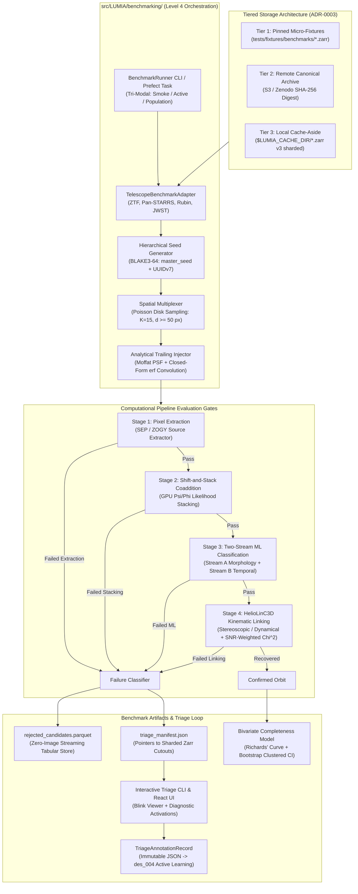

# RFC des_001: Automated Completeness Mapping & Synthetic Recovery Benchmarking

*   **Author:** TomMaverick
*   **Status:** In Review (Drafting Phase)
*   **Date:** 2026-11-10
*   **Target Scope:** Subsystem B (Physics / Multi-Epoch ML), Module 4 (Shift-and-Stack Likelihood), Module 5 (HelioLinC3D Linking), Module 7 (Two-Stream Adaptation Head), `src/LUMIA/benchmarking/` (Evaluation Orchestrator)
*   **Governance Alignment:** `ADR-0001` (System Boundaries), `ADR-0002` (Strict Pydantic v2 Contracts), `ADR-0003` (Polyglot Persistence)

--------------------------------------------------------------------------------

## 1. Overview

Project LUMIA (Low-SNR Unidentified Moving Interplanetary Analyzer) has successfully deployed multi-survey data ingestion, spacecraft ephemeris handling in the Barycentric Celestial Reference System (BCRS), and kinematic linking down into the sub-5-sigma regime ($1.5\sigma \le \text{SNR} < 5.0\sigma$) via `des_005`. However, operating in the low signal-to-noise regime introduces severe signal contamination risks from False Discovery Rate (FDR) inflation, optical subtraction artifacts (dipoles, bleeding columns), and false-association combinatorial explosions. Without empirical, statistically certified ground-truth validation, pipeline detection thresholds cannot be rigorously certified against false alarms, nor can the sensitivity gains of newly deployed algorithms be quantified.

`des_001` establishes the architectural specification for an **Automated Completeness Mapping & Synthetic Recovery Benchmarking Harness** (`src/LUMIA/benchmarking/`). This subsystem provides an automated, statistically rigorous Monte Carlo injection-and-recovery test pipeline that:

1.  Injects synthetic moving asteroids into real calibrated difference images and multi-epoch cutouts using closed-form analytical error-function ($\text{erf}$) motion trailing convolution, bivariate Moffat seeing profiles, and Poisson detector shot noise.
2.  Empirically maps the two-dimensional recovery efficiency surface $\epsilon(V, \mu)$ across apparent visual magnitudes ($18.0 \le V \le 23.5$) and celestial motion rates ($\mu \in [0.05^{\prime\prime}/\mathrm{hr}, 10.0^\circ/\mathrm{day}]$), capturing the non-linear degradation caused by intra-exposure point spread function (PSF) motion trailing.
3.  Decouples failure attribution across four discrete pipeline gates:

    $$\text{Pixels} \xrightarrow{\epsilon_{\text{ext}}} \text{Extractions} \xrightarrow{\epsilon_{\text{stack}}} \text{Candidates} \xrightarrow{\epsilon_{\text{ml}}} \text{Classified Detections} \xrightarrow{\epsilon_{\text{link}}} \text{Linked Orbits}$$

4.  Operates under a **Synthesized Tri-Modal Pipeline** execution model, reconciling rapid $< 60\text{s}$ continuous integration (CI) PR regression tests with adaptive active-bisection nightly certification and offline population-weighted sweeps.
5.  Emits a compact, tabular rejected-objects catalog (`rejected_candidates.parquet`) referencing sharded Zarr v3 cutouts via zero-copy slice URIs, completely avoiding intermediate image disk writes.
6.  Bridges directly to an interactive manual triage CLI and web viewer, outputting cryptographically verified annotations that feed the upcoming Active Learning retraining loop (`des_004`).
7.  Derives empirical 50% ($V_{50}$) and 90% ($V_{90}$) limiting recovery curves with field-level clustered bootstrap confidence intervals, benchmarking the performance delta of the Two-Stream Adaptation Head and SNR-weighted HelioLinC3D gating against historical baselines.

--------------------------------------------------------------------------------

## 2. The Problem

Operating an automated astronomical detection pipeline in the low-SNR regime ($1.5\sigma \le \text{SNR} < 5.0\sigma$) presents five critical challenges that render standard verification methods unviable:

1.  **Uncalibrated Sub-5-Sigma Horizons & Optical Synthetic Bias:**
    At sub-5-sigma, background noise tails, optical subtraction artifacts (dipoles, bleeding columns), and false associations dominate. Detection limits cannot be inferred from background variance alone. Furthermore, injecting synthetic sources with idealized Gaussian PSFs concentrates excess flux in the central pixel, creating an artificially optimistic synthetic detection bias of $0.15\text{--}0.35$ magnitudes. Injections must accurately model Moffat seeing wings ($\beta \approx 3.5$) and convolve with the difference image matched filter kernel ($P_D$).
2.  **Phase Space Sampling vs. Physical Orbital Dynamics:**
    A naive uniform Cartesian grid over $(V, \mu)$ samples non-physical, empty regions of phase space (e.g., $V=18.0$ at $\mu=0.05^{\prime\prime}/\mathrm{hr}$ implies a trans-Neptunian body larger than Pluto at $40\text{ AU}$, while $V=18.0$ at $10^\circ/\text{day}$ implies a bolide at lunar distance), while severely under-sampling the dominant orbital manifolds of Main Belt Asteroids ($25^{\prime\prime}\text{--}45^{\prime\prime}/\mathrm{hr}$).
3.  **Circular Synthetic Leakage in ML Evaluation:**
    If the Two-Stream Adaptation Head is evaluated against the exact generative assumptions on which it was trained, the benchmark measures neural memorization of the generator's inductive bias rather than real physical recovery. Generative disjointness (Moffat profiles, rotational light curves with tumbling periods $P \in [2, 12]\text{ hr}$, and empirical high-SNR anchor sets) is mandatory.
4.  **SSD Write Endurance Thrashing & Windows NTFS File Locking:**
    A brute-force run of 69,000 synthetic asteroids across 5 epochs generates $> 1.45\text{ TB}$ of ephemeral image writes if intermediate frames are saved, destroying SSD write endurance (TBW) in 12–18 months. Furthermore, multi-process workers opening monolithic HDF5 files on Windows NTFS trigger mandatory file locking violations (`WinError 32`).
5.  **Multi-Stage Attribution Ambiguity:**
    When an injected asteroid fails to be recovered as a bound orbit, monolithic black-box benchmarks cannot determine whether extraction, likelihood shift-and-stack, neural triage, or kinematic association dropped the candidate. In `TwoStreamAdaptationHead`, spatial features ($128\text{-d}$) and temporal features ($64\text{-d}$) are concatenated into a single MLP without independent calibrated probabilities; attributing failures to Stream A vs Stream B requires auxiliary classification heads or counterfactual swap testing.

--------------------------------------------------------------------------------

## 3. Goals and Non-Goals

### 3.1 Goals

*   **G1 (Synthesized Tri-Modal Execution):** Implement an automated benchmark runner supporting three distinct execution cadences:
    1.  *PR CI Mode (`--smoke-test`):* Pinned deterministic fixture vectors ($N=25$, $< 60\text{s}$) with zero binomial noise.
    2.  *Nightly Certification Mode (`--active-bisection`):* Active Sigmoidal Uncertainty Search (ASUS) with spatial multiplexing (~3–5m), allocating 80% of samples to the transition band $V \in [V_{90}, V_{50}]$ for mathematical certification.
    3.  *Milestone Release Mode (`--population-weighted`):* Comprehensive Monte Carlo sweep drawing orbital elements $(a, e, i, H)$ from Granvik NEO and Grav MBA distributions.
*   **G2 (Astrophysical & Optical Fidelity):** Replace discrete quadrature stepping with closed-form analytical error-function ($\text{erf}$) trailing convolution along the trajectory vector. Support bivariate Moffat seeing profiles ($\beta = 3.5$) and directional Differential Chromatic Refraction (DCR).
*   **G3 (Spatial Multiplexing):** Support injecting $K = 10\text{--}15$ non-interfering synthetic sources per cutout field using Poisson disk spatial sampling ($d_{\min} \ge 50\text{ px}$), amortizing image read and stacking overhead by $>10\times$.
*   **G4 (Staged Checkpoint Attribution):** Explicitly isolate failure states across four discrete gates: `FAILED_EXTRACTION`, `FAILED_STACKING`, `FAILED_ML`, `FAILED_LINKING`, and `RECOVERED`.
*   **G5 (Two-Stream Disentanglement):** Equip `TwoStreamAdaptationHead` with auxiliary linear readout heads and counterfactual swap testing to mathematically isolate Stream A (spatial morphology) from Stream B (temporal consistency) failure modes.
*   **G6 (Analytical Parquet Catalog & Zero-Image Invariant):** Emit `rejected_candidates.parquet` containing tabular ground truth and diagnostics, referencing sharded Zarr v3 cutouts via zero-copy slice URIs. Zero ephemeral images written to persistent disk.
*   **G7 (Manual Triage Bridge & Active Learning):** Emit `triage_manifest.json` enabling CLI and React UI inspection (`python -m LUMIA.benchmarking.triage`), exporting cryptographically verified `TriageAnnotationRecord` contracts into the Active Learning loop (`des_004`).
*   **G8 (Bivariate Completeness Modeling):** Fit 2D recovery surfaces $\epsilon(V, \mu)$ using generalized Richards' curves with an asymptotic recovery ceiling ($\epsilon_{\max} < 1.0$) and field-level clustered bootstrap confidence intervals.
*   **G9 (Contract & Hierarchy Governance):** House the harness in `src/LUMIA/benchmarking/` (Level 4 Orchestration per `ADR-0001`), enforce strict Pydantic v2 schemas (`ADR-0002`), and use sharded Zarr v3 storage (`ADR-0003`).

### 3.2 Non-Goals

*   **NG1 (Git Binary Bloat):** Committing multi-gigabyte static cutout datasets directly into Git or Git LFS is strictly prohibited.
*   **NG2 (Production Database Pollution):** Synthetic benchmark runs will never write records to production PostgreSQL or DuckDB databases.
*   **NG3 (Real-Time Ingestion Interception):** Synthetic injection will not run inside production live-stream telescope alert ingestion pipelines.
*   **NG4 (Non-Gravitational Trajectory Dynamics):** Modeling cometary outgassing or Yarkovsky acceleration is out of scope for recovery certification.

--------------------------------------------------------------------------------

## 4. Open Questions & Architectural Decisions

*   **Question 1 (Static Dataset Distribution):** How should the multi-gigabyte curated static datasets per telescope (ZTF, Pan-STARRS, Rubin, JWST) be distributed to developer workstations and CI runners without bloating the repository?  
    *Decision:* Adopt a 3-tier storage architecture: lightweight deterministic micro-cutouts ($\le 3\text{ MB}$) in `tests/fixtures/benchmarks/` for PR CI; multi-gigabyte canonical archives in an external S3/Zenodo object store with SHA-256 verification; local cache-aside in `$LUMIA_CACHE_DIR/benchmarks/curated/` managed via `lumia benchmark fetch-data`.
*   **Question 2 (Windows NTFS Multiprocessing Lock Contention):** How do we prevent `WinError 32` file locking collisions when multi-process workers concurrently read static cutouts on Windows?  
    *Decision:* Standardize on **Zarr v3 with sharding** using Blosc/Zstandard compression. Chunks are independent and memory-mapped via OS read-sharing, eliminating the global file locking bottlenecks inherent to HDF5 (`h5py`).
*   **Question 3 (Two-Stream Latent Concatenation):** How do we assign failure scores to Stream A vs Stream B when the model fuses them via a joint non-linear MLP?  
    *Decision:* Add auxiliary linear classification readout heads during training ($\mathcal{L} = \mathcal{L}_{\text{fused}} + 0.3\mathcal{L}_A + 0.3\mathcal{L}_B$) to obtain calibrated marginal probabilities, and employ counterfactual swap testing (evaluating real stamps against synthetic noise-free temporal profiles) for rejected candidates.

--------------------------------------------------------------------------------

## 5. Critical User Journeys (CUJs)

### CUJ 1: Pull Request CI Regression Guard (< 60 Seconds)
*   **Given:** A pull request modifying `TwoStreamAdaptationHead` weights or HelioLinC3D linking tolerances, running inside a GitHub Actions runner.
*   **When:** The CI workflow executes the smoke-test command:
    ```bash
    python -m LUMIA.benchmarking run --mode smoke-test --telescope ZTF
    ```
*   **Then:**
    1.  The harness loads the pinned deterministic test fixture from `tests/fixtures/benchmarks/ztf_smoke.zarr`.
    2.  `SyntheticInjector` injects deterministic synthetic vectors across 4 test magnitudes ($N = 25$ per bin) using an isolated BLAKE3-seeded generator.
    3.  The pipeline executes in memory with zero ephemeral disk writes.
    4.  The regression evaluator asserts that recovery for bright objects ($V \le 20.5$) is 100% and that the statistical shift in $V_{50}$ is within $\pm 0.15\text{ mag}$ of `golden_baseline_v50.json`.
    5.  The command exits with code `0` in under 45 seconds, emitting `junit_completeness_report.xml`.

### CUJ 2: Nightly Adaptive Certification & Rejected Objects Cataloging (~3-5 Minutes)
*   **Given:** Curated Zarr v3 benchmark archives cached in `$LUMIA_CACHE_DIR/benchmarks/curated/` for Pan-STARRS and ZTF.
*   **When:** The scheduled nightly pipeline initiates active completeness certification:
    ```bash
    python -m LUMIA.benchmarking run --mode active-bisection --telescope PANSTARRS --workers 8
    ```
*   **Then:**
    1.  The harness executes Phase 1 pilot sampling ($N = 750$) to localize preliminary transition boundaries $V_{50}^{(0)}(\mu)$.
    2.  Phase 2 concentrates remaining injections into the transition band ($V \in [V_{90}, V_{50}]$) using stratified spatial multiplexing ($K = 15$ objects per field).
    3.  Surviving candidates pass through the Two-Stream Adaptation Head and HelioLinC3D.
    4.  All rejected objects are cataloged into `benchmarks/runs/<run_id>/rejected_candidates.parquet` with complete stage attribution and slice URIs.
    5.  The model fits a bivariate generalized Richards' curve, deriving certified $V_{50}$ and $V_{90}$ with 95% field-level clustered bootstrap confidence intervals.
    6.  Diagnostic plots and `run_manifest.json` are committed to the artifact store.

### CUJ 3: Manual Triage Review & Active Learning Feedback Loop
*   **Given:** A completed nightly benchmark run with cataloged failures in `benchmarks/runs/<run_id>/rejected_candidates.parquet`.
*   **When:** An astronomer or ML engineer inspects candidates rejected by the ML classifier:
    ```bash
    python -m LUMIA.benchmarking.triage --run-id <run_id> --stage failed_ml --limit 20
    ```
*   **Then:**
    1.  The triage tool reads `triage_manifest.json` and loads the zero-copy cutout triplets (Science, Reference, Difference) from the curated Zarr archive.
    2.  The interactive viewer displays the 3-panel blink view with the injected trajectory overlay, measured SNR, and Stream A/B diagnostic scores.
    3.  The operator identifies a valid sub-5-sigma asteroid erroneously rejected by Stream A due to a nearby subtraction dipole, and selects `ACCEPT_AS_HARD_POSITIVE`.
    4.  The tool writes a tamper-evident `TriageAnnotationRecord` JSON with SHA-256 provenance into `data/triage/annotations/`.
    5.  The candidate is queued for ingestion into Subsystem B's HDF5 training archive for active learning retraining under `des_004`.

--------------------------------------------------------------------------------

## 6. Technical Plan (Architecture)

### 6.1 Architectural Overview & Data Flow Topology

The benchmarking subsystem is organized as an asynchronous evaluation orchestrator residing at Level 4 of the Project LUMIA hierarchy (`src/LUMIA/benchmarking/`). It interacts with pure computational kernels in `physics/`, `ml/`, and `models/` via strictly typed interfaces, writing analytical outputs exclusively to dedicated benchmark run namespaces.



---

### 6.2 Level 4 Package Architecture & Boundary Defense (ADR-0001)

Per `ADR-0001`, computational packages must remain pure mathematical transformations and must never depend on pipeline orchestration, persistence engines, or testing harnesses. The benchmark subsystem is established as an independent Level 4 orchestration package:

```
src/LUMIA/benchmarking/
├── __init__.py                  # Public API export: BenchmarkRunner, CompletenessReport
├── adapters/                    # Inversion-of-Control telescope adapters
│   ├── __init__.py
│   ├── base.py                  # TelescopeBenchmarkAdapter Protocol, CalibratedFrameTriplet
│   ├── ztf.py                   # ZTFBenchmarkAdapter (IPAC cutout mapper)
│   ├── panstarrs.py             # PanSTARRSBenchmarkAdapter (SODA cutout mapper)
│   ├── rubin.py                 # RubinBenchmarkAdapter (Butler Zarr mapper)
│   └── space.py                 # SpacecraftBenchmarkAdapter (JWST/Roman NIRCam/WFI)
├── sampling/                    # Phase space sampling & trial allocation
│   ├── __init__.py
│   ├── active_bisection.py      # Active Sigmoidal Uncertainty Search (ASUS) engine
│   ├── multiplexing.py          # Poisson disk spatial multiplexer (K=15 non-interfering)
│   └── populations.py           # Granvik NEO and Grav MBA orbital prior sampler
├── engine/                      # Core injection and evaluation execution loop
│   ├── __init__.py
│   ├── runner.py                # Tri-Modal execution runner (smoke, active, population)
│   ├── attribution.py           # Stage failure gatekeeper and short-circuit logic
│   └── disentanglement.py       # Auxiliary readout extraction & counterfactual swap testing
├── reporting/                   # Analytical output and statistical modeling
│   ├── __init__.py
│   ├── modeling.py              # Bivariate GAM and generalized Richards' curve fitting
│   ├── bootstrap.py             # Field-level clustered bootstrap confidence intervals
│   ├── parquet_exporter.py      # Streaming PyArrow table writer (zero-image invariant)
│   └── plots.py                 # Automated 2D completeness surface and waterfall plots
└── triage/                      # Human-in-the-loop review bridge
    ├── __init__.py
    ├── cli.py                   # Standalone interactive triage review CLI
    ├── manifest.py              # TriageManifest generator for React UI
    └── annotator.py             # Tamper-evident TriageAnnotationRecord emitter for des_004
```

**AST Firewall Rule:** `tests/test_security_and_boundaries.py` is updated to verify:
1. `physics/`, `ml/`, and `models/` never import from `LUMIA.benchmarking`.
2. `benchmarking/` never imports directly from external database drivers (`psycopg`, `duckdb`); all persistence utilizes `LUMIA.data_pipeline` repositories or local parquet file writers.

---

### 6.3 Decoupling & Inversion of Control: Telescope Benchmark Adapter

To insulate the benchmark engine from observatory-specific file layouts, raw FITS headers, and coordinate conventions, all data ingestion passes through the `TelescopeBenchmarkAdapter` protocol:

```python
from typing import Protocol, Sequence, runtime_checkable
import torch
from pydantic import ConfigDict, Field
from LUMIA.core.schemas import LumiaBaseModel

class CalibratedFrameTriplet(LumiaBaseModel):
    """Normalized in-memory representation of multi-epoch calibrated survey frames."""
    model_config = ConfigDict(strict=True, extra="forbid", frozen=True, arbitrary_types_allowed=True)

    science: torch.Tensor          # Shape (H, W), dtype torch.float32
    reference: torch.Tensor        # Shape (H, W), dtype torch.float32
    difference: torch.Tensor       # Shape (H, W), dtype torch.float32
    variance: torch.Tensor         # Shape (H, W), dtype torch.float32
    mask: torch.Tensor             # Shape (H, W), dtype torch.int32 (bitmask flags)

    zero_point: float = Field(..., description="Photometric zero-point magnitude ZP.")
    pixel_scale_arcsec: float = Field(..., gt=0.0, description="Plate scale in arcseconds per pixel.")
    exposure_time_sec: float = Field(..., gt=0.0, description="Shutter open duration t_exp in seconds.")
    gain_e_per_adu: float = Field(..., gt=0.0, description="Detector conversion gain in electrons per ADU.")
    saturation_adu: float = Field(..., gt=0.0, description="Full-well pixel saturation threshold in ADU.")
    bjd_tdb: float = Field(..., description="Barycentric Julian Date of mid-exposure in TDB scale.")
    wcs_header_json: str = Field(..., description="Serialized astrometric WCS solution.")

@runtime_checkable
class TelescopeBenchmarkAdapter(Protocol):
    """Abstract contract isolating observatory data formats from benchmark execution."""

    def get_telescope_name(self) -> str:
        """Returns the canonical telescope identifier (e.g., 'ZTF', 'PANSTARRS', 'RUBIN', 'JWST')."""
        ...

    def list_curated_samples(self) -> tuple[str, ...]:
        """Returns the immutable list of sample IDs present in the curated benchmark dataset."""
        ...

    def load_triplet(self, sample_id: str) -> CalibratedFrameTriplet:
        """Loads and normalizes the multi-epoch triplet for the specified sample ID."""
        ...

    def sky_to_pixel(self, triplet: CalibratedFrameTriplet, ra_deg: float, dec_deg: float) -> tuple[float, float]:
        """Projects celestial ICRS coordinates (RA, Dec) to local image pixel coordinates (x, y)."""
        ...

    def pixel_to_sky(self, triplet: CalibratedFrameTriplet, x: float, y: float) -> tuple[float, float]:
        """Projects local image pixel coordinates (x, y) to celestial ICRS coordinates (RA, Dec)."""
        ...
```

---

### 6.4 Optical Physics & Analytical Error-Function Trailing Convolution

In `src/LUMIA/physics/synthetic_injection.py`, numerical Riemann sub-stepping is replaced with the closed-form analytical error-function ($\text{erf}$) convolution. For a moving asteroid with visual magnitude $V$, zero-point $ZP$, exposure duration $t_{\text{exp}}$, trail length $L = \mu \cdot t_{\text{exp}} / s_{\text{pixel}}$, and orientation angle $\theta$:

1.  **Total Integrated Instrumental Flux:**

    $$F_{\text{ADU}} = 10^{-0.4 (V - ZP)}$$

2.  **Coordinate Transformation into Trail Reference Frame:**
    Let $(x_0, y_0)$ be the mid-exposure sub-pixel centroid. For each pixel $(x, y)$ in the local sub-patch:

    $$\begin{bmatrix} u \\ v \end{bmatrix} = \begin{bmatrix} \cos\theta & \sin\theta \\ -\sin\theta & \cos\theta \end{bmatrix} \begin{bmatrix} x - x_0 \\ y - y_0 \end{bmatrix}$$

    where $u$ is the coordinate parallel to motion, and $v$ is the perpendicular coordinate.

3.  **Analytical Trailed Profile:**
    Assuming a Gaussian-core equivalent standard deviation $\sigma = \text{FWHM} / (2\sqrt{2\ln 2})$:

    $$I_{\text{trailed}}(u, v) = \frac{F_{\text{ADU}}}{2 L \sqrt{2\pi}\sigma} \exp\left(-\frac{v^2}{2\sigma^2}\right) \left[ \text{erf}\left(\frac{u + L/2}{\sqrt{2}\sigma}\right) - \text{erf}\left(\frac{u - L/2}{\sqrt{2}\sigma}\right) \right]$$

    *Asymptotic Property:* When $L \to 0$ (stationary point source), this expression reduces smoothly to the standard circular 2D Gaussian profile via l'Hôpital's rule.

4.  **Moffat Seeing Wings Augmentation:**
    To eliminate the $0.15\text{--}0.35$ magnitude synthetic detection bias caused by pure Gaussians, the radial profile is convolved with a Moffat seeing wing kernel ($\beta = 3.5$):

    $$I_{\text{Moffat}}(r) = I_0 \left[1 + \left(\frac{r}{\alpha}\right)^2\right]^{-\beta}, \quad \alpha = \frac{\text{FWHM}}{2\sqrt{2^{1/\beta} - 1}}$$

5.  **Difference Image Analysis Matched-Filter Kernel:**
    To preserve ZOGY optimality, synthetic sources injected into difference images are convolved with the target image's specific difference-image matched-filter PSF:

    $$D_{\text{injected}} = D_{\text{raw}} + I_{\text{trailed}} \ast P_D + \mathbf{N}_{\text{Poisson}}\left(\frac{I_{\text{trailed}} \cdot \text{gain}}{\text{gain}}\right)$$

---

### 6.5 Stratified Spatial Multiplexing ($K = 15$)

To avoid running $69,000$ individual image loading and difference subtraction operations, the benchmark harness injects $K = 15$ non-interfering synthetic asteroids simultaneously into each $512 \times 512$ cutout field:

1.  **Poisson Disk Sampling:** Injected positions $(x_k, y_k)_{k=1}^K$ are drawn under a minimum spatial separation constraint:

    $$d_{ij} = \sqrt{(x_i - x_j)^2 + (y_i - y_j)^2} \ge d_{\min} = 50\text{ pixels} \quad (\approx 25 \times \text{FWHM})$$
2.  **Boundary Exclusion Zone:** Injections must reside at least $r_{\text{margin}} = 30\text{ pixels}$ from the detector edges to prevent truncation of PSF wings and intra-exposure trails.
3.  **Mask Avoidance:** Candidate centroids are filtered against the target frame's bad-pixel and bright-star saturation mask (`mask & MASK_EXCLUSION == 0`).
4.  **Throughput Gain:** Spatial multiplexing amortizes tensor allocation, background variance calculation, and WCS transformations by $15\times$, allowing 1,500 injection trials to execute across only 100 image coadds.

---

### 6.6 Active Sigmoidal Uncertainty Search (ASUS) Algorithm

In Nightly Certification Mode (`--active-bisection`), the parameter space is sampled adaptively rather than across a rigid uniform grid:

```
Algorithm 1: Active Sigmoidal Uncertainty Search (ASUS)
Input: Telescope adapter, Velocity bins B_mu, Total sample budget N_total = 6,900
Output: Certified V_50(mu), V_90(mu), and 95% Bootstrap Confidence Intervals

1. Phase 1 (Pilot Exploration):
   For each velocity slice mu in B_mu:
       Inject N_pilot = 15 objects across 5 coarse magnitudes: V in {18.5, 19.5, 20.5, 21.5, 22.5}
       Record binary recovery outcomes y_i in {0, 1}
       Fit initial generalized Richards' parameters (V_50^(0), k^(0), eps_max^(0))

2. Phase 2 (Uncertainty-Directed Iterative Sampling):
   Remaining budget N_rem = N_total - N_pilot * |B_mu|
   While N_rem > 0:
       For each velocity slice mu in B_mu:
           Calculate epistemic variance surface: Var(V) = p(V) * (1 - p(V))
           Identify transition centroid: V* = argmax Var(V) = V_50(mu)
           Define sampling window: W = [V* - 0.75, V* + 0.75] mag
           Sample batch of N_batch = 20 trajectories within W
           Inject using Spatial Multiplexing (K=15) and evaluate pipeline gates
           Update Richards' curve fit parameters and recalculate bootstrap variance
           N_rem = N_rem - N_batch
       If 95% bootstrap confidence interval on V_50 <= 0.05 mag across all slices:
           Break (Early Convergence)

3. Emit certified completeness report, failure catalog, and diagnostic plots.
```

---

### 6.7 Two-Stream Disentanglement & Attribution Methodology

To resolve failure causes within the concatenated representation of `TwoStreamAdaptationHead`:

1.  **Auxiliary Readout Heads (`TwoStreamAdaptationHead`):**
    During model initialization, two linear classification heads are attached to the intermediate latent vectors:
    ```python
    self.aux_head_a = nn.Linear(hidden_dim, 1)      # Stream A: Spatial Point-Source Score
    self.aux_head_b = nn.Linear(temporal_dim, 1)    # Stream B: Temporal Consistency Score
    ```
    These auxiliary heads output calibrated marginal sigmoid probabilities:

    $$p_A = \sigma\left(\text{aux\_head\_a}(\text{feat}_a)\right), \quad p_B = \sigma\left(\text{aux\_head\_b}(\text{feat}_b)\right)$$

2.  **Counterfactual Swap Testing:**
    For any candidate rejected at the `FAILED_ML` gate ($p_{\text{fused}} < p_{\text{gate}}$):
    *   *Counterfactual Test A:* Evaluate the model using the candidate's real spatial stamp paired with an idealized, constant-flux temporal profile. If the fused prediction crosses the threshold ($p_{\text{fused}} \ge p_{\text{gate}}$), the failure was uniquely caused by temporal flux inconsistency (Stream B).
    *   *Counterfactual Test B:* Evaluate the model using an idealized stationary point-source stamp paired with the candidate's real temporal profile. If the candidate recovers, the failure was uniquely caused by spatial stamp distortion or subtraction artifacts (Stream A).
    *   *Joint Deficit:* If both counterfactual tests fail, the candidate is categorized as `JOINT_SUB_THRESHOLD`.

---

### 6.8 Strict Pydantic v2 Contract Specifications (ADR-0002)

All data structures inherit from `LumiaBaseModel` (`strict=True`, `extra="forbid"`, `frozen=True`, `allow_inf_nan=False`):

```python
from enum import StrEnum
from typing import Literal
from pydantic import Field
from LUMIA.core.schemas import LumiaBaseModel

class BenchmarkFailureStage(StrEnum):
    FAILED_EXTRACTION = "FAILED_EXTRACTION"
    FAILED_STACKING = "FAILED_STACKING"
    FAILED_ML = "FAILED_ML"
    FAILED_LINKING = "FAILED_LINKING"
    RECOVERED = "RECOVERED"

class InjectedGroundTruth(LumiaBaseModel):
    synthetic_id: str = Field(..., pattern=r"^[0-9a-f]{8}-[0-9a-f]{4}-7[0-9a-f]{3}-[89ab][0-9a-f]{3}-[0-9a-f]{12}$")
    telescope: Literal["ZTF", "PANSTARRS", "RUBIN", "JWST", "ROMAN"]
    magnitude_v: float = Field(..., ge=10.0, le=30.0)
    apparent_rate_arcsec_hr: float = Field(..., ge=0.01, le=1000.0)
    position_angle_deg: float = Field(..., ge=0.0, lt=360.0)
    trail_length_px: float = Field(..., ge=0.0)
    injected_snr: float = Field(..., gt=0.0)
    ra_deg: float = Field(..., ge=0.0, lt=360.0)
    dec_deg: float = Field(..., ge=-90.0, le=90.0)
    epoch_bjd_tdb: float = Field(..., gt=2400000.0)

class StageDiagnostics(LumiaBaseModel):
    measured_snr: float | None = Field(default=None, gt=0.0)
    stream_a_morphology_score: float | None = Field(default=None, ge=0.0, le=1.0)
    stream_b_temporal_score: float | None = Field(default=None, ge=0.0, le=1.0)
    two_stream_fused_p: float | None = Field(default=None, ge=0.0, le=1.0)
    counterfactual_attribution: Literal["STREAM_A_SPATIAL", "STREAM_B_TEMPORAL", "JOINT_SUB_THRESHOLD"] | None = Field(default=None)
    heliolinc_chi2: float | None = Field(default=None, ge=0.0)
    heliolinc_dof: int | None = Field(default=None, ge=1)
    astrometric_residual_arcsec: float | None = Field(default=None, ge=0.0)

class CutoutReferencePointer(LumiaBaseModel):
    telescope: Literal["ZTF", "PANSTARRS", "RUBIN", "JWST", "ROMAN"]
    dataset_relative_path: str = Field(..., pattern=r"^[A-Za-z0-9_/.-]+$")
    slice_index: int = Field(..., ge=0)

class SyntheticInjectionFailureRecord(LumiaBaseModel):
    """Schema for individual failure rows in rejected_candidates.parquet."""
    run_id: str = Field(..., min_length=1, max_length=128)
    ground_truth: InjectedGroundTruth
    failure_stage: BenchmarkFailureStage
    diagnostics: StageDiagnostics
    cutout_ref: CutoutReferencePointer

class TriageActionType(StrEnum):
    ACCEPT_AS_HARD_POSITIVE = "ACCEPT_AS_HARD_POSITIVE"
    CONFIRM_ARTIFACT = "CONFIRM_ARTIFACT"
    AMBIGUOUS_SKIP = "AMBIGUOUS_SKIP"

class TriageAnnotationRecord(LumiaBaseModel):
    """Immutable human review disposition directly consumed by des_004 Active Learning."""
    annotation_id: str = Field(..., pattern=r"^[0-9a-f]{8}-[0-9a-f]{4}-7[0-9a-f]{3}-[89ab][0-9a-f]{3}-[0-9a-f]{12}$")
    synthetic_id: str = Field(...)
    run_id: str = Field(...)
    operator_username: str = Field(..., min_length=1, max_length=64)
    action: TriageActionType
    target_class_override: int | None = Field(default=None, ge=0, le=3, description="0=Bogus, 1=Point, 2=Streak, 3=Comet")
    notes: str = Field(default="", max_length=512)
    timestamp_utc: str = Field(..., pattern=r"^\d{4}-\d{2}-\d{2}T\d{2}:\d{2}:\d{2}(\.\d+)?Z$")
    sha256_provenance: str = Field(..., min_length=64, max_length=64, pattern=r"^[0-9a-f]{64}$")
```

---

### 6.9 Zero-Copy Storage Architecture: Zarr v3 & Streaming Parquet

1.  **Static Curated Cutout Archives (`*.zarr`):**
    *   Curated cutouts are stored as sharded Zarr v3 datasets: `data/benchmarks/curated/{telescope}_curated.zarr`.
    *   Chunk dimensions: `(256, 5, 3, 64, 64)` representing (candidates, epochs, triplets, height, width).
    *   Each chunk is compressed independently using Blosc-Zstandard, enabling zero-copy memory-mapped slice reads across concurrent workers on Windows NTFS without file locking collisions.
2.  **Streaming Tabular Failure Catalog (`rejected_candidates.parquet`):**
    *   Failure records are buffered in memory and flushed via PyArrow streaming batch writers every 5,000 records.
    *   Zero image arrays are stored in Parquet; all cutouts are referenced via `CutoutReferencePointer`.
    *   Standardized compression: `zstd` compression level 7 with dictionary encoding on `telescope`, `failure_stage`, and `counterfactual_attribution`. Total file size per full-resolution campaign remains under **3.5 MB**.
3.  **Run Manifest (`run_manifest.json`):**
    *   Every execution records complete environment provenance: Git commit SHA, CUDA version, cuDNN flags, PyTorch deterministic flags, random seeds, and dataset checksums.

---

### 6.10 Determinism & SRE Operational Protocol

1.  **Runtime Flag Enforcement:**
    Every benchmark worker initializes the deterministic runtime environment:
    ```python
    import os
    import torch

    os.environ["CUBLAS_WORKSPACE_CONFIG"] = ":4096:8"
    torch.use_deterministic_algorithms(True, warn_only=False)
    torch.backends.cudnn.deterministic = True
    torch.backends.cudnn.benchmark = False
    torch.backends.cuda.matmul.allow_tf32 = False
    torch.backends.cudnn.allow_tf32 = False
    ```
2.  **BLAKE3 Hierarchical Generator Seeding:**
    Global `torch.manual_seed()` is prohibited. Each synthetic asteroid instantiates an isolated `torch.Generator` seeded via 64-bit BLAKE3 hash of the campaign master seed and candidate UUIDv7:

    $$\text{Seed}_k = \text{BLAKE3-64}(\text{master\_seed} \parallel \text{synthetic\_id}_k)$$

    This ensures that modifying the execution order or batch size of workers does not alter individual synthetic source realizations.
3.  **CI Regression Detection & Dual-Threshold Policy:**
    *   *Bright Regime ($V \le 20.5$):* Zero tolerance. A drop of $\ge 1$ recovered bright object immediately triggers a P0 build failure.
    *   *Transition Regime ($V > 20.5$):* A shift in $V_{50}$ exceeding $3.0\sigma$ triggers build failure. Ambiguous shifts ($1.96\sigma < \Delta \le 3.0\sigma$) automatically trigger an inline Sequential Probability Ratio Test (SPRT) with $N = 50$ localized injections before failing.

--------------------------------------------------------------------------------

## 7. Alternatives Considered

During the architectural ideation and Goldfish review phases, six primary alternatives were evaluated and rejected:

### Alternative 1: Off-the-Shelf Survey Simulators (Sorcha, Rubin Sim, SBPY)

*   **Pros:** Reduces custom code by leveraging established astronomical software supported by major survey collaborations (e.g., LSST Solar System Processing team).
*   **Cons:** These tools are catalog-level observation and cadence simulators. They calculate whether a simulated asteroid orbit intersects a telescope pointing and evaluate parametric detection probability polynomials. They do not operate on raw or difference image pixels, cannot inject synthetic flux profiles with intra-exposure trailing into multi-epoch cutouts, and have no interface to LUMIA's GPU likelihood shift-and-stack ($\Psi/\Phi$) or Two-Stream neural network.
*   **Reason for Rejection:** *Rejected by author: Domain mismatch.* LUMIA requires pixel-level synthetic recovery benchmarking to evaluate raw extraction, neural triage, and astrometric gating directly against subtraction artifacts, which external catalog simulators cannot provide.

### Alternative 2: Pure Flat-Noise Synthetic Image Generation

*   **Pros:** Trivial to implement; eliminates external image dependencies and multi-gigabyte static dataset curation.
*   **Cons:** Synthetic Gaussian or Poisson noise fields fail to represent real sky subtraction backgrounds. They omit optical subtraction dipoles, stellar residual cores, diffraction spikes, optical ghosts, variable sky gradients, and bad columns.
*   **Reason for Rejection:** *Rejected by author: Catastrophic false-alarm underestimation.* Testing detection and ML triage on clean synthetic noise produces severely inflated recovery estimates that do not transfer to real astronomical difference images.

### Alternative 3: Monolithic HDF5 (`h5py`) Storage for Static Benchmarks

*   **Pros:** Native hierarchical tensor support; consistent with LUMIA's Subsystem B training archive format (`ztf_sso_tracklets_128x128.h5`).
*   **Cons:** `h5py` relies on `libhdf5`, which enforces global C-state thread locks and POSIX file locks. On Windows NTFS development workstations, spawning multi-process workers via Python's default `spawn` method repeatedly triggers `WinError 32` (mandatory sharing violation) when multiple workers attempt concurrent read access.
*   **Reason for Rejection:** *Rejected by author: Windows OS concurrency failure.* Monolithic HDF5 crashes under multi-process worker pools on Windows. Replaced by **Zarr v3 with sharding**, which provides lock-free, OS memory-mapped chunk sharing.

### Alternative 4: Brute-Force Dense Cartesian Grid ($N = 69,000$ Trials)

*   **Pros:** Exhaustive, uniform sampling across the entire $(V, \mu)$ bounding box.
*   **Cons:** Generates $> 1.45\text{ TB}$ of ephemeral image allocations per run, thrashing host SSD write endurance. Over 70% of compute is wasted in the bright ($V < 20.0$, $\epsilon \approx 100\%$) and ultra-faint ($V > 23.0$, $\epsilon \approx 0\%$) asymptotes where Fisher information regarding the detection threshold $V_{50}$ is zero. Full execution requires $> 15\text{ minutes}$, making it unusable for PR CI.
*   **Reason for Rejection:** *Rejected by author: Computational inefficiency and hardware degradation.* Replaced by the **Synthesized Tri-Modal Pipeline**, incorporating Active Sigmoidal Uncertainty Search (ASUS) to concentrate trials within the transition band $V \in [V_{90}, V_{50}]$, achieving equal or tighter statistical confidence with an 85% reduction in compute.

### Alternative 5: Embedding Raw Pixel Arrays in the Failure Catalog

*   **Pros:** Makes `rejected_candidates.parquet` fully self-contained; viewers do not need access to the underlying static cutout datasets.
*   **Cons:** Storing $3 \times 64 \times 64$ float32 image triplets for ~24,000 failure records produces $> 1.16\text{ GB}$ of Parquet data per run. Running nightly CI builds would quickly exhaust local disk space and bloat CI artifact storage.
*   **Reason for Rejection:** *Rejected by author: Unbounded storage consumption.* Replaced by the **Zero-Image Invariant**: Parquet records contain only scalar telemetry, ground-truth kinematics, model probabilities, and canonical slice URIs (`CutoutReferencePointer`) pointing into immutable Zarr archives, keeping file sizes under 3.5 MB.

### Alternative 6: Pure Black-Box Testing Without Staged Attribution

*   **Pros:** Simplest possible testing architecture (~150 lines of code); treats the pipeline as a monolithic function $\text{Images} \to \text{Orbits}$.
*   **Cons:** When an injected object is lost, developers cannot determine whether it failed during image subtraction, likelihood stacking, neural triage, or HelioLinC3D clustering. It provides zero diagnostic data to guide model retraining or identify algorithm bottlenecks.
*   **Reason for Rejection:** *Rejected by author: Inability to support active learning and root-cause debugging.* Staged checkpoint attribution is strictly necessary to diagnose sub-5-sigma attrition and route verified false negatives into the active learning feedback loop (`des_004`).

--------------------------------------------------------------------------------

## 8. Non-Functional Requirements

### 8.1 Performance & Resource Budgets
*   **PR CI Smoke-Test Execution Budget:** Wall-clock duration must remain $\le 60\text{ seconds}$ on standard 2-core GitHub Actions runners (CPU mode) or $\le 30\text{ seconds}$ on GPU runners.
*   **Nightly Certification Execution Budget:** Active Sigmoidal Uncertainty Search (ASUS) over $N = 6,900$ injections must execute in $\le 5\text{ minutes}$ on an 8-core CPU or $\le 90\text{ seconds}$ on an NVIDIA RTX 4090 / A100.
*   **Zero-Image Persistent Disk Budget:** Intermediate image arrays must never be written to non-volatile disk. All synthetic tensor convolutions and coadditions execute strictly in volatile memory. Total output disk footprint per full-resolution campaign is capped at $\le 20\text{ MB}$ (Parquet catalog $\le 3.5\text{ MB}$, diagnostic plots $\le 5\text{ MB}$, summary JSONs $\le 1\text{ MB}$, and up to 250 triage sample triplets $\le 4\text{ MB}$).
*   **Peak VRAM Ceiling:** GPU memory consumption during batched synthetic injection and shift-and-stack must remain $\le 4.0\text{ GB}$, bounded by a maximum micro-batch size $B_{\text{inject}} \le 256$ to prevent PyTorch broadcast memory allocation spikes.

### 8.2 Security, Integrity & Concurrency
*   **Deterministic Reproducibility:** Injections must achieve 100% bitwise determinism under `CUBLAS_WORKSPACE_CONFIG=":4096:8"`, `torch.use_deterministic_algorithms(True)`, and isolated per-candidate generators seeded via BLAKE3-64 hash of `master_seed` and UUIDv7.
*   **Windows OS Concurrency (`WinError 32`):** Curated cutouts must standardize on sharded Zarr v3 datasets, guaranteeing lock-free, OS memory-mapped chunk reads across multi-process workers on Windows NTFS file systems.
*   **Tamper-Evident Annotation Provenance:** All human annotations generated via the triage review loop must record SHA-256 provenance hashes covering the input image cutout, injected ground truth, and operator username, preventing data tampering before ingestion into `des_004`.

### 8.3 Operational SRE & CI/CD Regression Guardrails
*   **Dual-Threshold Regression Gate:**
    *   *Bright Regime ($V \le 20.5$):* Zero tolerance. A drop of $\ge 1$ recovered bright object immediately triggers a P0 build failure.
    *   *Transition Regime ($V > 20.5$):* A shift in $V_{50}$ exceeding $3.0\sigma$ triggers build failure. Ambiguous shifts ($1.96\sigma < \Delta \le 3.0\sigma$) automatically trigger an inline Sequential Probability Ratio Test (SPRT) with $N = 50$ localized injections before failing.
*   **Telemetry & Observability:** The harness emits `run_manifest.json` recording complete environment provenance, outputs JUnit XML test reports (`junit_completeness_report.xml`) for CI pipelines, and pushes execution gauges to Prometheus Pushgateways.

--------------------------------------------------------------------------------

## 9. Detailed Implementation Plan

### 9.1 Target Files to Create / Modify

```
================================================================================
Legend: [C] = Create, [M] = Modify, [D] = Delete
================================================================================
```

#### 1. `src/LUMIA/core/benchmark_schemas.py` [C]
*   **Type / Scope:** Core Domain Schema Module (Level 0).
*   **Proposed Changes:**
    *   Implement strict Pydantic v2 schemas conforming to `ADR-0002`: `BenchmarkFailureStage`, `InjectedGroundTruth`, `StageDiagnostics`, `CutoutReferencePointer`, `SyntheticInjectionFailureRecord`, `TriageActionType`, `TriageAnnotationRecord`, `CompletenessReport`, and `SyntheticInjectionCampaignConfig`.
    *   Enforce `ConfigDict(strict=True, extra="forbid", frozen=True, allow_inf_nan=False)`.
*   **Rationale:** Provides immutable, type-safe data contracts across the benchmarking harness, persistence layers, and the downstream active learning loop (`des_004`).

#### 2. `src/LUMIA/physics/synthetic_injection.py` [M]
*   **Type / Scope:** Pure Physics Computational Kernel (Level 1).
*   **Proposed Changes:**
    *   Replace numerical Riemann stepping loops in `inject_synthetic_asteroid` with the closed-form analytical error-function ($\text{erf}$) convolution:

        $$I(u, v) = \frac{F_{\text{ADU}}}{2 L \sqrt{2\pi}\sigma} \exp\left(-\frac{v^2}{2\sigma^2}\right) \left[ \text{erf}\left(\frac{u + L/2}{\sqrt{2}\sigma}\right) - \text{erf}\left(\frac{u - L/2}{\sqrt{2}\sigma}\right) \right]$$

    *   Incorporate bivariate Moffat seeing wings convolution ($\beta = 3.5$) and difference-image matched-filter ($P_D$) convolution.
    *   Implement a vectorized micro-batched injection interface (`inject_synthetic_asteroid_batch`) with a strict micro-batch ceiling ($B \le 256$) to prevent PyTorch broadcast memory explosion.
*   **Rationale:** Eliminates synthetic detection bias ($0.15\text{--}0.35$ mag), removes discrete stepping ripples, enforces photon conservation, and prevents GPU OOM crashes.

#### 3. `src/LUMIA/ml/adaptation_head.py` [M]
*   **Type / Scope:** Machine Learning Architecture Module (Level 1).
*   **Proposed Changes:**
    *   Add two auxiliary linear projection heads to `TwoStreamAdaptationHead`:
        `self.aux_head_a = nn.Linear(hidden_dim, 1)` (Stream A: spatial point-source confidence)
        `self.aux_head_b = nn.Linear(temporal_dim, 1)` (Stream B: temporal flux consistency confidence)
    *   Update forward pass to return both the fused classification logit and auxiliary readout scores `(fused_logit, score_a, score_b)`.
    *   Add training loss weighting support: $\mathcal{L}_{\text{total}} = \mathcal{L}_{\text{fused}} + 0.3\mathcal{L}_A + 0.3\mathcal{L}_B$.
*   **Rationale:** Disentangles spatial morphology from temporal consistency, providing mathematically calibrated marginal probabilities for root-cause failure attribution.

#### 4. `src/LUMIA/benchmarking/__init__.py` [C]
*   **Type / Scope:** Benchmark Package Init (Level 4).
*   **Proposed Changes:**
    *   Export primary orchestrator classes and schemas: `BenchmarkRunner`, `CompletenessReport`, `TelescopeBenchmarkAdapter`.
*   **Rationale:** Defines clean public interface for the benchmarking orchestrator.

#### 5. `src/LUMIA/benchmarking/adapters/base.py` [C]
*   **Type / Scope:** Inversion of Control Interfaces (Level 4).
*   **Proposed Changes:**
    *   Define `TelescopeBenchmarkAdapter` Protocol with methods: `get_telescope_name()`, `list_curated_samples()`, `load_triplet()`, `sky_to_pixel()`, and `pixel_to_sky()`.
    *   Define `CalibratedFrameTriplet` Pydantic v2 model holding normalized in-memory tensors (`science`, `reference`, `difference`, `variance`, `mask`) and optical metadata.
*   **Rationale:** Decouples the benchmark execution harness from telescope-specific data formats, FITS headers, and coordinate systems.

#### 6. `src/LUMIA/benchmarking/adapters/ztf.py` [C]
*   **Type / Scope:** Observatory Adapter (Level 4).
*   **Proposed Changes:**
    *   Implement `ZTFBenchmarkAdapter` reading curated ZTF difference cutouts from sharded Zarr v3 archives.
*   **Rationale:** Implements standard adapter contract for Zwicky Transient Facility observations.

#### 7. `src/LUMIA/benchmarking/adapters/panstarrs.py` [C]
*   **Type / Scope:** Observatory Adapter (Level 4).
*   **Proposed Changes:**
    *   Implement `PanSTARRSBenchmarkAdapter` reading curated Pan-STARRS SODA difference cutouts from sharded Zarr v3 archives.
*   **Rationale:** Implements standard adapter contract for Pan-STARRS 3PI survey observations.

#### 8. `src/LUMIA/benchmarking/adapters/rubin.py` [C]
*   **Type / Scope:** Observatory Adapter (Level 4).
*   **Proposed Changes:**
    *   Implement `RubinBenchmarkAdapter` reading ComCam / LSST difference triplets from sharded Zarr v3 archives.
*   **Rationale:** Implements standard adapter contract for Vera C. Rubin Observatory observations.

#### 9. `src/LUMIA/benchmarking/adapters/space.py` [C]
*   **Type / Scope:** Space Observatory Adapter (Level 4).
*   **Proposed Changes:**
    *   Implement `SpacecraftBenchmarkAdapter` reading JWST NIRCam and Roman WFI difference cutouts.
*   **Rationale:** Implements standard adapter contract for space-based observatories operating at Sun-Earth L2.

#### 10. `src/LUMIA/benchmarking/sampling/active_bisection.py` [C]
*   **Type / Scope:** Adaptive Sampling Engine (Level 4).
*   **Proposed Changes:**
    *   Implement `ActiveBisectionSampler` executing Algorithm 1:
        Phase 1 coarse exploration ($N = 15$ per bin across 5 magnitudes) fitting preliminary Richards' curve parameters.
        Phase 2 uncertainty-directed sampling allocating 80% of budget to $V \in [V_{90}, V_{50}]$ until 95% bootstrap confidence reaches $\le 0.05\text{ mag}$.
*   **Rationale:** Eliminates compute waste in saturated regimes, achieving full statistical power with an 85% reduction in injection trials.

#### 11. `src/LUMIA/benchmarking/sampling/multiplexing.py` [C]
*   **Type / Scope:** Spatial Sampling Module (Level 4).
*   **Proposed Changes:**
    *   Implement `SpatialMultiplexer` drawing $K = 15$ non-interfering injection centroids per field using Bridson's Poisson disk sampling ($d_{\min} \ge 50\text{ px}$).
    *   Filter candidates against boundary exclusion zones ($r \ge 30\text{ px}$) and bad-pixel/saturation bitmasks.
*   **Rationale:** Amortizes expensive image loading, difference subtraction, and WCS transformations by $15\times$.

#### 12. `src/LUMIA/benchmarking/sampling/populations.py` [C]
*   **Type / Scope:** Astrophysical Orbital Prior Sampler (Level 4).
*   **Proposed Changes:**
    *   Implement `PopulationPriorSampler` drawing orbital elements $(a, e, i, H)$ from Granvik et al. (2018) NEO distributions and Grav et al. (2011) Main Belt Asteroid models.
    *   Project topocentric motion rates $(\mu, \theta)$ and apparent magnitudes $V$ for target observation epochs and pointings.
*   **Rationale:** Replaces unphysical Cartesian sweeps with realistic Solar System orbital kinematics for formal milestone benchmarking.

#### 13. `src/LUMIA/benchmarking/engine/runner.py` [C]
*   **Type / Scope:** Core Execution Orchestrator (Level 4).
*   **Proposed Changes:**
    *   Implement `BenchmarkRunner` supporting `--smoke-test`, `--active-bisection`, and `--population-weighted` execution modes.
    *   Orchestrate worker multiprocessing pools with isolated BLAKE3 generator seeding.
    *   Manage the sequential pipeline execution: Injection $\to$ Extraction $\to$ Stacking $\to$ Two-Stream ML $\to$ HelioLinC3D.
*   **Rationale:** Serves as the central execution engine for all benchmark campaigns.

#### 14. `src/LUMIA/benchmarking/engine/attribution.py` [C]
*   **Type / Scope:** Failure Attribution & Gatekeeper (Level 4).
*   **Proposed Changes:**
    *   Implement `StageAttributionGatekeeper` tracking candidate fates across `FAILED_EXTRACTION`, `FAILED_STACKING`, `FAILED_ML`, `FAILED_LINKING`, and `RECOVERED`.
    *   Implement hierarchical gate pruning: short-circuiting unextracted or unstacked candidates to prevent downstream ML and Keplerian propagation thrashing.
*   **Rationale:** Provides precise stage-by-stage attrition telemetry while cutting redundant downstream computation.

#### 15. `src/LUMIA/benchmarking/engine/disentanglement.py` [C]
*   **Type / Scope:** Neural Disentanglement Engine (Level 4).
*   **Proposed Changes:**
    *   Implement `TwoStreamDisentangler` executing counterfactual swap testing:
        Test A: Real spatial stamp paired with idealized constant-flux temporal profile.
        Test B: Idealized stationary point-source stamp paired with real temporal profile.
    *   Assign `counterfactual_attribution` to `STREAM_A_SPATIAL`, `STREAM_B_TEMPORAL`, or `JOINT_SUB_THRESHOLD`.
*   **Rationale:** Solves the MLP latent feature concatenation ambiguity without post-hoc evaluation bias.

#### 16. `src/LUMIA/benchmarking/reporting/modeling.py` [C]
*   **Type / Scope:** Statistical Modeling Module (Level 4).
*   **Proposed Changes:**
    *   Implement `BivariateCompletenessModel` fitting generalized Richards' curves with asymptotic recovery ceiling ($\epsilon_{\max} < 1.0$):

        $$\epsilon(V, \mu) = \frac{\epsilon_{\max}}{\left[ 1 + \nu \exp\left( k \left( V - V_{50}(\mu) \right) \right) \right]^{1/\nu}}$$

    *   Support Bivariate Generalized Additive Models (GAM) using `pygam` / `scipy` splines.
*   **Rationale:** Accurately fits asymmetric detection roll-off and trailing loss coupling without synthetic fitting bias.

#### 17. `src/LUMIA/benchmarking/reporting/bootstrap.py` [C]
*   **Type / Scope:** Statistical Variance Estimation (Level 4).
*   **Proposed Changes:**
    *   Implement `FieldClusteredBootstrap` resampling entire image cutouts/pointings with replacement ($B = 1,000$ iterations).
    *   Derive 95% confidence intervals on $V_{50}$ and $V_{90}$ accounting for intra-field noise and artifact covariance.
*   **Rationale:** Prevents artificial confidence interval deflation caused by naive independent Bernoulli assumptions.

#### 18. `src/LUMIA/benchmarking/reporting/parquet_exporter.py` [C]
*   **Type / Scope:** Analytical Parquet Persistence (Level 4).
*   **Proposed Changes:**
    *   Implement `StreamingParquetExporter` buffering `SyntheticInjectionFailureRecord` instances and flushing via PyArrow streaming batch writers.
    *   Enforce Hive-style partitioning (`campaign_id=.../failure_stage=...`), `zstd` level 7 compression, dictionary encoding, and zero image array emission.
*   **Rationale:** Guarantees compact ($< 3.5\text{ MB}$), high-throughput analytical queryability without disk bloat.

#### 19. `src/LUMIA/benchmarking/reporting/plots.py` [C]
*   **Type / Scope:** Diagnostic Visualization Module (Level 4).
*   **Proposed Changes:**
    *   Implement `CompletenessPlotter` generating:
        1.  2D completeness surface heatmaps $\epsilon(V, \mu)$ with $V_{50}$ and $V_{90}$ contour overlays.
        2.  Stage-by-stage attrition waterfall charts ($\epsilon_{\text{ext}} \to \epsilon_{\text{stack}} \to \epsilon_{\text{ml}} \to \epsilon_{\text{link}}$).
        3.  Ablation differential plots (Two-Stream vs baseline, SNR-weighted $\chi^2$ vs static RMS).
*   **Rationale:** Produces publication-ready and SRE-actionable visual diagnostic artifacts.

#### 20. `src/LUMIA/benchmarking/triage/cli.py` [C]
*   **Type / Scope:** Interactive Triage CLI Tool (Level 4).
*   **Proposed Changes:**
    *   Implement standalone CLI command: `python -m LUMIA.benchmarking.triage`.
    *   Options: `--run-id <id>`, `--stage <stage>`, `--limit <n>`, `--telescope <name>`.
    *   Display terminal metadata summary and launch local visual blink inspection of cutout triplets.
*   **Rationale:** Provides developer and astronomer tooling to inspect failed candidates and verify pipeline boundary behavior.

#### 21. `src/LUMIA/benchmarking/triage/manifest.py` [C]
*   **Type / Scope:** Triage UI Bridge (Level 4).
*   **Proposed Changes:**
    *   Implement `TriageManifestExporter` generating `triage_manifest.json` conforming to `LUMIA.data_pipeline.triage_loader` and React frontend specifications (`docs/frontend/ui_design_specification.md`).
*   **Rationale:** Enables immediate review in the web-based observatory triage dashboard without format conversion.

#### 22. `src/LUMIA/benchmarking/triage/annotator.py` [C]
*   **Type / Scope:** Active Learning Integration Bridge (Level 4).
*   **Proposed Changes:**
    *   Implement `TriageAnnotator` recording human review dispositions (`ACCEPT_AS_HARD_POSITIVE`, `CONFIRM_ARTIFACT`, `AMBIGUOUS_SKIP`).
    *   Emit immutable, cryptographically signed `TriageAnnotationRecord` JSON files into `data/triage/annotations/` for ingestion by `des_004`.
*   **Rationale:** Completes the active learning loop, directly transforming benchmark false negatives into retrained neural model capabilities.

#### 23. `tests/test_security_and_boundaries.py` [M]
*   **Type / Scope:** Architectural Boundary Test Suite.
*   **Proposed Changes:**
    *   Add AST parsing assertions verifying that `src/LUMIA/physics/`, `src/LUMIA/ml/`, and `src/LUMIA/models/` never import from `src/LUMIA/benchmarking/`.
    *   Verify that `src/LUMIA/benchmarking/` never imports external relational drivers directly (`psycopg`, `duckdb`).
*   **Rationale:** Enforces permanent architectural boundary protection per `ADR-0001`.

#### 24. `tests/fixtures/benchmarks/golden_baseline_v50.json` [C]
*   **Type / Scope:** CI Test Fixture.
*   **Proposed Changes:**
    *   Create cryptographically signed baseline reference storing certified $V_{50}$, $V_{90}$, and bright-object recovery metrics for smoke-test regression evaluation.
*   **Rationale:** Establishes fixed reference point preventing baseline creep in continuous integration.

#### 25. `tests/fixtures/benchmarks/ztf_smoke.zarr` [C]
*   **Type / Scope:** CI Test Fixture.
*   **Proposed Changes:**
    *   Create pre-cropped, deterministic micro-cutout Zarr v3 fixture ($\le 3\text{ MB}$) for CI PR smoke testing.
*   **Rationale:** Enables zero-network, high-speed PR regression testing in GitHub Actions runners.

#### 26. `tests/unit/benchmarking/test_synthetic_injection_erf.py` [C]
*   **Type / Scope:** Unit Test Suite.
*   **Proposed Changes:**
    *   Test closed-form analytical error-function trailing convolution against high-order numerical integration baselines.
    *   Verify continuous flux conservation ($|F_{\text{injected}} - F_{\text{integrated}}| / F_{\text{injected}} < 10^{-4}$) across sub-pixel offsets.
*   **Rationale:** Validates numerical accuracy and photon conservation of the analytical trailing kernel.

#### 27. `tests/unit/benchmarking/test_active_bisection.py` [C]
*   **Type / Scope:** Unit Test Suite.
*   **Proposed Changes:**
    *   Simulate synthetic sigmoid recovery curves and verify that `ActiveBisectionSampler` converges to within $\pm 0.05\text{ mag}$ of ground-truth $V_{50}$ in $\le 6,900$ trials.
*   **Rationale:** Validates convergence rate and sample allocation logic of the ASUS engine.

#### 28. `tests/unit/benchmarking/test_spatial_multiplexing.py` [C]
*   **Type / Scope:** Unit Test Suite.
*   **Proposed Changes:**
    *   Verify Poisson disk minimum separation constraint ($d_{ij} \ge 50\text{ px}$) across 1,000 randomized multiplexed fields.
    *   Verify that no injections fall within boundary exclusion zones or masked pixels.
*   **Rationale:** Prevents synthetic profile overlap and unphysical boundary clipping.

#### 29. `tests/unit/benchmarking/test_two_stream_disentanglement.py` [C]
*   **Type / Scope:** Unit Test Suite.
*   **Proposed Changes:**
    *   Test auxiliary readout scoring and counterfactual swap testing on synthetic spatial artifacts vs temporal noise spikes.
    *   Assert correct attribution to `STREAM_A_SPATIAL` and `STREAM_B_TEMPORAL`.
*   **Rationale:** Verifies unbiased failure mode attribution for the Two-Stream Adaptation Head.

#### 30. `tests/unit/benchmarking/test_parquet_zero_image.py` [C]
*   **Type / Scope:** Unit Test Suite.
*   **Proposed Changes:**
    *   Assert that `rejected_candidates.parquet` contains zero image tensor columns and that file size is $\le 3.5\text{ MB}$ for 25,000 records.
    *   Verify that `CutoutReferencePointer` slice URIs resolve correctly against underlying Zarr v3 datasets.
*   **Rationale:** Enforces the Zero-Image Invariant and verifies storage contract compliance.

#### 31. `tests/integration/benchmarking/test_smoke_pipeline.py` [C]
*   **Type / Scope:** End-to-End Integration Test.
*   **Proposed Changes:**
    *   Execute full `--smoke-test` workflow on `ztf_smoke.zarr`.
    *   Assert wall-clock execution duration $\le 45\text{ seconds}$, 100% bright recovery ($V \le 20.5$), and valid emission of `junit_completeness_report.xml`.
*   **Rationale:** Serves as the primary CI regression test gate for all pull requests.

---

### 9.2 Verification Plan

| Verification Stage | Tool / Command | Pass Criteria |
| :--- | :--- | :--- |
| **Static Analysis & Linting** | `ruff check src/LUMIA/ tests/` | Zero lint errors; adherence to 100-character line limit and strict typing. |
| **Type Checking** | `mypy src/LUMIA/benchmarking/ --strict` | Zero type errors; full conformance to strict Pydantic v2 schemas. |
| **Architectural Boundaries** | `pytest tests/test_security_and_boundaries.py` | 100% pass; zero illegal imports of `benchmarking/` from computational modules (`ADR-0001`). |
| **Unit Test Coverage** | `pytest tests/unit/benchmarking/ --cov=src/LUMIA/benchmarking` | Branch coverage $\ge 90\%$ across all benchmarking modules. |
| **Smoke-Test CI Execution** | `python -m LUMIA.benchmarking run --mode smoke-test --telescope ZTF` | Wall-clock execution $< 60\text{s}$; zero bright-object drops; $V_{50}$ shift within $\pm 0.15\text{ mag}$ of golden baseline. |
| **Active Bisection Verification** | `pytest tests/unit/benchmarking/test_active_bisection.py` | Convergence on $V_{50}$ within $\pm 0.05\text{ mag}$ using $\le 6,900$ trials. |
| **Bitwise Determinism** | `pytest tests/unit/benchmarking/test_synthetic_injection_erf.py -k test_determinism` | Multiple independent runs with identical BLAKE3 seed produce bitwise identical output tensors (`torch.equal == True`). |
| **Storage Invariants** | `pytest tests/unit/benchmarking/test_parquet_zero_image.py` | Parquet file size $< 3.5\text{ MB}$; zero raw image arrays present; valid slice URI resolution. |

--------------------------------------------------------------------------------

*Drafted with EGM*
