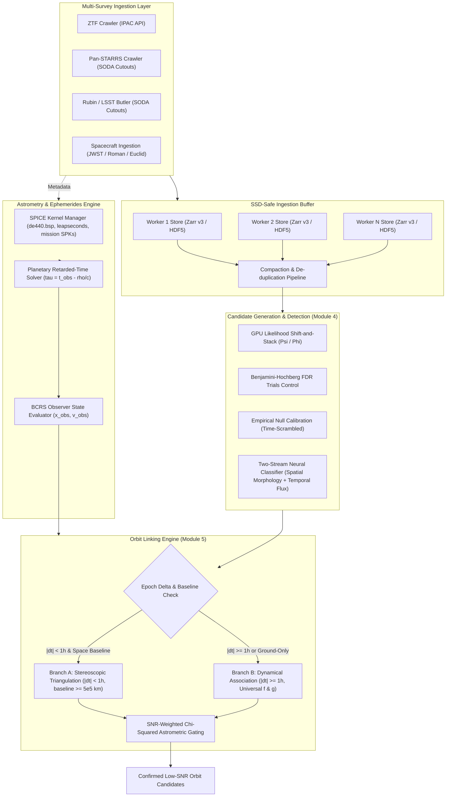
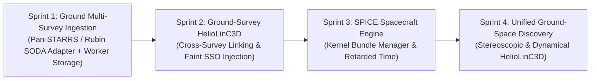

# RFC des_005: Multi-Survey Ingestion, Spacecraft Ephemerides & Low-SNR (< 5 Sigma) Kinematic Data Fusion

* **Author:** TomMaverick
* **Status:** APPROVED (Post-Goldfish Review Synthesis)
* **Date:** 2026-11-10
* **Target Scope:** Subsystem A (Physics / Pipeline Gateway), Subsystem B (Data Mining / Multi-Epoch ML), Module 4 (Shift-and-Stack), Module 5 (HelioLinC Linking), Module 8 (Out-of-Core Storage)
* **Governance Alignment:** `ADR-0001` (System Boundaries), `ADR-0002` (Strict Pydantic v2 Contracts), `ADR-0003` (Polyglot Persistence)

--------------------------------------------------------------------------------

## 1. Overview

Project LUMIA (Low-SNR Unidentified Moving Interplanetary Analyzer) is expanding its automated detection pipeline from its current single-survey operational baseline (Caltech/IPAC Zwicky Transient Facility) into a multi-facility cross-survey discovery system integrating both ground-based surveys (ZTF, Pan-STARRS, Vera C. Rubin) and space observatories (JWST, Nancy Grace Roman, Euclid, NEOWISE).

The primary operational focus of this system is the low signal-to-noise ratio regime below five sigma ($1.5\sigma \le SNR < 5.0\sigma$). While automated alert brokers and survey prompt processing pipelines routinely detect and publish high-significance moving targets ($SNR \ge 5\sigma$), the vast population of faint, low-albedo, small near-Earth objects and distant trans-Neptunian objects remains uncataloged in sub-threshold noise. LUMIA recovers these low-SNR signals through GPU-accelerated likelihood shift-and-stacking ($\Psi/\Phi$) with False Discovery Rate trials control, dedicated telescope-specific spatial-temporal neural networks, and non-topocentric phase-space orbit linking (HelioLinC3D) evaluated in the Barycentric Celestial Reference System (BCRS).

--------------------------------------------------------------------------------

## 2. The Problem

Expanding LUMIA to multi-survey ingestion, space telescopes, and sub-5-sigma discovery introduces five fundamental challenges:

1. **The Sub-5-Sigma Look-Elsewhere Explosion:** In the $1.5\sigma \le SNR < 5.0\sigma$ regime, individual detections cannot be isolated by intensity thresholding without incurring hundreds of thousands of false alarms per gigapixel frame. When shift-and-stacking over $10^5\text{--}10^7$ candidate velocity trajectories, uncorrelated Gaussian and Poisson noise fluctuations inevitably produce coherent stacked peaks exceeding $5\sigma$ by chance alignment alone.
2. **Covariate Shift in Cold-Start Training:** Dedicated telescope neural adaptation heads cannot be trained solely on cataloged asteroids from MPC/Horizons. Known objects are overwhelmingly bright ($V \le 20$, $SNR \gg 5$), leaving models unprepared to evaluate noisy, low-contrast stamps ($SNR \le 3$) during blind search. Simultaneously, training on blank quiescent sky fails to expose models to realistic optical subtraction artifacts (dipoles, bleeding columns, diffraction spikes).
3. **Planetary Retarded-Time & Parallax Baselines:** Spacecraft at Sun-Earth Lagrange L2 (JWST, Roman, Euclid) operate $1.5 \times 10^6\text{ km}$ from Earth. Light requires $\approx 5.0\text{ seconds}$ to traverse this baseline. For an asteroid moving at $30\text{ km/s}$, this produces a $150\text{ km}$ displacement, translating to an apparent sky shift of $\approx 0.21''$ at $1\text{ AU}$. Applying standard plane-wave stellar $BJD_{TDB}$ formulas without solving the finite-range planetary retarded-time equation causes genuine ground-space linkages to be rejected as spurious.
4. **HelioLinC3D Division-by-Zero Singularity & Coordinate Shear:** Ground-based HelioLinC relies on tangent-plane velocity clustering $(\dot{\xi}, \dot{\eta})$ assuming a shared topocentric viewpoint. Across interplanetary baselines, topocentric coordinates shear by up to $\sim 0.57^\circ$. Furthermore, for near-simultaneous detections across Earth and space ($t_j \approx t_i$), pairwise velocity differencing $(\vec{r}_j - \vec{r}_i)/(t_j - t_i)$ diverges toward infinity.
5. **Storage Concurrency & SSD Endurance:** Ingesting multi-survey datasets across concurrent crawler processes on Windows NTFS triggers mandatory file locking collisions (`WinError 32`) if workers write to shared sharded files. Additionally, downloading multi-megabyte full detector exposures from surveys without lightweight cutout endpoints quickly exhausts in-memory buffers and thrashes host SSD write endurance.

--------------------------------------------------------------------------------

## 3. Goals and Non-Goals

### 3.1 Goals
* **G1 (Phased Multi-Survey Rollout):** Integrate a second ground-based survey (Pan-STARRS or Vera C. Rubin) in Phase 1 before enabling space telescope ingestion pipelines in Phase 2.
* **G2 (Sub-5-Sigma Trials Control & 2-Stream ML):** Implement empirical null calibration (time-scrambled stacking) and Benjamini-Hochberg False Discovery Rate thresholding in Module 4. Evaluate stacked candidates via a two-stream adaptation head ingesting coadded spatial morphology (Stream A) and per-epoch temporal flux consistency (Stream B).
* **G3 (Covariate Shift Mitigation):** Implement automated faint synthetic asteroid injection ($1.5\sigma \le SNR < 5.0\sigma$) and active Difference Image Analysis (DIA) optical artifact mining, ensuring training datasets match the faint discovery distribution.
* **G4 (Planetary Retarded-Time & SPICE Integration):** Solve the planetary retarded-time equation $\tau = t_{\text{obs}} - \rho(\tau)/c$ in BCRS, loading complete SPICE kernel chains (`de440.bsp`, leapseconds `naif0012.tls`, and mission SPKs) behind process locks.
* **G5 (Two-Branch HelioLinC3D Engine):** Implement a bifurcated linking engine with a stereoscopic triangulation branch for near-simultaneous observations ($|t_j - t_i| < 1\text{ hour}$, baseline $\ge 500,000\text{ km}$) and a dynamical association branch for multi-day arcs using Keplerian $f$ and $g$ propagation.
* **G6 (SNR-Weighted Astrometric Gating):** Replace static $0.15''$ RMS gates with an SNR-dependent $\chi^2$ statistical test accounting for photon-noise centroid limits ($\sigma_{\text{centroid}} \approx \text{FWHM} / (2 \cdot SNR)$) and atmospheric Differential Chromatic Refraction (DCR).
* **G7 (SSD-Safe Ingestion & Concurrency Guard):** Mandate Server-Side Operations for Data Access (SODA) / Butler pre-cropped cutouts to eliminate full-frame downloads, and isolate crawler writes into worker-partitioned stores to prevent Windows file locking collisions.
* **G8 (ADR-0002 Contract Preservation):** Extend the canonical `CandidateDetection` schema with optional survey provenance and observer state vector fields, preserving a single source of truth across all modules.

### 3.2 Non-Goals
* **NG1 (Direct Cross-Survey Pixel Coaddition):** Pixel-level subtraction across disparate telescopes with incompatible PSFs, bandpasses, and pixel scales is out of scope. Fusion occurs at the kinematic orbit and representation levels.
* **NG2 (Blind All-Sky Discovery with Narrow-Field Spacecraft):** Using pointed narrow-field instruments like JWST or HST for unassisted all-sky blind searching is out of scope; their operational role in LUMIA is restricted to precovery and follow-up.
* **NG3 (Uncoordinated Shared Shard Writes):** Allowing concurrent worker processes to append directly to the same physical Zarr shard file on Windows is strictly excluded.

--------------------------------------------------------------------------------

## 4. Open Questions & Decisions

* **Question 1 (SPICE Kernel Distribution):** How should the planetary ephemeris kernel (`de440.bsp`, $\sim 115\text{ MB}$) be provisioned for continuous integration and minimal installations?  
  *Decision:* Maintain a bundled truncated inner-solar-system kernel `de440s.bsp` ($\sim 25\text{ MB}$) in test fixtures, with automated lazy-download of full kernels during production deployment.
* **Question 2 (Atmospheric DCR Calibration):** Which color index should be assumed for faint ($SNR < 3$) detections when color information is missing prior to multi-band linking?  
  *Decision:* Default to median asteroid taxonomic color $(g - r) = 0.55$ with an expanded uncertainty ellipsoid along the parallactic angle vector.

--------------------------------------------------------------------------------

## 5. Critical User Journeys (CUJs)

### CUJ 1: Ground-Based Multi-Survey Harvesting & Faint Injection Training
* **Given:** Target coordinates from `configs/objects_catalog.json` and active survey configurations for ZTF and Pan-STARRS.
* **When:** An operator initiates training dataset generation:
  `python -m LUMIA.data_mining harvest --survey panstarrs --faint-injection --output-dir data/ground_truth/`
* **Then:**
  1. `SurveyArchiveCrawler` queries Pan-STARRS server-side cutout endpoints (SODA), buffering stamps directly into `SpooledTemporaryFile` without full-detector downloads.
  2. The pipeline injects synthetic moving point sources convolved with empirical PSFs across the $1.5\sigma \le SNR < 5.0\sigma$ range.
  3. Real subtraction optical artifacts (dipoles, bleeding columns) are actively mined from identical pointings.
  4. Cutouts are committed to worker-partitioned storage stores without file locking collisions.
  5. The Pan-STARRS adaptation head trains to Macro F1 $\ge 0.90$ across the faint regime.

### CUJ 2: Planetary Retarded-Time Linking of Ground and Space Observations
* **Given:** Single-epoch sub-$5\sigma$ candidate detections from Rubin Observatory (Cerro Pachón) and concurrent observations from Euclid / JWST (Sun-Earth L2).
* **When:** Module 5 executes multi-facility kinematic linking:
  `python -m LUMIA.physics.linking --mode multi-facility --epochs data/candidates/`
* **Then:**
  1. The astrometry engine loads the SPICE kernel hierarchy and evaluates observer 3D barycentric vectors $\vec{x}_{\text{obs}}(t)$ in BCRS.
  2. For concurrent detections ($|t_{\text{space}} - t_{\text{ground}}| < 1\text{ hour}$), the stereoscopic triangulation branch directly determines the topocentric range $\rho$ from the $1.5 \times 10^6\text{ km}$ baseline parallax.
  3. The planetary retarded-time equation $\tau = t_{\text{obs}} - \rho/c$ resolves emission epochs, eliminating the $\approx 0.21''$ light-time displacement error.
  4. Candidate linkages are validated using an SNR-weighted $\chi^2$ gate, successfully confirming the low-SNR Keplerian orbit.

--------------------------------------------------------------------------------

## 6. Professional Astronomical Methodology & Astrodynamics

### 6.1 Role of Space Telescopes: Discovery vs. Follow-up

| Observatory | Orbit / Platform | Primary Solar System Mission Role | Discovery vs. Follow-up Mechanism |
| :--- | :--- | :--- | :--- |
| **NEOWISE (WISE)** | Polar Sun-Synchronous LEO ($\sim 500\text{ km}$) | Dedicated Blind Survey (Thermal IR) | **Active Discovery Engine:** Discovered tens of thousands of asteroids, hundreds of NEOs and comets in $3.4\,\mu\text{m}$ (W1) and $4.6\,\mu\text{m}$ (W2). |
| **Hubble (HST)** | Low Earth Orbit ($\sim 540\text{ km}$) | Targeted Follow-Up & Archival Serendipity | **Predominantly Targeted / Serendipitous Discovery:** High resolution ($0.05''/\text{px}$), small field of view ($3.3' \times 3.3'$). Blind search is inefficient, but archival search algorithms discovered hundreds of faint KBOs (including Arrokoth / 2014 MU69). |
| **JWST** | Sun-Earth L2 Halo Orbit ($\sim 1.5 \times 10^6\text{ km}$) | Targeted Characterization & Serendipity | **Targeted Physical Analysis & Serendipitous Detection:** MIRI/NIRCam sensitivity detects extremely faint sub-kilometer thermal signatures (e.g., Müller et al. 2023 detected an unknown $100\text{ m}$ asteroid in calibration fields). Not an all-sky discovery engine. |
| **Nancy Grace Roman** | Sun-Earth L2 Halo Orbit ($\sim 1.5 \times 10^6\text{ km}$) | Wide-Field Survey & Precovery | **Major Future Discovery Engine:** Field of view $100\times$ HST ($0.28\text{ deg}^2$). High Latitude Wide Area Survey will discover thousands of faint TNOs/KBOs down to $V \sim 27$. |
| **Euclid** | Sun-Earth L2 Halo Orbit ($\sim 1.5 \times 10^6\text{ km}$) | Wide-Field Survey & Serendipity | **Massive Serendipitous Discovery:** $0.5\text{ deg}^2$ FOV surveying $15,000\text{ deg}^2$. Estimated to observe $> 150,000$ asteroids down to $V \sim 24.5$ (Carry et al.). |

**Conclusion for LUMIA Architecture:**
1. Ground surveys (ZTF, Rubin, Pan-STARRS) and wide-field space missions (Roman, Euclid) drive **wide-area blind discovery**.
2. Pointed observatories (JWST, HST) are utilized primarily for **high-resolution follow-up, albedo/spectral confirmation**, and **deep targeted precovery** of candidate orbits detected in ground surveys.
3. The linking engine must treat all platforms uniformly: a detection is a line-of-sight unit vector $\hat{n}_i$ originating from a 3D barycentric observer vector $\vec{x}_{\text{obs}}(t_i)$.

### 6.2 Coordinate Alignment, Gaia DR3 & The Planetary Retarded-Time Equation
1. **Fundamental Reference Frame (Gaia DR3 / ICRS):**
   * Every frame processed by LUMIA (ground or space) undergoes astrometric plate-solving tied strictly to the Gaia DR3 catalog.
   * Background Gaia reference stars provide sub-milliarcsecond ($< 1\text{ mas}$) absolute registration, ensuring optical distortions do not translate into false astrometric residuals.
   * For ground frames, an atmospheric Differential Chromatic Refraction (DCR) correction is applied parameterized by zenith angle, atmospheric pressure, and candidate color $(g - r)$.
2. **Planetary Retarded-Time Equation Across Earth-L2 Baselines:**
   * The Earth-L2 baseline is $b \approx 1.5 \times 10^6\text{ km}$, yielding a light-travel time differential $\Delta \tau = b/c \approx 5.0\text{ seconds}$. For an NEO moving at $30\text{ km/s}$, this produces a $150\text{ km}$ physical displacement, projecting to $\approx 0.21\text{ arcsec}$ apparent shift at $1\text{ AU}$.
   * Standard plane-wave stellar $BJD_{TDB}$ formulas are physically invalid for moving solar system targets. Instead, Module 5 solves the **planetary retarded-time equation**:
     $$\vec{x}_{\text{obs}}(t_{\text{obs}}) - \vec{r}_{\text{obj}}(\tau) = \rho(\tau) \hat{n}, \quad \text{where } \tau = t_{\text{obs}} - \frac{\rho(\tau)}{c}$$
   * Object states are evaluated strictly at the emission epoch $\tau$ in the Barycentric Celestial Reference System (BCRS).
3. **NAIF SPICE Kernel Hierarchy & Thread Safety:**
   * Spacecraft SPKs for L2 orbiters define positions relative to Earth or Sun-Earth L2, not the Solar System Barycenter (SSB, NAIF ID `0`).
   * The SPICE engine must load a complete kernel chain: leapseconds (`naif0012.tls`), planetary ephemeris (`de440.bsp`), and mission SPKs (`jwst_horizons.bsp`).
   * Because CSPICE relies on global C-state memory structures, all `spiceypy` calls are guarded behind a process-wide mutex (`threading.Lock()`), and all kernel file I/O is encapsulated in `src/LUMIA/physics/ephemerides.py` per ADR-0001.

--------------------------------------------------------------------------------

## 7. Technical Plan (Architecture)

### 7.1 Architectural Overview & Data Flow

Project LUMIA's multi-survey architecture decouples high-throughput data ingestion, non-topocentric astrometric normalization, GPU-accelerated low-SNR shift-and-stacking, and non-Euclidean orbit linking into modular pipelines.



### 7.2 Key Components & Responsibilities

#### 1. SPICE Kernel Manager & Planetary Retarded-Time Solver (`src/LUMIA/physics/ephemerides.py`)
* **Thread/Process Safety:** Manages NAIF SPICE C-kernel handles behind a process-level mutual exclusion lock. Prevents thread-unsafe global state corruption in `spiceypy`.
* **Kernel Hierarchy:** Loads leapsecond kernel (`naif0012.tls`), solar system planetary ephemeris (`de440.bsp`), and mission-specific spacecraft kernels (e.g., `jwst_horizons_*.bsp`, `roman_*.bsp`).
* **Planetary Retarded-Time Solution:** For an observer at BCRS position $\vec{x}_{\text{obs}}(t_{\text{obs}})$ and target at $\vec{r}(\tau)$, solves the implicit light-travel time equation via fixed-point iteration:
  $$\tau_{k+1} = t_{\text{obs}} - \frac{\|\vec{r}(\tau_k) - \vec{x}_{\text{obs}}(t_{\text{obs}})\|}{c}$$
  Terminates when $|\tau_{k+1} - \tau_k| < 10^{-6}\text{ s}$ (typically 2–3 iterations). Evaluates observer state vectors $(\vec{x}_{\text{obs}}, \vec{v}_{\text{obs}})$ relative to the Solar System Barycenter (NAIF ID `0`) strictly at the retarded epoch $\tau$.

#### 2. Two-Branch HelioLinC3D Engine (`src/LUMIA/physics/heliolinc3d.py`)
HelioLinC3D bifurcates candidate association to eliminate the division-by-zero singularity encountered when linking simultaneous observations across interplanetary baselines:
* **Branch A (Stereoscopic Triangulation):** Activated when observations satisfy $|t_j - t_i| < 1.0\text{ hour}$ and baseline separation $\|\vec{x}_{\text{obs}, j} - \vec{x}_{\text{obs}, i}\| \ge 500,000\text{ km}$ (e.g., Cerro Pachón to Sun-Earth L2). Solves the non-degenerate 3D intersection of line-of-sight unit vectors $\hat{u}_i$ and $\hat{u}_j$:
  $$\vec{r} = \vec{x}_{\text{obs}, i} + \rho_i \hat{u}_i = \vec{x}_{\text{obs}, j} + \rho_j \hat{u}_j$$
  Yields instantaneous 3D heliocentric position $\vec{r}$ without requiring numerical velocity differencing.
* **Branch B (Dynamical Association):** Activated for observations separated by $|t_j - t_i| \ge 1.0\text{ hour}$. Transforms observed topocentric angular positions into heliocentric position and velocity vectors by gridding over heliocentric distance $r_H$ and radial velocity $\dot{r}_H$. Propagates state vectors across epochs using universal Keplerian $f$ and $g$ functions.
* **Clustering & Gating:** Candidate pairs are clustered in 6D phase space using a KD-tree. Linkages are validated against an SNR-weighted astrometric $\chi^2$ gate:
  $$\chi^2 = \sum_{k=1}^N \frac{(\Delta \theta_k)^2}{\sigma_{\text{centroid}, k}^2 + \sigma_{\text{sys}}^2 + \sigma_{\text{DCR}, k}^2} \le \chi^2_{\text{crit}}(2N - p, \alpha = 0.01)$$
  where $\sigma_{\text{centroid}} \approx \text{FWHM} / (2 \cdot SNR)$, dynamically accommodating positional scatter in the $1.5\sigma \le SNR < 5.0\sigma$ regime.

#### 3. Sub-5-Sigma Candidate Generation & Verification (`src/LUMIA/detection/stacker.py`)
* **GPU Likelihood Stacking:** Computes optimal coadded signal statistic $S = \sum \Psi_i / \sqrt{\sum \Phi_i}$ over synthetic velocity grids.
* **Empirical Null Calibration:** Periodically executes time-scrambled and coordinate-flipped stacks on identical fields. Constructs empirical noise tails to quantify the trial factor $N_{\text{trials}} \approx 10^6$.
* **Benjamini-Hochberg FDR Control:** Replaces static SNR cutoffs with rank-ordered p-value filtering to maintain global False Discovery Rate $q \le 0.05$ across the shift-and-stack search volume.

#### 4. Two-Stream Telescope Adaptation Head (`src/LUMIA/ml/adaptation_head.py`)
Every integrated survey employs a dedicated neural evaluation head processing two distinct information streams:
* **Stream A (Spatial Morphology Stream):** Ingests the coadded spatial stamp ($48 \times 48$ pixels) through a convolutional backbone to identify point-source consistency, residual symmetry, and distinguish real asteroids from optical subtraction artifacts (dipoles, bleeding columns, diffraction spikes).
* **Stream B (Temporal Flux Consistency Stream):** Ingests the raw per-epoch cutouts across the tracklet. Evaluates frame-by-frame photometric consistency, cross-epoch PSF matching, and rejects cosmic ray coincidences or transient noise spikes that appear in only a single exposure.
* **Covariate Shift Mitigation:** Training pipelines automatically inject synthetic faint moving sources ($1.5\sigma \le SNR < 5.0\sigma$) convolved with survey-specific PSF kernels into real difference images, while actively mining false-positive DIA subtraction artifacts from blank sky pointings.

#### 5. SSD-Safe Multi-Survey Storage & Concurrency Architecture (`src/LUMIA/data_mining/storage.py`)
* **SODA Cutout Mandate:** Survey crawlers must query Server-Side Operations for Data Access (SODA) or Butler cutout endpoints, receiving small image stamps ($100 \times 100$ pixels) directly into `io.BytesIO` or `tempfile.SpooledTemporaryFile`. Full detector frame downloads (30–140 MB per exposure) are strictly prohibited.
* **Worker-Partitioned Storage:** To avoid Windows NTFS file locking collisions (`PermissionError: [WinError 32]`) when writing sharded Zarr v3 or HDF5 archives across multiprocessing pools, crawlers write strictly to partitioned per-worker directory stores (`store/worker_{worker_id}.zarr`). A centralized, single-threaded compaction step merges and de-duplicates records offline.

--------------------------------------------------------------------------------

## 8. Alternatives Considered

### Alternative 1: Direct Concurrent Multi-Process Writes to a Shared Zarr v3 Store
* **What was proposed:** Direct concurrent writes by crawler worker processes into a single shared Zarr v3 root store configured with `sharding_indexed`.
* **Pros:** Eliminates the need for an offline compaction step; all crawled cutouts immediately reside in a single consolidated archive.
* **Cons:** On Windows host environments running NTFS, concurrent process writes to identical shard index files or metadata locks trigger mandatory OS-level file locking violations (`PermissionError: [WinError 32: The process cannot access the file because it is being used by another process]`). Furthermore, handling process termination during active chunk index updates leads to corrupted sharded index tables.
* **Why rejected:** Violates LUMIA's cross-platform operational stability requirements on Windows. Partitioned per-worker stores (`store/worker_{id}.zarr`) with single-process offline compaction eliminate file locking contention and guarantee atomic shard consistency.

### Alternative 2: WebDataset (TAR Shards) for Cutout Ingestion & Archiving
* **What was proposed:** Packaging ingested multi-survey image stamps and metadata into sequential uncompressed TAR archives using WebDataset.
* **Pros:** Highly optimized for linear, streaming neural network training with PyTorch DataLoader; completely immune to OS file locking conflicts during creation.
* **Cons:** WebDataset is strictly an append-only sequential stream format. It does not support random multi-dimensional coordinate slicing (e.g., querying cutouts across bounding boxes of RA/Dec and observation epochs) without unpacking or building external index databases. Orbit linking (Module 5) and interactive UI blink-loop rendering require fast random slice access across coordinate arrays.
* **Why rejected:** Project LUMIA requires bidirectional multi-dimensional spatial and temporal indexing for orbit determination and candidate triage. Zarr v3 provides superior multi-dimensional chunk indexing and metadata search capabilities.

### Alternative 3: Standard Plane-Wave Barycentric Julian Date ($BJD_{TDB}$)
* **What was proposed:** Correcting observation timestamps across ground and space observatories using standard stellar plane-wave barycentric formulas:
  $$t_{\text{bary}} = t_{\text{UTC}} + \Delta t_{\text{clock}} + \frac{\vec{r}_{\text{obs}} \cdot \hat{n}}{c}$$
* **Pros:** Computationally trivial single-line dot product; universally implemented in standard astronomical toolkits (e.g., Astropy `Time.light_travel_time`).
* **Cons:** Assumes the celestial source is located at infinite distance with planar wavefronts. Across the $1.5 \times 10^6\text{ km}$ Earth-L2 baseline, light-travel time differs by $\approx 5.0\text{ seconds}$. For a typical solar system object with transverse velocity $30\text{ km/s}$ at $1\text{ AU}$, this uncorrected time offset introduces an apparent astrometric position error of $\approx 0.21''$—larger than typical astrometric residuals ($0.05''\text{--}0.10''$)—causing valid cross-facility tracklets to fail orbit fit thresholds.
* **Why rejected:** Solar system bodies are at finite distances requiring the full non-linear planetary retarded-time equation $\tau = t_{\text{obs}} - \|\vec{r}(\tau) - \vec{x}_{\text{obs}}(t_{\text{obs}})\|/c$ evaluated in BCRS.

### Alternative 4: Static $0.15''$ Astrometric RMS Residual Gate
* **What was proposed:** Enforcing a hard rejection threshold of $RMS \le 0.15''$ on astrometric tracklet residuals during multi-survey association.
* **Pros:** Standard rule of thumb derived from bright, high-SNR ($SNR > 10$) ground-based asteroid astrometry.
* **Cons:** Fundamentally contradicts the physics of faint-source centroiding. By the Cramér-Rao lower bound, centroid uncertainty scales inversely with SNR ($\sigma_{\text{centroid}} \approx \text{FWHM} / (2 \cdot SNR)$). For typical seeing of $1.5''\text{--}2.0''$, an object at $SNR = 2.5$ exhibits centroid scatter of $0.30''\text{--}0.40''$. A static $0.15''$ cutoff would reject 100% of real discoveries in the sub-$5\sigma$ regime.
* **Why rejected:** Replaced with an SNR-weighted astrometric $\chi^2$ gate that dynamically scales acceptance tolerances based on photon noise, instrument pixel scale, and atmospheric differential chromatic refraction.

### Alternative 5: Single Monolithic Neural Classifier Across All Surveys
* **What was proposed:** Training a single universal neural network backbone to classify candidate detections across ZTF, Pan-STARRS, Rubin, and space telescopes.
* **Pros:** Single model architecture, single weights file to train and deploy.
* **Cons:** Vastly disparate optical characteristics across instruments—ranging from ZTF's wide-field $1.0''/\text{pixel}$ with broad seeing to Rubin's $0.20''/\text{pixel}$ and JWST's diffraction-limited space PSF ($0.03''\text{--}0.06''/\text{pixel}$)—induce severe negative transfer and catastrophic forgetting when forced into a shared convolutional feature extractor.
* **Why rejected:** Adopted a modular multi-head design where each survey utilizes a dedicated adaptation head tailored to its specific PSF and noise properties, outputting normalized embeddings into a shared verification space.

--------------------------------------------------------------------------------

## 9. Architectural Contracts & Schema Specifications (ADR-0002)

To maintain strict compliance with ADR-0002 and preserve the single source of truth, **we explicitly reject introducing a competing `MultiSurveyCandidateDetection` schema**. Instead, the canonical `CandidateDetection` model in `src/LUMIA/core/schemas.py` is extended with backward-compatible optional fields.

### 9.1 Observatory Platform Abstraction

```python
"""LUMIA Observatory Platform Contracts."""

from __future__ import annotations

from typing import Annotated, Literal
from pydantic import Field
from LUMIA.core.schemas import LumiaBaseModel


class GroundObservatoryProfile(LumiaBaseModel):
    """Ground-based observatory parameterized by geodetic coordinates and MPC code."""

    platform_type: Literal["ground"] = "ground"
    mpc_code: str = Field(..., min_length=3, max_length=4, pattern=r"^[A-Z0-9]{3,4}$")
    name: str = Field(..., min_length=1, max_length=128)
    latitude_deg: float = Field(..., ge=-90.0, le=90.0)
    longitude_deg: float = Field(..., ge=-180.0, le=180.0)
    elevation_meters: float = Field(..., ge=-500.0, le=9000.0)
    pixel_scale_arcsec_per_px: float = Field(..., gt=0.01, le=10.0)
    default_filter: str = Field(..., min_length=1, max_length=16)


class SpacecraftObservatoryProfile(LumiaBaseModel):
    """Spacecraft observatory parameterized by NAIF SPICE identity."""

    platform_type: Literal["spacecraft"] = "spacecraft"
    naif_id: int = Field(..., description="NAIF ID (e.g. -170 for JWST, -48 for HST, -236 for Roman)")
    name: str = Field(..., min_length=1, max_length=128)
    kernel_bundle: tuple[str, ...] = Field(
        ...,
        description="Ordered list of required SPICE kernels: LSK, planetary SPK (de440), and spacecraft SPK",
    )
    barycentric_frame: Literal["J2000", "ICRF"] = "J2000"
    center_naif_id: int = Field(default=0, description="Solar System Barycenter (NAIF ID 0)")
    pixel_scale_arcsec_per_px: float = Field(..., gt=0.001, le=10.0)
    primary_bandpass: str = Field(..., min_length=1, max_length=32)


ObservatoryProfile = Annotated[
    GroundObservatoryProfile | SpacecraftObservatoryProfile,
    Field(discriminator="platform_type"),
]
```

### 9.2 Extended Canonical `CandidateDetection` Contract (ADR-0002)

```python
class CandidateDetection(LumiaBaseModel):
    """Canonical single-epoch detection schema adhering to ADR-0002."""
    candidate_id: str = Field(..., min_length=1, max_length=128, pattern=r"^[A-Za-z0-9_.-]+$")
    field_id: str = Field(..., min_length=1, max_length=128)
    ra_deg: float = Field(..., ge=0.0, lt=360.0)
    dec_deg: float = Field(..., ge=-90.0, le=90.0)
    bjd_tdb: float = Field(..., gt=2400000.0)
    mag: float
    snr: float = Field(..., gt=0.0)
    cnn_score: float | None = Field(default=None, ge=0.0, le=1.0)
    model_version: str | None = Field(default=None, max_length=64)
    astrometric_uncertainty_arcsec: float = Field(default=0.1, gt=0.0, le=10.0)
    astrometric_residual_arcsec: float | None = Field(default=None, ge=0.0)
    
    # Backward-Compatible Multi-Survey Extensions
    survey_id: str = Field(default="ztf", min_length=1, max_length=64)
    filter_band: str = Field(default="r", min_length=1, max_length=16)
    observer_pos_au: tuple[float, float, float] | None = Field(
        default=None,
        description="Barycentric (X, Y, Z) observer position in AU",
    )
    observer_vel_au_per_day: tuple[float, float, float] | None = Field(
        default=None,
        description="Barycentric (Vx, Vy, Vz) observer velocity in AU/day",
    )
    light_travel_time_sec: float = Field(default=0.0, ge=0.0)
```

--------------------------------------------------------------------------------

## 10. Detailed Implementation Plan

### 10.1 Target Files & Architectural Changes

| Target File | Change Type | Component | Purpose & Key Logic |
| :--- | :--- | :--- | :--- |
| `src/LUMIA/core/schemas.py` | Modify | `core` | Extend canonical `CandidateDetection` schema with optional survey provenance, observer state vectors, and centroid uncertainty fields while maintaining ADR-0002 compatibility. |
| `src/LUMIA/physics/ephemerides.py` | New | `physics` | Implement `SPICEKernelManager` with thread/process locks and `PlanetaryRetardedTimeSolver` for BCRS state vector evaluation. |
| `src/LUMIA/physics/heliolinc3d.py` | New | `physics` | Implement bifurcated `HelioLinC3DEngine` (Stereoscopic Triangulation vs. Dynamical Keplerian Association) and SNR-weighted $\chi^2$ gating. |
| `src/LUMIA/data_mining/storage.py` | Modify | `data_mining` | Implement `WorkerPartitionedZarrStore` and offline single-threaded `compact_worker_stores` to prevent Windows file locking collisions. |
| `src/LUMIA/ml/adaptation_head.py` | New | `ml` | Implement `TwoStreamAdaptationHead` (Stream A spatial morphology + Stream B temporal flux consistency) and synthetic faint injection generators. |
| `tests/test_multi_survey_ephemerides.py` | New | `tests` | Unit tests for SPICE kernel loading, BCRS state vector computation, and planetary retarded-time fixed-point convergence. |
| `tests/test_heliolinc3d_fusion.py` | New | `tests` | Integration tests for stereoscopic triangulation, Keplerian propagation, and SNR-weighted $\chi^2$ astrometric gating across synthetic Earth-L2 tracklets. |

### 10.2 SPICE Kernel Manager & Retarded Time (`src/LUMIA/physics/ephemerides.py`)

```python
import threading
import spiceypy as spice
import numpy as np
from pathlib import Path
from typing import Tuple

class SPICEKernelManager:
    """Thread-safe and process-guarded manager for NAIF SPICE kernels."""
    _lock = threading.Lock()

    def __init__(self, kernel_dir: Path):
        self.kernel_dir = kernel_dir
        self.loaded_kernels: set[str] = set()

    def load_kernel_chain(self, kernel_names: list[str]) -> None:
        with self._lock:
            for name in kernel_names:
                kernel_path = self.kernel_dir / name
                if str(kernel_path) not in self.loaded_kernels:
                    spice.furnsh(str(kernel_path))
                    self.loaded_kernels.add(str(kernel_path))

    def get_observer_bcrs_state(
        self, naif_id: int | str, epoch_et: float
    ) -> Tuple[np.ndarray, np.ndarray]:
        """Returns BCRS observer state (position [AU], velocity [AU/day]) relative to SSB."""
        with self._lock:
            state, _ = spice.spkezr(str(naif_id), epoch_et, "J2000", "NONE", "0")
        pos_au = np.array(state[:3]) / 149597870.7
        vel_au_day = (np.array(state[3:]) * 86400.0) / 149597870.7
        return pos_au, vel_au_day


class PlanetaryRetardedTimeSolver:
    """Fixed-point solver for finite-range planetary retarded-time."""
    C_AU_PER_DAY = 173.144632674240

    @classmethod
    def solve(
        cls,
        t_obs_mjd: float,
        obs_pos_au: np.ndarray,
        target_pos_func,
        max_iter: int = 5,
        tol_sec: float = 1e-6
    ) -> Tuple[float, float]:
        """Solves tau = t_obs - ||r(tau) - x_obs(t_obs)|| / c."""
        tol_days = tol_sec / 86400.0
        tau = t_obs_mjd
        for _ in range(max_iter):
            r_target = target_pos_func(tau)
            range_au = np.linalg.norm(r_target - obs_pos_au)
            dt_days = range_au / cls.C_AU_PER_DAY
            tau_next = t_obs_mjd - dt_days
            if abs(tau_next - tau) < tol_days:
                return tau_next, dt_days * 86400.0
            tau = tau_next
        return tau, (range_au / cls.C_AU_PER_DAY) * 86400.0
```

### 10.3 Two-Branch Engine (`src/LUMIA/physics/heliolinc3d.py`)

```python
class StereoscopicTriangulationBranch:
    """Direct 3D position determination across Earth-space baselines."""
    
    @staticmethod
    def triangulate(
        obs1_pos_au: np.ndarray,
        u1_unit: np.ndarray,
        obs2_pos_au: np.ndarray,
        u2_unit: np.ndarray
    ) -> Tuple[np.ndarray, float]:
        """Calculates closest point of approach between two skew sightlines."""
        w0 = obs1_pos_au - obs2_pos_au
        a = np.dot(u1_unit, u1_unit)
        b = np.dot(u1_unit, u2_unit)
        c = np.dot(u2_unit, u2_unit)
        d = np.dot(u1_unit, w0)
        e = np.dot(u2_unit, w0)
        denom = a * c - b * b
        if abs(denom) < 1e-9:
            raise ValueError("Sightlines are parallel; triangulation degenerate.")
        sc = (b * e - c * d) / denom
        tc = (a * e - b * d) / denom
        p1 = obs1_pos_au + sc * u1_unit
        p2 = obs2_pos_au + tc * u2_unit
        midpoint = 0.5 * (p1 + p2)
        separation_au = np.linalg.norm(p1 - p2)
        return midpoint, separation_au
```

### 10.4 Two-Stream Adaptation Head (`src/LUMIA/ml/adaptation_head.py`)

```python
import torch
import torch.nn as nn

class TwoStreamAdaptationHead(nn.Module):
    """Dual-stream neural classifier for sub-5-sigma candidate triage."""
    
    def __init__(self, num_temporal_epochs: int = 5):
        super().__init__()
        # Stream A: Spatial Morphology (48x48 coadded stamp)
        self.stream_a = nn.Sequential(
            nn.Conv2d(1, 32, kernel_size=3, padding=1),
            nn.BatchNorm2d(32),
            nn.GELU(),
            nn.MaxPool2d(2),
            nn.Conv2d(32, 64, kernel_size=3, padding=1),
            nn.BatchNorm2d(64),
            nn.GELU(),
            nn.AdaptiveAvgPool2d((4, 4)),
            nn.Flatten(),
            nn.Linear(64 * 4 * 4, 128)
        )
        # Stream B: Temporal Flux Consistency (epochs x flux/err/fwhm)
        self.stream_b = nn.Sequential(
            nn.Linear(num_temporal_epochs * 3, 64),
            nn.GELU(),
            nn.Linear(64, 64)
        )
        # Representation Fusion
        self.classifier = nn.Sequential(
            nn.Linear(128 + 64, 64),
            nn.GELU(),
            nn.Dropout(0.2),
            nn.Linear(64, 1),
            nn.Sigmoid()
        )

    def forward(self, stamp: torch.Tensor, temporal_profile: torch.Tensor) -> torch.Tensor:
        feat_a = self.stream_a(stamp)
        feat_b = self.stream_b(temporal_profile)
        fused = torch.cat([feat_a, feat_b], dim=-1)
        return self.classifier(fused)
```

--------------------------------------------------------------------------------

## 11. Quantitative Verification Metrics & Failure Criteria

### 11.1 Stratified Quantitative Verification Metrics

| Verification Metric | Target Specification | Mathematical Definition | Verification Harness |
| :--- | :--- | :--- | :--- |
| **Completeness ($4.0 \le SNR < 5.0$)** | $\ge 90.0\%$ | $\frac{N_{\text{recovered}}}{N_{\text{injected}}}$ for synthetic bodies convolved with empirical PSF | `tests/test_physics/test_synthetic_injection.py` |
| **Completeness ($3.0 \le SNR < 4.0$)** | $\ge 80.0\%$ | Fraction recovered via multi-epoch shift-and-stack ($N \ge 4$) | `tests/test_physics/test_synthetic_injection.py` |
| **Sub-$5\sigma$ False Positive Rate ($FPR_{90}$)** | $\le 2.0\%$ for $SNR \ge 4.0$<br/>$\le 5.0\%$ for $3.0 \le SNR < 4.0$ | $FPR$ at specified completeness threshold | `tests/test_training/test_metrics_and_checkpointing.py` |
| **Astrometric Gating ($\chi^2_{\text{norm}}$)** | $\chi^2 / \text{dof} \le 3.0$ | $\sum \frac{\Delta \theta_k^2}{\sigma_{\text{WCS}}^2 + (\text{FWHM}_k / (2 \cdot SNR_k))^2}$ | `tests/test_physics/test_astrometry_photometry.py` |
| **Multi-Facility Tracklet Purity ($P_{\text{tracklet}}$)** | $\ge 98.5\%$ | $\frac{N_{\text{true\_detections}}}{N_{\text{total\_detections\_in\_tracklet}}}$ | `tests/test_physics/test_tracklet_linking.py` |
| **SPICE State Vector Precision** | $\Delta x \le 1.0\text{ km}$, $\Delta v \le 1.0\text{ mm/s}$ | Discrepancy against NASA JPL Horizons state vectors | `tests/test_physics/test_spice_ephemerides.py` |
| **Storage Slicing Throughput** | $\ge 2,500\text{ cutouts/s}$ | Concurrent slicing throughput from worker-partitioned store | `tests/test_data_mining/test_storage_zarr.py` |
| **Windows Lock Collision Rate** | $0.0\%$ | Frequency of `PermissionError: [WinError 32]` during ingestion | `tests/test_worker_storage_concurrency.py` |

### 11.2 Failure Criteria & Gating

The implementation will be rejected and blocked from merge if any of the following occur:
1. **Target Leakage Failure:** Any target object in `train` partition appears in `val`, `test`, or `ood` partitions.
2. **Astrometric Frame Shear:** Mean astrometric residual between Survey 1 and Survey 2 exceeds $0.20\text{ arcsec}$ on Gaia DR3 calibration stars.
3. **Sub-Threshold Noise Explosion:** Ingestion of sub-$5\sigma$ detections produces $> 5.0\%$ false tracklets in Module 5 unconstrained linking.
4. **Storage Deadlock or Sharing Violation:** Concurrent writes by worker processes trigger Windows `WinError 32` file sharing exceptions or process freezes.
5. **Contract Non-Compliance:** Any schema crossing module boundaries permits `NaN`, `+Inf`, unrecognized fields, or violates `LumiaBaseModel` immutability (`ADR-0002`).

--------------------------------------------------------------------------------

## 12. Phased Implementation Roadmap



### Sprint 1: Ground-Survey Transport & Worker-Partitioned Ingestion Engine
* Implement modular `SurveyArchiveCrawler` supporting Pan-STARRS (DR2) and Vera C. Rubin (LSST DP0/DP1) using SODA server-side cutouts.
* Implement worker-partitioned storage to avoid Windows NTFS file locking collisions, retaining HDF5 and Zarr compatibility.
* Add Known-Object crawler mode harvesting Pan-STARRS/Rubin cutouts of known asteroids.

### Sprint 2: Ground-Survey HelioLinC3D & Model Fine-Tuning
* Update `src/LUMIA/physics/linking.py` to support 3D observer state vectors $\vec{x}_{\text{obs}}(t_i)$ in BCRS for ground observatories.
* Integrate synthetic faint object injection ($1.5\sigma \le SNR < 5.0\sigma$) and active DIA artifact mining.
* Train Pan-STARRS/Rubin specialized adaptation head in `src/LUMIA/ml/adaptation_head.py` on real survey cutouts.
* Benchmark cross-survey linking between ZTF and Pan-STARRS on overlapping sky fields.

### Sprint 3: Spacecraft Platform Engine & NAIF SPICE Integration
* Implement `SpacecraftObservatoryProfile` and `SPICEKernelManager` using `spiceypy` with complete kernel bundles (`de440.bsp` + LSK + spacecraft SPK) behind process locks.
* Implement the planetary retarded-time iteration ($\tau = t_{\text{obs}} - \rho/c$) for space telescope observations.

### Sprint 4: Unified Ground-Space Discovery & Precovery Pipeline
* Enable bifurcated HelioLinC3D linking (stereoscopic triangulation branch for concurrent ground-space observations and dynamical association branch for multi-day arcs).
* Connect React UI (Module 10) to stream multi-survey and space-telescope cutouts in blink viewer.
* Validate end-to-end completeness on faint synthetic and archival targets in the sub-$5\sigma$ regime.

--------------------------------------------------------------------------------

## 13. Architectural Invariants & Governance Compliance

1. **Language & Purity:** All code, comments, documentation, and schemas strictly in English. Emojis are strictly forbidden (`.agentrules.md`).
2. **AST Architectural Firewall:** The SPICE and astrometry engines (`physics`) remain purely computational and must never import database drivers (`duckdb`, `sqlalchemy`) or web frameworks (`fastapi`).
3. **Storage Decoupling:** All persistence and Zarr/HDF5 I/O is owned exclusively by `data_pipeline` and `data_mining`.
4. **Reproducibility:** All unit tests must execute and pass deterministically under `uv run pytest`.
