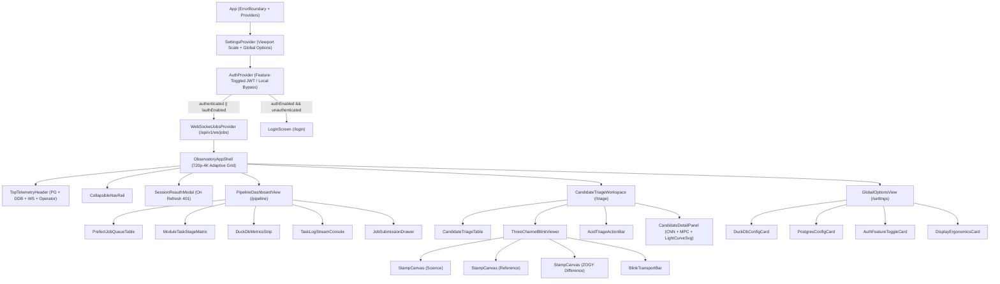
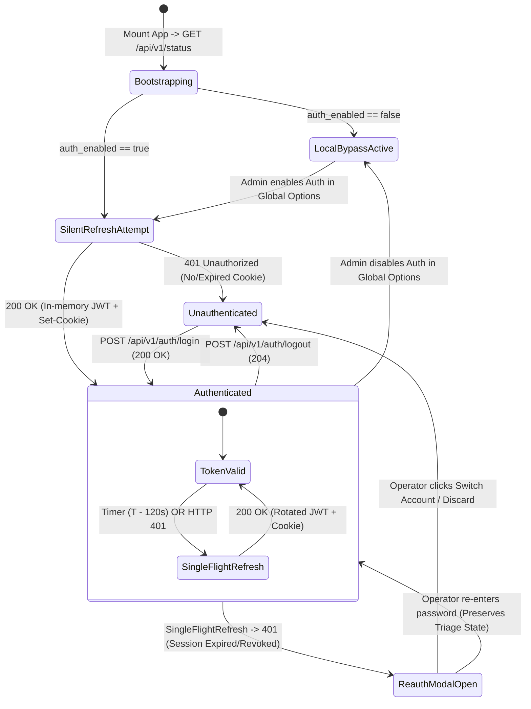
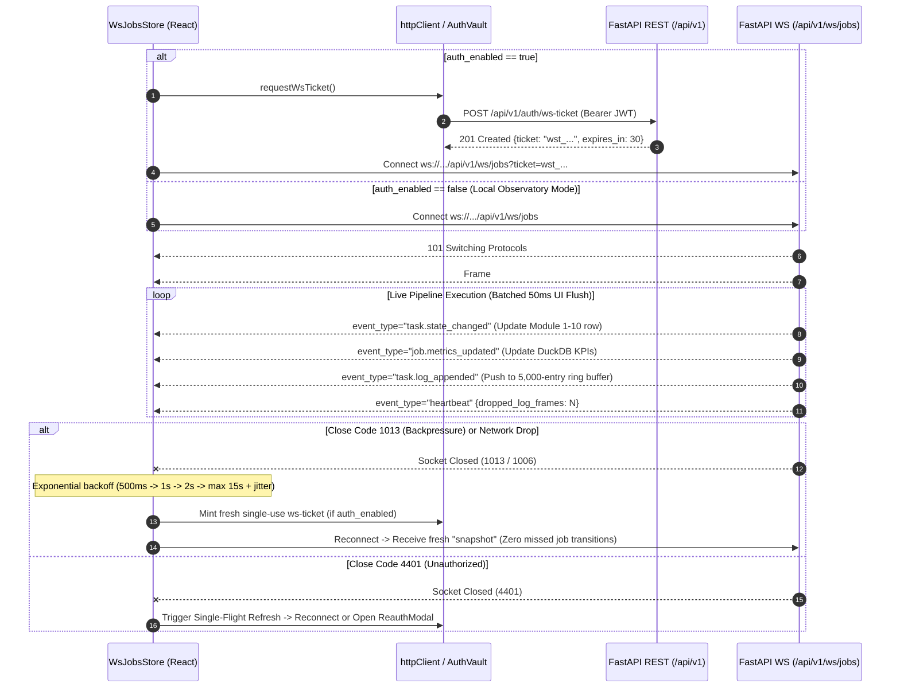
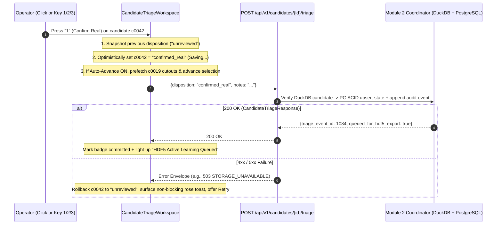

# Project LUMIA: Frontend UI/UX Design Specification & Component Architecture Blueprint

* **Document Version:** 1.0.0
* **Date:** 2026-11-08
* **Status:** Canonical Frontend Architecture Specification
* **Target Workspace:** `frontend/` (`React 19`, `TypeScript 5.7+`, `Tailwind CSS v4.1`, `Vite 6`)
* **Related Specifications & ADRs:**
  * `docs/modules/module_10_web_ui.md` (Module 10 Overview)
  * `docs/modules/module_10_api.md` (FastAPI REST, JWT Auth & WebSocket `/api/v1/ws/jobs` Contracts)
  * `docs/database_schema_blueprint.md` (PostgreSQL 3NF OLTP & DuckDB/Parquet OLAP Schemas)
  * `docs/adr/0001-module-boundaries-and-numbering.md` (Strict Module Layering)
  * `docs/adr/0002-strict-pydantic-contracts.md` (Strict Types & Finite Floating-Point Policy)
  * `docs/adr/0003-duckdb-vs-postgresql-persistence.md` (Polyglot Persistence Separation)

---

## 1. Design Philosophy & Architectural Governance

Project LUMIA's web console serves astronomers and pipeline operators hunting sub-threshold moving solar system objects across wide-field optical exposures. Operators work in darkened observatory control rooms or late-night review environments where visual glare degrades dark adaptation, numeric jitter obscures sub-arcsecond astrometric residuals, and UI latency slows high-volume candidate triage.

### 1.1 Non-Negotiable UX & Engineering Mandates

1. **Strict Night-Time Observatory Ergonomics:**
   * Light mode does not exist. All surfaces use deep void/charcoal slate backgrounds (`#090a0f` to `#181b28`) paired with rich observatory purple interactive accents (`#3b185f` to `#581c87`).
   * Pure white (`#ffffff`) fills are prohibited on cards, modals, inputs, and table backgrounds to prevent pupil constriction during extended night runs.
2. **Zero Emojis Policy:**
   * In compliance with Project LUMIA global directives, emojis are strictly forbidden across all UI labels, badges, empty states, tooltips, log streams, and documentation. All iconography uses crisp, geometric inline SVG vector glyphs (`1.5px`–`1.8px` stroke width) with explicit `aria-hidden="true"` or accessible `role="img"` labels.
3. **Tabular Numeric Determinism (`tabular-nums`):**
   * Every astronomical, statistical, and timing readout—ICRS coordinates (`RA`/`Dec`), Barycentric Julian Dates (`BJD_TDB`), magnitudes, signal-to-noise ratios (`SNR`), CNN Real/Bogus probabilities, pixel centroids, and UTC timestamps—must enforce `font-variant-numeric: tabular-nums` so streaming updates never cause horizontal layout shift.
4. **Strict Contract & Finite-Number Discipline (`ADR-0002`):**
   * All outgoing API payloads validate `Number.isFinite(value)` prior to serialization (`NaN`, `+Infinity`, and `-Infinity` are rejected before network egress). Missing optional backend metrics (`null`) render deterministically as `--`.
5. **Zero Persistence Leakage (`ADR-0001`, `ADR-0003`):**
   * The React client communicates exclusively with Module 10 REST (`/api/v1/*`) and WebSocket (`/api/v1/ws/jobs`) endpoints. Database configuration controls in the Global Options Panel bind to structured configuration schemas rather than raw SQL queries, and sensitive credentials (`PostgreSQL` passwords, `JWT` bearer tokens) are never persisted in `localStorage` or `sessionStorage`.

---

## 2. Observatory Aesthetic, Color System & Tailwind CSS Design Tokens

### 2.1 Surface & Brand Color Palette

The palette anchors visual hierarchy using luminance steps in cool charcoal-slate while reserving chromatic saturation for interactive purple controls, FITS cutout intensity ramps, and semantic status indicators.

| Token Role | CSS Custom Property | Hex Value | Usage Specification | Contrast vs `#090a0f` |
| :--- | :--- | :--- | :--- | :--- |
| **Canvas Void** | `--color-lumia-bg` | `#090a0f` | Root viewport background, FITS canvas surround, recessed metric wells, log terminal background. | `1.00:1` (Base) |
| **Sunken Well** | `--color-lumia-sunken` | `#0d0f17` | Input field interiors, virtualized table body background, inactive tab tracks. | `1.08:1` |
| **Primary Surface** | `--color-lumia-surface` | `#11131c` | Primary cards, navigation rail, top telemetry bar, modal dialogs. | `1.16:1` |
| **Elevated Surface** | `--color-lumia-elevated` | `#181b28` | Hover states on neutral rows/buttons, dropdown menus, popover cards, secondary badges. | `1.32:1` |
| **Subtle Border** | `--color-lumia-border` | `#26293d` | Internal card dividers, data table row hairlines, inactive input borders. | `1.68:1` |
| **Strong Divider** | `--color-lumia-border-strong` | `#343952` | Resizable split-pane handles, table header bottom borders, modal framing. | `2.18:1` |
| **Purple Subtle** | `--color-lumia-purple-subtle` | `#24103a` | Selected table row background tint, active navigation item wash, KPI highlight fill. | `1.38:1` |
| **Purple Dark (Primary Accent Low)** | `--color-lumia-purple-dark` | `#3b185f` | Primary card borders on scientific focal panels, resting secondary action buttons, scrollbar thumbs. | `1.95:1` |
| **Purple Core (Primary Accent High)** | `--color-lumia-purple` | `#581c87` | Primary interactive button fills, active epoch pills, selected control borders, server `accent_color_hex`. | `2.54:1` |
| **Purple Bright** | `--color-lumia-purple-bright` | `#7e22ce` | Primary button hover state, light-curve polyline stroke, CNN progress bar mid-stop. | `3.75:1` |
| **Purple Glow / Focus** | `--color-lumia-purple-focus` | `#a855f7` | `:focus-visible` keyboard outline ring (`2px`), aperture circle overlay, active chart node stroke. | `5.82:1` |
| **Purple Telemetry Text** | `--color-lumia-purple-text` | `#e9d5ff` | High-legibility text labels inside `#3b185f` / `#581c87` buttons and badges (`WCAG AAA`). | `13.9:1` |

### 2.2 Typography & Text Hierarchy Contrast

| Text Tier | Tailwind Utility / Token | Hex Value | Minimum Contrast (on `#11131c`) | Target Elements |
| :--- | :--- | :--- | :--- | :--- |
| **Primary Readout** | `text-slate-100` (`--color-lumia-text-primary`) | `#f1f5f9` | `15.8:1` (AAA) | Panel headings, candidate IDs, primary numeric KPIs, coordinate values. |
| **Secondary Body** | `text-slate-300` (`--color-lumia-text-secondary`) | `#cbd5e1` | `11.4:1` (AAA) | Table cell data, control labels, log entry messages, form descriptions. |
| **Muted Metadata** | `text-slate-400` (`--color-lumia-text-muted`) | `#94a3b8` | `6.8:1` (AA+) | Column headers (`10px`–`11px` uppercase), unit suffixes (`deg`, `px/hr`, `mag`), sync timestamps. |
| **Disabled / Placeholder** | `text-slate-500` (`--color-lumia-text-disabled`) | `#64748b` | `3.9:1` | Disabled action labels, input placeholders, empty-slot dashes. |

### 2.3 Semantic Observatory Accent Tokens

Secondary accents are desaturated in background fill (`950`/`900` dark tints at `40%`–`65%` opacity) with crisp mid-tone borders and pastel foreground text so semantic states remain unmistakable without emitting harsh neon glare.

| Semantic Domain | Surface Fill | Border Token | Indicator / Text | Operational Mapping |
| :--- | :--- | :--- | :--- | :--- |
| **Confirmed Real / Healthy** | `#064e3b` (`45%` alpha) | `#059669` | `#6ee7b7` (`emerald-300`) | `confirmed_real` disposition, `OPERATIONAL` status, `MPC Pass (<= 0.25")`, connected DB engines. |
| **Follow-Up / Tracklet Link** | `#3b185f` (`65%` alpha) | `#7e22ce` | `#d8b4fe` (`purple-300`) | `follow_up` disposition, `HIGH CONFIDENCE REAL` CNN tier (`>= 0.80`), linked `tracklet_id` pill. |
| **Analytical OLAP (DuckDB)** | `#083344` (`50%` alpha) | `#0e7490` | `#67e8f9` (`cyan-300`) | DuckDB/Parquet columnar metrics, sky-box star counts, zero-copy cache indicators (visual separation from PostgreSQL OLTP). |
| **Warning / Degraded / Retry** | `#451a03` (`55%` alpha) | `#d97706` | `#fcd34d` (`amber-300`) | `OFFLINE SIMULATION` fallback, `retrying` Prefect tasks, astrometric residual `> 0.25"`, WebSocket dropped log frames, `WARNING` logs. |
| **Flagged Bogus / Error** | `#4c0519` (`55%` alpha) | `#e11d48` | `#fda4af` (`rose-300`) | `flagged_bogus` disposition, `failed` jobs/tasks, `DEGRADED` / `503` storage errors, `ERROR`/`CRITICAL` logs. |

### 2.4 Astronomical FITS Cutout LUT Palettes & Pixel Stretch Modes

To inspect `31x31` and `51x51` floating-point cutout stamps across **Science**, **Reference**, and **ZOGY Difference** channels, the canvas renderer supports four deterministic lookup tables (LUTs) and four dynamic range transfer functions:

* **Color Map Modes (`ColorMapMode`):**
  1. `violet` (*Observatory Violet* — Default for Science/Reference): Maps normalized `[0.0, 1.0]` intensity through `#090a0f` -> `#24103a` -> `#581c87` -> `#a855f7` -> `#f3e8ff`, preserving dark adaptation while highlighting faint PSF wings.
  2. `grayscale` (*Photometric Grayscale*): Linear perceptual ramp `#090a0f` -> `#e2e8f0` for classical aperture inspection.
  3. `inverted` (*Inverted Print*): High-contrast `#e2e8f0` background -> `#090a0f` PSF core (capped at `#e2e8f0` rather than `#ffffff` to prevent night-vision flash).
  4. `zogy_diverging` (*ZOGY Dipole Diverging* — Default option for ZOGY Difference channel): Zero-centered diverging ramp mapping negative subtraction residuals (`-sigma`) to muted cyan-blue (`#0e7490`), background sky (`0 sigma`) to `#090a0f`, and positive transient flux (`+sigma`) to luminous observatory violet-amber (`#a855f7` -> `#f5d0fe`). Makes astrometric misalignment dipoles immediately distinguishable from clean point-source moving targets.
* **Pixel Stretch Modes (`StretchMode`):**
  * `zscale` (IRAF-style robust median/MAD clipping around background sky), `asinh` (hyperbolic arcsinh stretch preserving both faint SNR ~ 3 cores and bright nearby stars), `sqrt` (square-root compression), and `linear` (min/max clamp).

### 2.5 Tailwind CSS v4 Design Tokens (`frontend/src/index.css`)

```css
@import "tailwindcss";

@theme {
  /* Core Observatory Surfaces */
  --color-lumia-bg: #090a0f;
  --color-lumia-sunken: #0d0f17;
  --color-lumia-surface: #11131c;
  --color-lumia-elevated: #181b28;
  --color-lumia-border: #26293d;
  --color-lumia-border-strong: #343952;

  /* Observatory Purple Brand & Interactive Accents */
  --color-lumia-purple-subtle: #24103a;
  --color-lumia-purple-dark: #3b185f;
  --color-lumia-purple: #581c87;
  --color-lumia-purple-bright: #7e22ce;
  --color-lumia-purple-focus: #a855f7;
  --color-lumia-purple-text: #e9d5ff;

  /* Semantic Observatory States */
  --color-lumia-real-bg: rgba(6, 78, 59, 0.45);
  --color-lumia-real-border: #059669;
  --color-lumia-real-text: #6ee7b7;

  --color-lumia-bogus-bg: rgba(76, 5, 25, 0.55);
  --color-lumia-bogus-border: #e11d48;
  --color-lumia-bogus-text: #fda4af;

  --color-lumia-warn-bg: rgba(69, 26, 3, 0.55);
  --color-lumia-warn-border: #d97706;
  --color-lumia-warn-text: #fcd34d;

  --color-lumia-olap-bg: rgba(8, 51, 68, 0.50);
  --color-lumia-olap-border: #0e7490;
  --color-lumia-olap-text: #67e8f9;

  /* Typography Families */
  --font-sans: "Inter", ui-sans-serif, system-ui, -apple-system, "Segoe UI", Roboto, sans-serif;
  --font-mono: "JetBrains Mono", "Cascadia Mono", ui-monospace, SFMono-Regular, Consolas, monospace;

  /* 16:9 Observatory Viewport Breakpoints */
  --breakpoint-hd: 80rem;     /* 1280px (1280x720 720p) */
  --breakpoint-fhd: 120rem;   /* 1920px (1920x1080 1080p) */
  --breakpoint-qhd: 160rem;   /* 2560px (2560x1440 1440p) */
  --breakpoint-uhd: 220rem;   /* 3520px+ (3840x2160 4K UHD) */

  /* Elevation & Low-Glare Shadows */
  --shadow-lumia-panel: 0 8px 24px -4px rgba(0, 0, 0, 0.55);
  --shadow-lumia-modal: 0 20px 48px -8px rgba(0, 0, 0, 0.80), 0 0 0 1px #3b185f;
  --shadow-lumia-focus: 0 0 0 2px #090a0f, 0 0 0 4px #a855f7;
}
```

---

## 3. Fluid Responsive Architecture (16:9 — 720p to 4K UHD)

Observatory environments span compact laptop/KVM crash-cart displays (`1280x720`), dual-monitor control desks (`1920x1080` and `2560x1440`), and large-format wall/workstation monitors (`3840x2160`). The layout locks the outer application shell to `height: 100dvh; overflow: hidden` on desktop viewports (`>= 1280px`) so individual panels scroll independently without pushing critical transport or triage buttons off-screen.

### 3.1 16:9 Viewport Adaptation Matrix

| Tier | Target Resolution | Navigation Rail | Top Telemetry Strip | Workspace Grid & Panel Strategy | Cutout Stamp Sizing |
| :--- | :--- | :--- | :--- | :--- | :--- |
| **Compact HD (`720p`)** | `1280 x 720` (`hd`) | Collapsed `52px` icon rail (expands as floating `220px` drawer on toggle). | Single-row `44px` compact bar; KPI metrics condensed into inline pill readouts. | **2-Pane Split (`12 cols`):** Left `6 cols` holds 3-channel stamps + sticky ACID triage action bar; Right `6 cols` switches via tabs between `Triage Queue` and `Diagnostics / Light Curve` to fit inside `676px` vertical height without page scroll. | `3 x 176px` side-by-side (`1px` gap) + click-to-zoom `320px` loupe modal. |
| **Standard FHD (`1080p`)** | `1920 x 1080` (`fhd`) | Collapsible `216px` labeled rail (user-collapsible to `56px`). | `52px` header + collapsible 6-card KPI strip (`64px`). | **2-Column Master/Detail (`12 cols`):** Left `5 cols` (`~740px`) stacks 3-Channel Stamp Matrix + Diagnostics/Light Curve; Right `7 cols` (`~1030px`) renders Virtualized Triage Queue or Prefect Job/Log split. | `3 x 216px` side-by-side crisp nearest-neighbor canvases. |
| **Workstation QHD (`1440p`)** | `2560 x 1440` (`qhd`) | Persistent `232px` rail with live queue badge counters. | Full `56px` header + 6-card KPI strip (`72px`). | **3-Pane Scientific Workbench (`16 cols`):** Col 1 (`5 cols`): Triage Queue; Col 2 (`6 cols`): 3-Channel Stamp Matrix + Transport + Pixel Histogram; Col 3 (`5 cols`): CNN Score, Astrometry, Light Curve & Triage Audit History. | `3 x 272px` side-by-side canvases + sub-pixel hover readout bar. |
| **Master Console 4K (`2160p`)** | `3840 x 2160` (`uhd`) | Persistent `256px` rail + quick job/field switcher. | Full header + 8-card extended OLAP/OLTP telemetry strip. | **Container-Governed Multi-Panel (`max-w-[3600px]` Command Mode or centered `max-w-[2560px]` Focus Mode):** Supports **Unified Split Operations**—side-by-side Live Prefect DAG + Structured Task Logs docked alongside the full 3-pane Candidate Triage Workbench, with configurable root UI scale (`100%`, `112.5%`, `125%`). | `3 x 357px` (`7x` integer multiple of `51x51` or `11x` multiple of `31x31`). |

### 3.2 Responsive Layout Comparison Wireframes

#### A. Compact `1280x720` (720p) Layout — Vertical-Budget Optimized (`720px` Total Height)

```text
+----+----------------------------------------------------------------------------------------+
| [] | LUMIA  [OPERATIONAL] | DDB:OK PG:OK WS:14ms | Jobs:42 | Cand:312 (>=0.8:29) | [User v] | 44px
+----+-------------------------------------------+--------------------------------------------+
|    | 3-CHANNEL STAMP INSPECTOR (E2/4 | 2 Hz)   | [Tab: Triage Queue (29)] [Tab: Diagnostics]| 36px
| [P]| +------------+------------+------------+  +--------------------------------------------+
|    | |  SCIENCE   | REFERENCE  | ZOGY DIFF  |  | Filter: CNN>=0.80 [Field...] [Unreviewed v]|
| [T]| |  176x176   |  176x176   |  176x176   |  +--------------------------------------------+
|    | |   (+)      |            |   (+)      |  | ID            | CNN   | SNR  | Mag  | Res  |
| [C]| +------------+------------+------------+  | > c0042       | 94.2% | 11.4 | 19.8 | 0.14"|
|    | BJD 2460622.84120 | X,Y 15.4,16.1 | 19.82 |   c0019       | 91.0% |  9.8 | 20.1 | 0.19"| 584px
| [S]| [|<] [Play/Pause] [>|] [E1][E2][E3][E4]   |   c0108       | 88.5% |  8.2 | 20.6 | 0.22"|
|    | Stretch:[ZScale v] LUT:[Violet v] [x]Ret  |   c0077       | 84.1% |  7.9 | 21.0 | 0.31"|
|    |-------------------------------------------|   ... (virtualized scroll, 32px rows)      |
| [>]| CNN REAL: 94.2% [===========.]  Res:0.14" |                                            |
|    | ACID TRIAGE (Keys: 1=Real 2=Follow 3=Bog) |                                            |
|    | [ 1: Confirm Real ] [2: Follow] [3: Bogus]|                                            |
+----+-------------------------------------------+--------------------------------------------+
 52px                           614px                                614px                     = 1280px
```

#### B. Expanded `3840x2160` (4K UHD) Multi-Panel Master Console (`Command Center` Mode)

```text
+----------+-------------------------------------------------------------------------------------------------------+
| LUMIA    | [OPERATIONAL] | DuckDB: CONNECTED | PostgreSQL: CONNECTED | WS /ws/jobs: LIVE (Seq #418, 9ms) | 14:42Z |
| Console  +-------------------------------------------------------------------------------------------------------+
|          | [DDB Catalog: 18.4k] [Active Jobs: 2] [Extracted: 312] [CNN>=0.8: 29] [Tracklets: 4] [HDF5 Queue: 14] |
+----------+-------------------------------+-----------------------------------+-----------------------------------+
| NAV RAIL | PANE 1: CANDIDATE QUEUE       | PANE 2: 3-CHANNEL BLINK MATRIX    | PANE 3: DIAGNOSTICS & LIGHT CURVE |
|          | (Virtualized + Multi-Filter)  | [Science]  [Reference] [ZOGY Diff]| - Module 7 CNN Score & Model Tag  |
| > Triage |                               |  357x357     357x357     357x357  | - ICRS Sexagesimal & MPC Residual |
|   Monitor|                               | + Synchronized Crosshair & Vector | - Interactive Light Curve SVG     |
|   Catalog|                               | + Transport, Stretch & Pixel Hist | - Tracklet Members & Audit Events |
|   Options|                               | + Sticky ACID Triage & Notes Bar  |                                   |
|          +-------------------------------+-----------------------------------+-----------------------------------+
|          | DOCKED BOTTOM TELEMETRY SPLIT (Collapsible 4K Live Operations Tray - 460px height)                    |
|          | LEFT 50%: Active Prefect Jobs & Module 1-10 Task Stage Matrix   | RIGHT 50%: Live Task Log Stream     |
| [Auth/DB]| [job-20261108-01] [M2 OK]->[M3 OK]->[M4 OK]->[M7 RUN]->[M5 ..]  | 14:42:11 [INFO] CNN_BATCH_SCORED... |
+----------+-----------------------------------------------------------------+-------------------------------------+
   256px                              1180px                             1260px                        1144px
```

### 3.3 Integer-Preferring Canvas Scaling Rule

Astronomical stamps (`31x31` or `51x51` pixels) must never undergo bilinear browser blurring. Every `<canvas>` element applies `ctx.imageSmoothingEnabled = false` and CSS `image-rendering: pixelated`, sizing its backing buffer by `devicePixelRatio` so sub-pixel vector overlays (aperture circle, crosshair gap, trajectory dashed line) render with razor-sharp vector anti-aliasing over crisp, unblurred detector pixels.

---

## 4. Core Surfaces & Detailed Wireframe Specifications

### 4.1 Surface 1: Live Pipeline Monitoring Dashboard (`/pipeline`)

The Pipeline Monitoring Dashboard provides real-time operational visibility into asynchronous Prefect flows, PostgreSQL job/task state machines, and DuckDB analytical extraction counters over `WS /api/v1/ws/jobs`.

#### Wireframe Specification (`1920x1080` Standard View)

```text
+------------------------------------------------------------------------------------------------------------------+
| LIVE PIPELINE MONITOR                           [WS: LIVE | Seq: 129 | RTT: 11ms] [+ Submit Field Job] [Refresh] |
+------------------------------------------------------------------------------------------------------------------+
| [PG Status: CONNECTED] [DDB Engine: MEMORY+PARQUET] [Running Jobs: 1] [Queued: 3] [Extracted: 312] [Tracklets: 4]|
+-------------------------------------------------------+----------------------------------------------------------+
| PREFECT PIPELINE JOBS (Filter: [All States v] [Night])| SELECTED JOB: job-20261108-01 (Field ZTF_0412)           |
|-------------------------------------------------------| Prefect Run: a1b2c3d4-... | Night: 2026-11-08            |
| > job-20261108-01 | ZTF_0412 | RUNNING   | 3/5 tasks  | [Cancel Job]  Parquet: Pending finalization              |
|   job-20261108-02 | ZTF_0413 | QUEUED    | 0/5 tasks  |----------------------------------------------------------|
|   job-20261107-19 | ZTF_0398 | COMPLETED | 5/5 tasks  | MODULE EXECUTION PROGRESS (pipeline_tasks)               |
|   job-20261107-18 | ZTF_0395 | FAILED    | 2/5 tasks  | [M2 Ingest & Catalog ] COMPLETED  (1.8s | 18,420 stars)  |
|                                                       | [M3 WCS & Photometry ] COMPLETED  (14.2s | Att 1/3)      |
|-------------------------------------------------------| [M4 GPU ZOGY & Stamps] COMPLETED  (6.4s  | 312 cutouts)  |
| DUCKDB ANALYTICAL METRICS (job.metrics_updated)       | [M7 CNN Triplet Score] RUNNING    (4.1s... | Att 1/3)    |
| +-------------------------+-------------------------+ | [M5 HelioLinC Linker ] PENDING    (--      | Att 0/3)    |
| | Catalog Stars:   18,420 | Brightest Cat: 9.41 mag | |----------------------------------------------------------|
| | Raw Candidates:     312 | CNN Passed:          29 | | LIVE TASK LOG STREAM (task.log_appended)                 |
| | Linked Tracklets:     4 | Mean Cand SNR:      9.4 | | Severity: [INFO v] [Search event_code...] [AutoScroll:ON]|
| +-------------------------+-------------------------+ | 12:19:50.30 [INFO]  [M7] Starting GPU inference batch... |
|                                                       | 12:19:52.11 [INFO]  [CNN_BATCH_SCORED] Scored 312 31x31  |
|                                                       |                     ZOGY triplets (29 >= 0.80).          |
+-------------------------------------------------------+----------------------------------------------------------+
```

#### Functional & Interactive Details

1. **WebSocket Subscription & Control Bar:**
   * Displays live connection state (`CONNECTING`, `LIVE`, `RECONNECTING (Attempt n)`, `OFFLINE SIMULATION`), monotonic `sequence_no`, round-trip latency via periodic `{"action": "ping"}` frames, and a warning pill if `heartbeat.payload.dropped_log_frames > 0` due to server backpressure.
   * Selecting a row in the **Prefect Pipeline Jobs** table dispatches `{"action": "subscribe", "job_id": "<id>", "min_log_severity": "INFO"}` over the open WebSocket, immediately hydrating a fresh `snapshot` and scoping high-rate task logs to that job.
2. **Module 1–10 Task Stage Matrix:**
   * Renders each `pipeline_tasks` record ordered by `module_number` and `started_at_utc`.
   * Displays retry resilience telemetry: `Attempt {attempt_count} / {max_retries}`. When `status === "retrying"`, displays a live `tabular-nums` countdown to `next_retry_at_utc` in muted amber.
3. **DuckDB Analytical Metrics Panel:**
   * Visually framed with the subtle OLAP cyan accent border (`--color-lumia-olap-border`) to distinguish vectorized DuckDB/Parquet metrics (`job.metrics_updated`) from PostgreSQL job state.
   * Once `job.state_changed` transitions to `completed`, renders a copyable Partition URI badge (`parquet_partition_uri`) and a one-click **`Inspect 29 Candidates in Triage ->`** button that deep-links to `/triage?field_id=ZTF_0412`.
4. **Job Submission Slide-Over Drawer (`POST /api/v1/jobs`):**
   * Visible and enabled for `astronomer` and `admin` roles (disabled with tooltip for `reviewer`).
   * Validates `job_id` and `target_field` against `^[A-Za-z0-9_.-]{1,128}$`, selects an optical `profile_id`, and validates ICRS sky-box coordinates (`ra_min_deg` in `[0, 360)`, `ra_max_deg` in `[0, 360]`, `dec_min_deg <= dec_max_deg` in `[-90, 90]`, finite `max_mag`). Includes an explicit visual badge (`0 deg / 360 deg Meridian Wrap Active`) whenever `ra_min_deg > ra_max_deg`.

---

### 4.2 Surface 2: Candidate Review & 3-Channel Blink-Loop Workspace (`/triage`)

This workspace is the scientific heart of Project LUMIA, designed for rapid human-in-the-loop verification of moving-object candidates and curation of **Module 8** Active Learning ground-truth labels.

#### Wireframe Specification (`2560x1440` 3-Pane / `1920x1080` Adaptive Workbench)

```text
+------------------------------------------------------------------------------------------------------------------+
| CANDIDATE TRIAGE & BLINK-LOOP WORKSPACE   Field: [ZTF_0412 x]  Min CNN: [0.80 ===o=]  Disposition: [Unreviewed v]|
+----------------------------------+-----------------------------------------------+-------------------------------+
| TRIAGE QUEUE (29 / 312 shown)    | SYNCHRONIZED 3-CHANNEL STAMP INSPECTOR        | DIAGNOSTICS & ACTIVE LEARNING |
| Sort: [CNN Score DESC v]         | Target: job-20261108-01_e0_c0042  [31x31 px]  |-------------------------------|
|----------------------------------| Epoch 2 / 4  |  BJD_TDB: 2460622.84125        | MODULE 7 CNN CLASSIFICATION   |
| ID        | CNN   | SNR | Disp   |                                               | 94.2% REAL   [HIGH CONFIDENCE]|
| > c0042   | 94.2% | 11.4| [UNREV]| +-------------+-------------+-------------+   | [======================..]    |
|   c0019   | 91.0% |  9.8| [UNREV]| |   SCIENCE   |  REFERENCE  |  ZOGY DIFF  |   | Model: resnet_lite_s31_v2     |
|   c0108   | 88.5% |  8.2| [REAL] | |             |             |             |   |-------------------------------|
|   c0077   | 84.1% |  7.9| [BOGUS]| |     (+)     |             |     (+)     |   | MODULE 5 ASTROMETRY & MOTION  |
|   c0214   | 81.3% |  6.5| [FOLL] | |  o--o       |             |  o--o       |   | RA : 04h 18m 22.41s (64.5934) |
|   c0155   | 79.4% |  6.1| [UNREV]| |             |             |             |   | Dec: +19d 42m 10.8s (+19.703) |
|   ...     |       |     |        | +-------------+-------------+-------------+   | Residual: 0.14" [MPC <=0.25"] |
|                                  | Centroid: (15.4, 16.1 px) | Cursor: +4.8 sig  | Velocity: 14.2 px/hr | Trk#04 |
|                                  |-----------------------------------------------|-------------------------------|
|                                  | [|<] [Pause] [>|]  [E1] [E2*] [E3] [E4]       | MULTI-EPOCH LIGHT CURVE       |
|                                  | Cadence:[2 Hz v] Mode:[Loop v] Stamp:[31px]   | 19.6 |   T        T           |
|                                  | Sci/Ref LUT:[Violet v] Diff:[ZOGY Diverge v]  | 19.8 |   o--------*--------o  |
|                                  | Stretch:[ZScale v] [x]Reticle [x]Track [ ]Grid| 20.0 |   |        |        |  |
|                                  |-----------------------------------------------|      +------------------------|
|                                  | ACID TRIAGE DISPOSITION (PostgreSQL + Mod 8)  |       E1       E2*      E3/E4 |
|                                  | [1/R: Confirm Real] [2/F: Follow-Up]          | Stack Mag: 19.82 +/- 0.06     |
|                                  | [3/B: Flag Bogus  ] [0/U: Reset    ] [x]Next  | SNR: 11.4  |  Delta Mag: 0.14 |
|                                  | Notes: [Clean 4-epoch ZOGY point source...  ] | [HDF5 Active Learning: QUEUED]|
+----------------------------------+-----------------------------------------------+-------------------------------+
```

#### Scientific Inspection & Interaction Capabilities

1. **Synchronized 3-Channel Multi-Epoch Stamp Canvas (`31x31` & `51x51`):**
   * Renders **Science** (`pixels`), **Reference** (`reference_pixels`), and **ZOGY Difference** (`difference_pixels`) matrices side-by-side on synchronized animation ticks.
   * If `reference_pixels` or `difference_pixels` are `null` for legacy/simulated records, the respective slot renders an explicit low-contrast `CHANNEL UNAVAILABLE` state rather than blank space, or collapses cleanly when toggled to `Single-Channel Focus` mode.
   * **Synchronized Crosshair Inspection:** Hovering the cursor over pixel `(x, y)` in any of the three canvases highlights the identical detector coordinate across all three channels simultaneously and displays the raw flux / normalized sigma value in the telemetry footer.
   * **Unobstructed PSF Aperture Reticle:** Crosshair arms terminate `8px` outside the target centroid (`target_x_px`, `target_y_px`) so the central PSF core and potential ZOGY dipole artifacts are never covered by UI ink.
2. **Blink-Loop Transport Controls:**
   * Frame rates: `0.5 Hz` (`2000 ms`), `1 Hz` (`1000 ms`), `2 Hz` (`500 ms` default), `4 Hz` (`250 ms`), and `8 Hz` (`125 ms`).
   * Loop modes: `Forward Loop` (`E1 -> E2 -> E3 -> E4 -> E1`) and `Ping-Pong` (`E1 -> E2 -> E3 -> E4 -> E3 -> E2`) to verify linear constant-velocity motion vs stationary cosmic rays.
3. **Keyboard-First Rapid Triage Ergonomics:**
   * Operators can review hundreds of candidates without touching the mouse (shortcuts automatically suspend when focus is inside text inputs or notes fields):

| Key Binding | Action | Target State / API Effect |
| :--- | :--- | :--- |
| `Space` | Toggle Play / Pause blink-loop | Local transport state |
| `ArrowLeft` / `[` | Pause and step to previous epoch | `activeEpochIndex - 1` |
| `ArrowRight` / `]` | Pause and step to next epoch | `activeEpochIndex + 1` |
| `ArrowUp` / `k` | Select previous candidate in filtered queue | `selectedCandidateId` |
| `ArrowDown` / `j` | Select next candidate in filtered queue | `selectedCandidateId` |
| `1` or `r` | Triage as **Confirmed Real** | `POST /api/v1/candidates/{id}/triage` (`confirmed_real`) |
| `2` or `f` | Triage as **Follow-Up** | `POST /api/v1/candidates/{id}/triage` (`follow_up`) |
| `3` or `b` | Triage as **Flagged Bogus** | `POST /api/v1/candidates/{id}/triage` (`flagged_bogus`) |
| `0` or `u` | Reset to **Unreviewed** | `POST /api/v1/candidates/{id}/triage` (`unreviewed`) |
| `n` | Focus operator `notes` textarea | Expands notes drawer (`max 2000 chars`) |
| `?` | Toggle keyboard shortcut overlay | Modal cheatsheet |

4. **One-Click ACID Triage & Active Learning Feedback:**
   * Clicking `Confirm Real`, `Follow-Up`, or `Flag Bogus` immediately applies an optimistic badge update, persists the decision via `POST /api/v1/candidates/{candidate_id}/triage`, and surfaces the transactional receipt (`Event #1084` + `HDF5 Export Queued` pill when `queued_for_hdf5_export === true`).
   * When **`Auto-Advance on Triage`** (`[x] Next`) is enabled, recording a disposition automatically advances selection to the next `unreviewed` candidate after a `180 ms` visual confirmation pulse.

---

### 4.3 Surface 3: Global Options Panel & Polyglot Database Configuration (`/settings`)

The Global Options Panel provides a structured administrative surface for configuring UI ergonomics, authentication mode, DuckDB analytical paths/instances, PostgreSQL OLTP connection parameters, and storage management.

#### Wireframe Specification (`Global Options & Database Configuration`)

```text
+------------------------------------------------------------------------------------------------------------------+
| GLOBAL OPTIONS & SYSTEM CONFIGURATION                                     [Discard Changes] [Save & Apply Config]|
+---------------------------+--------------------------------------------------------------------------------------+
| SETTINGS SECTIONS         | DATABASE SELECTION & POLYGLOT PERSISTENCE (ADR-0003)                                 |
|                           | Configured exclusively via Module 2 Repository Factories (Zero raw SQL in UI/API).   |
|   1. Console & Display    |--------------------------------------------------------------------------------------|
| > 2. Database Connections | [A] DUCKDB ANALYTICAL ENGINE (OLAP: Catalogs, Detections, Cutouts, Tracklets)        |
|   3. Authentication & RBAC| Engine Mode:  (o) In-Memory + Parquet (:memory:)   ( ) Persistent Instance (.duckdb) |
|   4. Telescope Profiles   | DuckDB File Path:     [data/olap/lumia_analytics.duckdb          ] (Disabled in mem) |
|   5. Storage & Endurance  | Parquet Root Path:    [data/olap/                                ] [Verify Layout]   |
|                           | Web-UI Reader Mode:   [x] Enforce read_only=True concurrent connections              |
|                           | Memory Limit / Thr:   [8 GB      ]  Threads: [8   ]  Compression: [ZSTD (Fixed)]     |
|                           | Status: [CONNECTED | 4 Partitions | 18,420 Stars]       [Test DuckDB & Parquet Scan] |
|                           |--------------------------------------------------------------------------------------|
|                           | [B] POSTGRESQL TRANSACTIONAL ENGINE (OLTP: Jobs, Auth, ACID Triage, Discoveries)     |
|                           | Connection Source: (o) Explicit Host/Port Parameters  ( ) Environment Secret Ref     |
|                           | Host: [127.0.0.1               ]   Port: [5432  ]   Database: [lumia_oltp          ] |
|                           | User: [lumia_operator          ]   Password: [********************] [Update Secret]  |
|                           | SSL Mode: [require        v]       Pool Size: [10 ]  Max Overflow: [20 ]             |
|                           | 3NF Schema Status: [VERIFIED (11/11 tables ready)]      [Test PostgreSQL Connection] |
|                           |--------------------------------------------------------------------------------------|
|                           | [C] OFFLINE & LOCAL DEVELOPMENT FALLBACK                                             |
|                           | [x] Automatically engage Synthetic Offline Simulation if /api/v1 is unreachable      |
+---------------------------+--------------------------------------------------------------------------------------+
```

#### Configuration Section Breakdown

1. **Section 1 — Console & Display Ergonomics:**
   * **Viewport Density & 4K Scaling:** `Auto (Responsive)`, `Compact (720p Optimized)`, `Standard`, `Expanded 4K (112.5% / 125% root rem scale)`, and `4K Container Cap` (`Fluid 3600px` vs `Centered 2400px`).
   * **Blink-Loop Scientific Defaults:** Default cadence (`2 Hz`), default Science/Reference stretch (`zscale`), default Difference LUT (`zogy_diverging`), default `Auto-Advance on Triage` state, and client WebSocket log ring-buffer ceiling (`1,000` to `10,000` entries).
2. **Section 2 — Database Selection & Polyglot Persistence Configuration:**
   * **DuckDB OLAP Configuration Card:**
     * *Instance Mode Selector:* Radio toggle between `In-Memory Transient + Hive Parquet (:memory:)` (recommended for SSD write-endurance protection per `docs/lastenheft.md` Section 3) and `Persistent DuckDB File (.duckdb)`.
     * *Path & Resource Controls:* Validated filesystem path inputs for the `.duckdb` database file and the root `data/olap/` Parquet directory (`stellar_catalog/`, `candidate_detections/`, `candidate_cutout_stamps/`, `tracklets/`), memory cap (`GB`), worker thread count, and `read_only=True` enforcement toggle for UI query readers.
     * *Diagnostic Action:* **`Test DuckDB & Parquet Scan`** triggers a non-destructive readiness check reporting DuckDB engine version, partition reachability, and sub-millisecond sample read latency.
   * **PostgreSQL OLTP Configuration Card:**
     * *Connection Parameters:* `host` (hostname/IPv4/IPv6), `port` (`1..65535`, default `5432`), `database` name, `username`, `ssl_mode` (`disable`, `prefer`, `require`, `verify-ca`, `verify-full`), and SQLAlchemy pool sizing (`pool_size`, `max_overflow`, `pool_timeout_seconds`).
     * *Write-Only Credential Handling:* Password input uses write-only masking (`has_password_configured: boolean` returned by backend; actual secret is never serialized back to the browser or cached in client state after submission). Supports referencing a server-side environment variable key (e.g., `LUMIA_PG_PASSWORD_ENV`) for zero-secret-in-transit enterprise setups.
     * *Diagnostic Action:* **`Test PostgreSQL Connection`** verifies TCP/TLS handshake, SQLAlchemy pool checkout, round-trip `SELECT 1` latency, and presence of canonical 3NF tables (`operators`, `pipeline_jobs`, `candidate_triage_state`, etc.).
   * **RBAC Protection:** When authentication is enabled, mutating database or global backend parameters requires the `admin` role (`reviewer` and `astronomer` see read-only connection health and personal UI preferences). When authentication is toggled off in single-user local observatory mode, full local configuration is unlocked.
3. **Section 3 — Authentication & Session Mode Toggle:**
   * Houses the master **`Require Operator Authentication (JWT + RBAC)`** feature toggle alongside clear security posture explanations (detailed in Section 4.4).
4. **Section 4 & 5 — Telescope Profiles & Storage Management:**
   * Read/select default `telescope_profiles` (`profile_id`, `mpc_code`, `pixel_scale_arcsec`, `gain_e_per_adu`, `read_noise_e`, `saturation_limit_adu`), astrometry solver routing (`Local Astrometry.net` vs `External API Fallback`), and read-only SSD endurance telemetry (`SpooledTemporaryFile` RAM threshold, Parquet partition disk usage, and pending **Module 8** HDF5 Active Learning export count).

---

### 4.4 Surface 4: Feature-Toggled Authentication Screen & Session Management (`/login`)

Project LUMIA supports both multi-operator institutional observatories requiring strict JWT/RBAC auditability and isolated single-observer dome computers where login screens create unnecessary operational friction during time-critical follow-up.

#### Wireframe Specification (`Observatory Login View & Re-Authentication Modal`)

```text
+------------------------------------------------------------------------------------------------------------------+
|                                                                                                                  |
|                                    +----------------------------------------+                                    |
|                                    |        [O] PROJECT LUMIA CONSOLE       |                                    |
|                                    |   Sub-Threshold Moving-Object Triage   |                                    |
|                                    |----------------------------------------|                                    |
|                                    | Backend: [OPERATIONAL | PG Auth Ready] |                                    |
|                                    |                                        |                                    |
|                                    | Operator Username                      |                                    |
|                                    | [obs_operator_01                     ] |                                    |
|                                    |                                        |                                    |
|                                    | Password                               |                                    |
|                                    | [************************      ] [Show]|                                    |
|                                    |                                        |                                    |
|                                    | [       Sign In to Observatory       ] |                                    |
|                                    |                                        |                                    |
|                                    | Session Security: 15m Bearer JWT +     |                                    |
|                                    | 7d HttpOnly Refresh Cookie (Strict)    |                                    |
|                                    +----------------------------------------+                                    |
|                                                                                                                  |
|                    UTC 2026-11-08 14:42:27  |  Dark Observatory Theme (#090a0f / #581c87)                        |
+------------------------------------------------------------------------------------------------------------------+
```

#### Feature-Toggled Architecture & UX Behavior

| Aspect | Mode A: Authentication Enabled (`auth_enabled = true`) | Mode B: Local Observatory Bypass (`auth_enabled = false`) |
| :--- | :--- | :--- |
| **Startup Boot Flow** | Calls `GET /api/v1/status`, then attempts silent session recovery via `POST /api/v1/auth/refresh` (`credentials: "include"`). If `401`, renders `/login` screen. | Calls `GET /api/v1/status`, detects `auth_enabled: false` (or local runtime override), skips `/login`, and mounts workspace immediately (`0 ms` auth block). |
| **Active Principal** | Hydrated from `AccessTokenResponse.operator` (`operator_id`, `username`, `email`, `role` in `'reviewer' \| 'astronomer' \| 'service' \| 'admin'`). | Hydrated deterministically as `LOCAL_OBSERVATORY_OPERATOR` (`username: "local_observer"`, `role: "admin"`, `authMode: "local_bypass"`). |
| **REST Transport** | Injects `Authorization: Bearer <access_token>` from in-memory closure; rotates silently at `13m` (`120s` prior to `900s` expiry). | Omits `Authorization` header (or attaches `X-Lumia-Local-Session: 1` for audit tagging); zero refresh timers run. |
| **WebSocket Handshake** | Calls `POST /api/v1/auth/ws-ticket` (`201 Created`, `30s` TTL) before opening `WS /api/v1/ws/jobs?ticket=<wst_...>`. | Connects directly to `WS /api/v1/ws/jobs` without ticket round-trip. |
| **Top Header Chrome** | Displays `[obs_operator_01 | ASTRONOMER]` badge, session health indicator, and `Sign Out` (`POST /api/v1/auth/logout`). | Displays a subtle muted-amber/purple `[LOCAL MODE | AUTH DISABLED]` pill clicking directly to `/settings#auth` so operators always know auth is bypassed. |
| **Mid-Session Expiry** | Opens a **Non-Destructive Re-Authentication Modal** over the current view rather than unmounting `/triage`, preserving active candidate selection, blink epoch, and unsaved triage notes! | Not applicable (no expiring JWT session). |

---

## 5. Component Architecture & TypeScript Contract Blueprint

### 5.1 Proposed `frontend/src/` Directory Layout

```text
frontend/src/
├── main.tsx                           # Root mount & strict error boundary
├── App.tsx                            # AppProviders + AuthGate + ShellRouter
├── index.css                          # Tailwind CSS v4 @theme observatory tokens
├── context/
│   ├── AuthContext.tsx                # Feature-toggled JWT + HttpOnly refresh + Local Bypass provider
│   ├── SettingsContext.tsx            # UI density, blink defaults, DB & global config state
│   └── WebSocketJobsContext.tsx       # Managed /api/v1/ws/jobs stream, snapshot store & ring buffer
├── components/
│   ├── shell/
│   │   ├── ObservatoryAppShell.tsx    # 100dvh responsive grid wrapper (720p rail <-> 4K multi-pane)
│   │   ├── CollapsibleNavRail.tsx     # 52px/224px sidebar navigation & badge counters
│   │   └── TopTelemetryHeader.tsx     # Evolution of PipelineStatusMonitor (DB/WS/Auth/UTC bar)
│   ├── auth/
│   │   ├── LoginScreen.tsx            # Full-screen low-glare observatory login card
│   │   ├── SessionReauthModal.tsx     # Non-destructive overlay when 7-day refresh session expires
│   │   └── RoleGuard.tsx              # Declarative RBAC capability wrapper (reviewer/astronomer/admin)
│   ├── pipeline/
│   │   ├── PipelineDashboardView.tsx  # Surface 1 container
│   │   ├── PrefectJobQueueTable.tsx   # Active/historical jobs list + WS subscription selector
│   │   ├── ModuleTaskStageMatrix.tsx  # Modules 1-10 progress, retry counters & backoff timers
│   │   ├── DuckDbMetricsStrip.tsx     # Live OLAP extraction & tracklet KPI cards
│   │   ├── TaskLogStreamConsole.tsx   # Virtualized severity-filtered log viewer + backpressure pill
│   │   └── JobSubmissionDrawer.tsx    # Validated sky-box & meridian-wrap job launcher
│   ├── triage/
│   │   ├── CandidateTriageWorkspace.tsx # Surface 2 responsive 2/3-pane workbench
│   │   ├── ThreeChannelBlinkViewer.tsx  # Upgraded Science/Reference/ZOGY Difference HTML5 canvases
│   │   ├── StampCanvas.tsx              # Offscreen ImageData + crisp DPR vector reticle/track canvas
│   │   ├── BlinkTransportBar.tsx        # Play/Pause, Ping-Pong, Hz cadence, Stretch & LUT selectors
│   │   ├── AcidTriageActionBar.tsx      # 1-click dispositions, keyboard listener, notes & HDF5 badge
│   │   ├── CandidateDetailPanel.tsx     # CNN gauge, ICRS/MPC residuals & interactive LightCurveSvg
│   │   └── CandidateTriageTable.tsx     # Virtualized candidate queue with multi-criteria filtering
│   └── settings/
│       ├── GlobalOptionsView.tsx        # Surface 3 tabbed settings workspace
│       ├── DuckDbConfigCard.tsx         # :memory: vs file path, Parquet root, threads & test action
│       ├── PostgresConfigCard.tsx       # Host, port, write-only SecretStr password, SSL, pool & test
│       ├── AuthFeatureToggleCard.tsx    # Enable/disable login screen & session policy controls
│       └── DisplayErgonomicsCard.tsx    # 720p/4K density, UI scale factor & shortcut cheatsheet
├── services/
│   ├── httpClient.ts                  # Fetch wrapper with Bearer injection & single-flight 401 refresh
│   ├── lumiaApi.ts                    # Typed REST client + offline synthetic simulation fallback
│   └── wsJobsClient.ts                # Ticket handshake, exponential backoff & sequence gap detector
├── types/
│   ├── api.ts                         # Strict REST & domain TypeScript interfaces
│   ├── auth.ts                        # Operator roles, JWT state & feature-toggle contracts
│   ├── settings.ts                    # Polyglot DB & global options contracts
│   └── websocket.ts                   # Discriminated union for /api/v1/ws/jobs frames
└── utils/
    ├── astronomyFormat.ts             # ICRS sexagesimal, ZScale/Asinh stretch, 4 LUTs & finite guards
    └── virtualWindow.ts               # Lightweight zero-dependency row virtualization hook
```

### 5.2 Component Hierarchy Diagram



### 5.3 Core TypeScript Contracts (`strict: true`)

```typescript
// types/auth.ts
export type OperatorRole = "admin" | "astronomer" | "reviewer" | "service";

export type AuthMode = "jwt_enforced" | "local_bypass";

export interface OperatorProfile {
  readonly operator_id: string;
  readonly username: string;
  readonly email: string;
  readonly role: OperatorRole;
}

export interface AuthSessionState {
  readonly authEnabled: boolean;
  readonly authMode: AuthMode;
  readonly status: "bootstrapping" | "authenticated" | "unauthenticated" | "reauth_required";
  readonly operator: OperatorProfile | null;
  readonly expiresAtEpochMs: number | null;
}

// types/api.ts (3-Channel Cutout & ACID Triage Extensions)
export type CutoutStampSize = 31 | 51;
export type CutoutChannel = "science" | "reference" | "difference";
export type StretchMode = "zscale" | "asinh" | "sqrt" | "linear";
export type ColorMapMode = "violet" | "grayscale" | "inverted" | "zogy_diverging";

export interface CandidateCutoutEpochV1 {
  readonly epoch_index: number;
  readonly bjd_tdb: number;
  readonly mag: number;
  readonly mag_err: number;
  readonly target_x_px: number;
  readonly target_y_px: number;
  readonly pixels: readonly (readonly number[])[];                    // Science stamp
  readonly reference_pixels: readonly (readonly number[])[] | null;   // Reference template
  readonly difference_pixels: readonly (readonly number[])[] | null;  // ZOGY difference stamp
}

export interface CandidateTriageRequest {
  readonly disposition: "confirmed_real" | "flagged_bogus" | "follow_up" | "unreviewed";
  readonly notes: string | null;
}

export interface CandidateTriageResponse {
  readonly triage_event_id: number;
  readonly candidate_id: string;
  readonly job_id: string;
  readonly field_id: string;
  readonly previous_disposition: string;
  readonly disposition: "confirmed_real" | "flagged_bogus" | "follow_up" | "unreviewed";
  readonly reviewed_by_operator_id: string;
  readonly cnn_score_at_review: number;
  readonly model_version_at_review: string | null;
  readonly queued_for_hdf5_export: boolean;
  readonly decided_at_utc: string;
}

// types/settings.ts (Database Selection & Global Options)
export interface DuckDbConfigSettings {
  readonly engine_mode: "in_memory_parquet" | "persistent_file";
  readonly database_file_path: string;
  readonly parquet_root_dir: string;
  readonly read_only_ui_readers: boolean;
  readonly memory_limit_gb: number;
  readonly worker_threads: number;
}

export interface PostgresConfigSettings {
  readonly connection_source: "structured_params" | "env_secret_ref";
  readonly host: string;
  readonly port: number;
  readonly database: string;
  readonly username: string;
  readonly password_secret_input?: string; // Write-only on PUT/POST; never populated on GET
  readonly has_password_configured: boolean;
  readonly env_password_var: string | null;
  readonly ssl_mode: "disable" | "prefer" | "require" | "verify-ca" | "verify-full";
  readonly pool_size: number;
  readonly max_overflow: number;
}

// types/websocket.ts (Discriminated Union matching Module 10 Section 4.2)
export type WsJobEventEnvelope =
  | WsEnvelopeBase<"snapshot", WsSnapshotPayload>
  | WsEnvelopeBase<"job.state_changed", WsJobStateChangedPayload>
  | WsEnvelopeBase<"task.state_changed", WsTaskStateChangedPayload>
  | WsEnvelopeBase<"job.metrics_updated", WsJobMetricsUpdatedPayload>
  | WsEnvelopeBase<"task.log_appended", WsTaskLogAppendedPayload>
  | WsEnvelopeBase<"heartbeat", { readonly server_status: string; readonly dropped_log_frames: number }>
  | WsEnvelopeBase<"error", { readonly error_code: string; readonly message: string }>;

export interface WsEnvelopeBase<TType extends string, TPayload> {
  readonly schema_version: "1.0";
  readonly event_id: string;
  readonly event_type: TType;
  readonly sequence_no: number;
  readonly emitted_at_utc: string;
  readonly payload: TPayload;
}
```

---

## 6. State Management & Data Flow Architecture

Project LUMIA avoids heavy Redux boilerplate by partitioning state according to update frequency and security sensitivity using native React 19 contexts, `useSyncExternalStore` ring buffers, and isolated closures.

### 6.1 Five-Plane Frontend State Partitioning

| State Plane | Storage Mechanism | Mutability & Scope | Rationale |
| :--- | :--- | :--- | :--- |
| **1. Security & Bearer Credentials** | Module-private JS closure (`tokenVault.ts`) + `AuthContext` metadata | In-memory only; wiped on tab close or `logout`. | Prevents XSS scripts from reading `access_token` out of `localStorage`; `lumia_refresh_token` stays in `HttpOnly` cookie. |
| **2. Real-Time Pipeline Stream** | External store (`WsJobsStore` via `useSyncExternalStore`) | Normalized `Map<job_id, JobRecord>`, `Map<task_run_id, TaskRecord>`, and fixed-capacity circular buffer (`Float64`/object ring, max `5,000` logs). | Decouples bursts of `task.log_appended` WebSocket frames (batched via `requestAnimationFrame` every `50ms`) from triggering full-app React re-renders. |
| **3. Scientific Candidate & Cutout Cache** | Scoped workspace state + LRU cutout sequence cache (`max 25` candidates) | Keyed by `candidate_id`; prefetches `nextCandidateId` cutouts in idle time. | Makes `j`/`k` and `Auto-Advance on Triage` transitions instantaneous (`0 ms` perceived stamp load). |
| **4. High-Frequency Blink Animation** | Pre-computed `ImageData[]` per `(epoch, channel, stretch, colorMap)` + `<canvas>` ref | Mutates HTML5 2D context directly on timer tick; syncs `activeEpochIndex` to LightCurve dot. | Avoids re-running ZScale sorting and `3 x 2,601` `fillRect` calls on every blink tick—cuts `51x51` 3-channel frame draw time to `< 0.3 ms`. |
| **5. Ergonomic UI Preferences** | `SettingsContext` mirrored to `localStorage` (`lumia.ui.prefs.v1`) | Non-sensitive display settings only (sidebar collapsed, 4K scale, default LUT/cadence). | Preserves night-to-night operator layout preferences safely without storing any connection secrets or tokens. |

### 6.2 Feature-Toggled Authentication & Single-Flight Refresh State Machine

To prevent concurrent REST requests from firing parallel `POST /api/v1/auth/refresh` calls when an access token expires (which would trigger PostgreSQL refresh-token reuse detection and revoke all operator sessions per `docs/modules/module_10_api.md` Section 2.3), `httpClient.ts` serializes refresh rotation behind a single shared `Promise<string | null>` mutex.



### 6.3 WebSocket Streaming, Backpressure & Reconnection Lifecycle



### 6.4 Optimistic One-Click ACID Candidate Triage Flow



---

## 7. Performance, Accessibility & Frontend Verification Standards

### 7.1 Rendering & Memory Performance Budgets

1. **Pre-Computed Offscreen `ImageData` Stamp Cache:**
   * Rather than executing nested `ctx.fillRect` loops on every animation timer tick, normalizing a `31x31` (`961 px`) or `51x51` (`2,601 px`) matrix populates a reusable `Uint8ClampedArray` (`ImageData`) cached per `(candidate_id, epoch_index, channel, stretchMode, colorMap)`. During an `8 Hz` blink loop across all 3 channels simultaneously, each tick executes a single hardware-accelerated `drawImage` upscale plus vector reticle stroke in `< 0.4 ms` (`> 99%` frame-budget headroom at `60/120 Hz`).
2. **Virtualized Candidate Queue & Log Ring Buffer:**
   * Candidate lists (`up to 500` rows per page) and structured task logs (`up to 5,000` retained entries) render only visible viewport rows (`~20`–`45` DOM nodes depending on `720p` vs `4K` height) with fixed row heights (`32px` compact / `40px` standard), sustaining `60 fps` scrolling during heavy GPU pipeline runs.
3. **Prefetching Next Unreviewed Cutouts:**
   * Whenever `selectedCandidateId` changes, an idle-priority `AbortController` prefetches `GET /api/v1/candidates/{nextUnreviewedId}/cutouts` into the 25-item LRU cutout cache so rapid keyboard triage (`1` -> `3` -> `1`) never stalls on network I/O.

### 7.2 Accessibility (WCAG 2.1 AA+) & Safety Guardrails

* **Photosensitive Epilepsy & Motion Safety:** Blink-loop cadence is capped at `8 Hz` (with `2 Hz` default); high-contrast white strobe flashes are structurally impossible because all LUTs cap peak luminance below `#f3e8ff` on `#090a0f` surrounds. Respects `prefers-reduced-motion: reduce` by defaulting `isPlaying` to `false` (manual step mode).
* **Color-Vision Deficiency Independence:** Every semantic state pairs color with an explicit text label or geometric badge (`CONFIRMED REAL`, `FOLLOW-UP`, `FLAGGED BOGUS`, `MPC PASS <= 0.25"`, `EXCEEDS 0.25"`), ensuring full usability under deuteranopia, protanopia, and tritanopia.
* **Keyboard Focus & Screen Readers:** All interactive controls exhibit high-visibility `2px` `#a855f7` focus outlines (`focus-visible`), semantic landmarks (`<header>`, `<nav>`, `<main>`, `<aside>`), `aria-live="polite"` announcements for pipeline job failures and session expiry warnings, and `role="status"` on connection indicators.

### 7.3 Frontend TDD Test Matrix (`Vitest` + `@testing-library/react`)

In accordance with Project LUMIA's Test-Driven Development mandate, implementation of each module in this specification must begin with failing `Vitest` specs covering:

1. **Theme & Contrast Invariants:** Asserting dark-mode root classes, presence of `#3b185f`/`#581c87` observatory tokens, `tabular-nums` on telemetry readouts, and zero emoji characters in rendered DOM trees.
2. **Responsive Shell Breakpoints:** Verifying sidebar rail collapse, compact `720p` (`1280x720`) tab switching, and `4K` (`3840x2160`) multi-panel expansion.
3. **3-Channel Blink-Loop & ACID Triage:** Verifying synchronized `Science`, `Reference`, and `ZOGY Difference` canvas rendering for both `31x31` and `51x51` stamps, keyboard triage shortcuts (`1`/`2`/`3`/`Space`), optimistic disposition updates, `queued_for_hdf5_export` indicator, and error rollback.
4. **WebSocket `/api/v1/ws/jobs` State Store:** Verifying `snapshot` hydration, monotonic `sequence_no` ordering, `job.metrics_updated` DuckDB KPI updates, `dropped_log_frames` warning banner, and `1013`/`4401` reconnect handling.
5. **Global Options & Feature-Toggled Auth:** Verifying seamless workspace mount when `auth_enabled = false`, login/refresh single-flight rotation and non-destructive re-auth modal when `auth_enabled = true`, write-only masking of PostgreSQL passwords, and finite-number validation on DuckDB/PostgreSQL settings forms.
