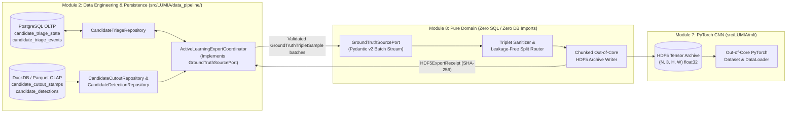
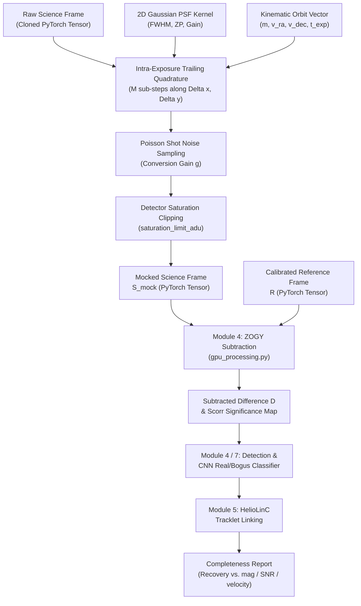

# Module 8: Out-of-Core HDF5 Ground Truth & Synthetic Mocking Specification

* **Module Number:** Module 8
* **Governance Alignment:** `ADR-0001` (Module Boundaries), `ADR-0002` (Strict Pydantic v2 Contracts), `ADR-0003` (Polyglot Persistence Separation), `docs/database_schema_blueprint.md`
* **Upstream / Downstream Interfaces:** Module 1 (`TelescopeConfig`), Module 2 (`data_pipeline` Repositories & Prefect Orchestration), Module 3 (WCS / BJD / Photometry), Module 4 (`ZOGY` Subtraction & Cutout Slicing), Module 5 (`Tracklet` Linking), Module 7 (`ml` PyTorch CNN Classifier), Module 10 (Active Learning Triage Web-UI)

---

## 1. Overview & Architectural Scope

Module 8 provides the ground-truth dataset curation, Active Learning feedback loop, and end-to-end astrophysical completeness validation infrastructure for Project LUMIA. It fulfills two distinct, pure domain responsibilities:

1. **Out-of-Core HDF5 Ground-Truth & Active Learning Curation:**
   * Consolidates supervised Real/Bogus training examples from two provenance streams:
     1. **Human-Vetted Active Learning Dispositions:** Validated operator reviews (`confirmed_real`, `flagged_bogus`) captured in **Module 10** and persisted across PostgreSQL and DuckDB/Parquet by **Module 2**.
     2. **Archival Minor Planet Center (MPC) Ephemeris Cross-Matching:** Automated extraction of historical wide-field exposures overlapping known asteroid ephemerides (**Real**) alongside high-significance subtraction artifacts, cosmic rays, and PSF dipole residuals (**Bogus**), buffered in RAM via `tempfile.SpooledTemporaryFile` with immediate deletion of bulky raw FITS files to protect host SSD write endurance.
   * Serializes aligned `(3, H, W)` floating-point image triplets (`Science`, `Reference`, `Difference/ZOGY` with `H = W` in `{31, 51}`), binary labels (`0.0` Bogus, `1.0` Real), and FAIR astronomical metadata into chunked, compressed HDF5 archives engineered for bounded-memory streaming into **Module 7** (`docs/modules/module_07_cnn_classifier.md`) PyTorch `DataLoader` pipelines.

2. **Synthetic Asteroid Injection (Mocking) & Completeness Characterization:**
   * Non-destructively injects astrophysically calibrated synthetic moving objects (convolved with the local empirical or ZOGY PSF, linear exposure-time motion trailing, conversion gain, and Poisson/readout/dark noise parameterized by **Module 1** `TelescopeConfig`) into cloned in-memory science exposures.
   * Evaluates end-to-end recovery efficiency across **Module 4** (`ZOGY` / $\Psi/\Phi$ stacking), **Module 7** (CNN classification), and **Module 5** (`HelioLinC` tracklet linking), emitting reproducible completeness curves as a function of apparent magnitude, Signal-to-Noise Ratio (SNR), and sky-plane angular speed.

3. **Subsystem B Multi-Epoch Archival Tracklet Integration:**
   * In addition to single-epoch cutouts ($31 \times 31$ and $51 \times 51$), the ground-truth infrastructure integrates the **Subsystem B Multi-Epoch Tracklet Subsystem** (`src/LUMIA/data_mining/`, `src/LUMIA/models/`, `src/LUMIA/training/`).
   * Subsystem B ingests real multi-epoch observation sequences from survey archives (Caltech/IPAC ZTF IBE) via `ArchiveCrawler`, stores $144 \times 144$ cutouts in compressed CSR HDF5 archives (v2.1.0), applies sequence-synchronized dynamic spatial jitter ($144 \to 128$), and trains 4-class spatial-temporal models (`TrackletClassifierNet`) with GroupNorm backbones and temporal sequence aggregators (`BiGRU`, `Transformer`).
   * See [`docs/designs/ztf_tracklet_real_data_migration.md`](../designs/ztf_tracklet_real_data_migration.md) and [`docs/data_mining/architecture_blueprint.md`](../data_mining/architecture_blueprint.md).

---

## 2. Architectural Boundary & Dependency Governance (`ADR-0001`, `ADR-0002`, `ADR-0003`)

In strict compliance with `ADR-0001` and `ADR-0003`, Module 8 is a **pure computational and tensor-archival domain module**:

1. **Zero SQL & Zero Database Driver Coupling:**
   * Module 8 source modules must **never** execute raw SQL strings, construct ORM queries, or import `duckdb`, `sqlalchemy`, `psycopg`, `pyarrow.parquet`, or concrete **Module 2** repository implementations.
   * All relational transactions (PostgreSQL) and columnar scans (DuckDB / Apache Parquet) remain exclusively encapsulated inside **Module 2** (`src/LUMIA/data_pipeline/`).

2. **Dependency Inversion via Structural `Protocol` Ports & Pure Batch Pipelines:**
   * Module 8 defines persistence-agnostic `typing.Protocol` port interfaces (such as `GroundTruthSourcePort`) and pure batch-transformation/archiving functions that accept and emit strictly validated **Pydantic v2** domain models.
   * During scheduled Prefect Active Learning export flows, **Module 2** instantiates a concrete coordinator service (`ActiveLearningExportCoordinator` in `src/LUMIA/data_pipeline/`) that queries the PostgreSQL and DuckDB repositories, hydrates canonical Pydantic contracts, passes bounded mini-batches into Module 8's HDF5 writer, and commits export acknowledgments back to PostgreSQL only after Module 8 verifies HDF5 file integrity.

3. **Strict Pydantic v2 Contract Enforcement (`ADR-0002`):**
   * Every configuration model, repository transfer DTO, sample metadata record, HDF5 manifest, synthetic source parameter set, and completeness report in Module 8 must inherit from `LumiaBaseModel` with:
     ```text
     ConfigDict(strict=True, extra="forbid", frozen=True, allow_inf_nan=False)
     ```
   * Standard-library `@dataclass`, `TypedDict`, `NamedTuple`, and untyped `dict[str, Any]` payloads are prohibited across all Module 8 boundaries. Non-finite floats (`NaN`, `+Inf`, `-Inf`), mismatched stamp dimensions, or unrecognized keys fail fast with `pydantic.ValidationError` prior to touching HDF5 storage.



---

## 3. Querying Module 2 Repositories for Human-Triaged Candidates

Because human triage audit state resides in **PostgreSQL** (`candidate_triage_state`, `candidate_triage_events`) while pixel cutout arrays and astrometric/photometric measurements reside in **DuckDB / Apache Parquet** (`candidate_cutout_stamps`, `candidate_detections`) per `docs/database_schema_blueprint.md`, cross-plane correlation is executed by **Module 2** repositories and delivered to **Module 8** as paginated Pydantic batches.

### 3.1 Disposition Filtering & Supervised Label Mapping

Only unambiguous binary human dispositions enter supervised Real/Bogus HDF5 archives:

| PostgreSQL `disposition` | Exported to Module 8? | Module 7 Target Label (`float32`) | Rationale |
| :--- | :--- | :--- | :--- |
| `'confirmed_real'` | **Yes** | `1.0` | Operator verified genuine moving object or transient source. |
| `'flagged_bogus'` | **Yes** | `0.0` | Operator verified subtraction artifact, cosmic ray, dipole, or noise spike. |
| `'follow_up'` | **No** (Excluded) | N/A | Ambiguous candidate awaiting additional astrometric epochs; excluded to prevent label noise. |
| `'unreviewed'` | **No** (Excluded) | N/A | No human ground-truth label assigned. |

### 3.2 Five-Stage Cross-Repository Hydration & Two-Phase Export Protocol

To guarantee bounded RAM consumption and exactly-once export semantics without cross-database SQL joins:

1. **Stage 1 — Paginated Unexported Triage Fetch (PostgreSQL via `CandidateTriageRepository`):**
   * Module 2 queries `candidate_triage_state` in deterministic cursor pages (ordered by `(updated_at_utc ASC, candidate_id ASC)`, configurable `page_size`, default `512` candidates) targeting the partial index `idx_triage_state_disposition_unexported`:
     * Filter condition: `hdf5_export_batch_id IS NULL AND disposition IN ('confirmed_real', 'flagged_bogus')`.
   * For the matched `candidate_id` page, `CandidateTriageRepository` resolves the authoritative audit provenance from `candidate_triage_events` via `idx_triage_events_candidate_time` (`ORDER BY decided_at_utc DESC LIMIT 1` per candidate), capturing `triage_event_id`, `operator_id` (`reviewed_by_operator_id`), `decided_at_utc`, `cnn_score_at_review`, and `model_version_at_review` as immutable `CandidateTriageState` / `CandidateTriageEvent` Pydantic models.

2. **Stage 2 — Bulk Cutout Stamp & Detection Hydration (DuckDB/Parquet via `CandidateCutoutRepository` & `CandidateDetectionRepository`):**
   * Using the immutable `(candidate_id, field_id, job_id)` keys from Stage 1 (allowing Parquet Hive partition pruning on `field_id` / `job_id`), Module 2 performs vectorized batch lookups:
     * `CandidateCutoutRepository.get_stamps_for_candidates(candidate_ids, cutout_size)` reads `candidate_cutout_stamps` (`PRIMARY KEY (candidate_id, epoch_index)`), returning validated `CandidateCutoutStampRecord` instances containing `epoch_index`, `observation_night`, `cutout_size` (`31` or `51`), `bjd_tdb`, `mag`, `mag_err`, `target_x_px`, `target_y_px`, `science_pixels`, `reference_pixels`, and `difference_pixels`.
     * `CandidateDetectionRepository.get_by_ids(candidate_ids)` reads `candidate_detections`, supplying `ra_deg`, `dec_deg`, `snr`, `astrometric_uncertainty_arcsec`, and `model_version`.

3. **Stage 3 — Three-Channel Completeness & Finiteness Gate:**
   * Notice in `docs/database_schema_blueprint.md` (Section 3.1.C) that `reference_pixels` and `difference_pixels` in `candidate_cutout_stamps` are nullable (`FLOAT[][] NULL`) to support degraded single-frame UI fallbacks.
   * For **Module 7** supervised CNN training, all three channels (`Channel 0: Science`, `Channel 1: Reference`, `Channel 2: Difference/ZOGY`) are mandatory. Any stamp record where `reference_pixels is None` or `difference_pixels is None`, where spatial dimensions deviate from `(cutout_size, cutout_size)`, or where all pixels in a channel are non-finite is deterministically quarantined with a structured warning log rather than corrupting the HDF5 tensor dataset.
   * Multi-epoch tracklet candidates produce one `(3, H, W)` training triplet per valid `epoch_index`, all sharing the parent `candidate_id` so split assignment keeps every epoch of the same candidate within the same partition (`train`, `val`, or `test`).

4. **Stage 4 — Out-of-Core HDF5 Chunk Append & Integrity Verification (Module 8):**
   * Module 8 receives the validated `Sequence[GroundTruthTripletSample]` batch over `GroundTruthSourcePort`, routes each `candidate_id` deterministically to its target split, appends the contiguous `(B_split, 3, H, W)` `float32` tensor slice and aligned 1D metadata arrays to the HDF5 archive, flushes HDF5 buffers to disk (`h5_file.flush()`), and computes an updated archive manifest receipt (`HDF5ExportReceipt` containing `export_batch_id`, sample counts per split/class, and file SHA-256 digest).

5. **Stage 5 — Atomic Export Acknowledgment (PostgreSQL via `CandidateTriageRepository`):**
   * Only after Stage 4 returns a verified `HDF5ExportReceipt` does Module 2 execute a single ACID PostgreSQL transaction updating `candidate_triage_state.hdf5_export_batch_id = :export_batch_id` (and `updated_at_utc = NOW()`) for the exported `candidate_id` set.
   * **Crash Recovery Idempotency:** If an export job terminates prematurely before Stage 5 commits, `hdf5_export_batch_id` remains `NULL` in PostgreSQL; upon retry, Module 8 inspects the existing `(candidate_id, epoch_index)` composite index inside the target HDF5 archive (or stages writes into an atomic batch file prior to merge) to prevent duplicate sample insertion.
   * **Operator Re-Labeling Semantics:** If an operator subsequently overrides a candidate's disposition in Module 10 (appending a new row to `candidate_triage_events` and flipping `candidate_triage_state.disposition`), `CandidateTriageRepository` resets `hdf5_export_batch_id = NULL` so the next Active Learning export supersedes the stale label during archive compaction.

### 3.3 Archival MPC & JPL Horizons Ephemeris Extraction via `astroquery`

In addition to human-triaged Active Learning candidates, Module 8 bootstraps foundational training sets from archival survey exposures using automated solar system ephemeris cross-matching:

1. **API Strategy (`astroquery.mpc` & `astroquery.jplhorizons`):**
   * **Target Ephemeris Resolution:** Module 8 invokes `astroquery.mpc.MPC` and `astroquery.jplhorizons.Horizons` to compute topocentric / geocentric sky coordinates $(\alpha, \delta)$, apparent visual magnitudes $V$, and sky-plane rates $(\dot{\alpha}\cos\delta, \dot{\delta})$ for known minor planets, comets, and Near-Earth Objects (NEOs).
   * **Cone-Search Footprint Matching:** For an archival science exposure centered at $(RA_0, Dec_0)$ observed at Barycentric Julian Date $BJD_{\text{TDB}}$ with field-of-view radius $\rho \le \theta_{\text{FOV}} / 2$, Module 8 queries known bodies whose predicted ephemerides intersect the exposure footprint during the shutter open interval $[t_{\text{start}}, t_{\text{end}}]$.
   * **Observatory Location & Ephemeris Timing:** Topocentric parallax corrections are resolved using the observatory MPC code registered in **Module 1** (`TelescopeConfig.mpc_site_code`, e.g. `500` for geocentric, or 3-character topocentric codes).
   * **Astrometric Cross-Matching:** Predicted positions $(\alpha_{\text{pred}}, \delta_{\text{pred}})$ are mapped to detector coordinates $(x_{\text{pred}}, y_{\text{pred}})$ via the exposure WCS (**Module 3** `AstrometricSolution`). Detections in the difference image whose centroids match the predicted position within angular tolerance:
     $$\Delta \theta = \sqrt{(\Delta \alpha \cos \delta)^2 + (\Delta \delta)^2} < 2.0'' \quad (\text{default } 1.5'')$$
     are automatically assigned supervised ground-truth labels:
     * **Real (`label = 1`):** Verified match to a known minor planet ephemeris with consistent magnitude ($|m_{\text{obs}} - V_{\text{pred}}| \le 1.5$).
     * **Bogus (`label = 0`):** Significant subtraction residuals ($SNR \ge 5.0$) located far from any known asteroid ephemeris or catalog star, exhibiting optical dipole morphology, cosmic-ray sharp gradients, or sensor edge bleeding.

2. **Strict Architectural Test Mandate (Hermetic Offline Testing):**
   * **Zero External Network Pings:** In accordance with the Project LUMIA hermetic testing governance, `pytest` test suites must **never** perform live HTTP/HTTPS calls to the Minor Planet Center (`minorplanetcenter.net`) or JPL Horizons (`ssd.jpl.nasa.gov`).
   * **Mock Transport Layer (`responses` & `pytest-httpx`):** All unit and integration tests covering the `astroquery` ingestion and ephemeris matching services must use `responses` (for synchronous `requests`-based libraries such as `astroquery`) and `pytest-httpx` (for asynchronous `httpx` clients).
   * **Hermetic Fixtures:** Test fixtures load pre-recorded, static JSON, VOTable, or ASCII ephemeris tables simulating MPC query responses. Any unmocked external socket connection attempt must be blocked and fail the test execution immediately.

3. **SSD-Safe In-Memory FITS Lifecycle:**
   * Archival Science and Reference FITS files are read into `tempfile.SpooledTemporaryFile` RAM buffers and streamed directly into **Module 3** (WCS / photometry) and **Module 4** (`ZOGY` subtraction).
   * Bulky raw FITS files are immediately purged from memory and temp storage once the compact 3-channel stamps (`float32` cutouts of size `31x31` or `51x51`, `< 35 KB` uncompressed) are verified and written into the HDF5 archive.

---

## 4. Out-of-Core HDF5 Schema & Module 7 PyTorch `DataLoader` Streaming

### 4.1 Hierarchical File & Dataset Layout

Because **Module 7** (`RealBogusClassifier`) enforces uniform spatial dimensions (`31x31` or `51x51`) within each 4D tensor `(B, 3, H, W)`, each HDF5 archive file stores a single standardized `stamp_size` (`S = 31` or `S = 51`), e.g., `lumia_ground_truth_s31_v1.h5` and `lumia_ground_truth_s51_v1.h5`.

The archive adopts standardized primary datasets (`cutouts`, `labels`, and `metadata`), while preserving backward-compatible dataset aliases (`triplets` -> `cutouts`):

```text
lumia_ground_truth_s{31|51}_v{N}.h5
├── @schema_version          : string  ("1.0.0")
├── @stamp_size              : int32   (31 or 51)
├── @channel_order           : string[3] (["science", "reference", "difference_zogy"])
├── @created_at_utc          : string  (ISO-8601 UTC timestamp)
├── @last_export_batch_id    : string  (Latest applied batch identifier)
├── @split_seed              : int64   (Deterministic hash/PRNG seed for split routing)
│
└── splits/
    ├── train/               (Same internal dataset schema replicated in val/ and test/)
    │   ├── cutouts          : float32, shape (N, 3, S, S), maxshape (None, 3, S, S)
    │   ├── labels           : int8,    shape (N,),         maxshape (None,)
    │   │
    │   ├── metadata/        (Aligned 1D datasets or compound table)
    │   │   ├── candidate_ids    : S128,    shape (N,),     maxshape (None,)
    │   │   ├── bjd_tdb          : float64, shape (N,),     maxshape (None,)
    │   │   ├── ra_deg           : float64, shape (N,),     maxshape (None,)
    │   │   ├── dec_deg          : float64, shape (N,),     maxshape (None,)
    │   │   ├── mag              : float32, shape (N,),     maxshape (None,)
    │   │   ├── snr              : float32, shape (N,),     maxshape (None,)
    │   │   ├── epoch_indices    : int32,   shape (N,),     maxshape (None,)
    │   │   ├── field_ids        : S128,    shape (N,),     maxshape (None,)
    │   │   ├── source_origin    : uint8,   shape (N,),     maxshape (None,)
    │   │   ├── triage_event_ids : int64,   shape (N,),     maxshape (None,)
    │   │   └── export_batch_ids : S128,    shape (N,),     maxshape (None,)
    │   │
    │   └── triplets         : Softlink -> cutouts (backward compatibility)
    ├── val/
    │   └── ...
    └── test/
        └── ...
```

### 4.2 Dataset Types, Chunking, Compression & Alignment Specifications

Every dataset inside `/splits/{train,val,test}/` shares an identical primary axis length `N` (`0 <= idx < N` indexes the exact same sample across all sibling datasets) and supports dynamic `resize((N + M, ...))` appends via `maxshape`:

| Dataset Name | HDF5 / NumPy `dtype` | Shape | Chunk Shape (`S=31` / `S=51`) | Filter / Compression | Semantics & Invariants |
| :--- | :--- | :--- | :--- | :--- | :--- |
| `cutouts` (`triplets`) | `float32` (`<f4`) | `(N, 3, S, S)` | `(64, 3, S, S)` | `lzf` + byte `shuffle=True` (default) or `gzip` (level 4) | Normalized float32 tensors with Channels `(0: Science, 1: Reference, 2: Difference/ZOGY)`. Stored in raw calibrated flux units prior to per-channel robust MAD normalization. Strictly finite (`NaN`/`Inf` sanitized before write). |
| `labels` | `int8` (`\|i1`) | `(N,)` | `(4096,)` | `lzf` | Discrete binary targets: `0 = Bogus`, `1 = Real`. Upon batch collation in PyTorch DataLoader, converted to `torch.float32` (`0.0` / `1.0`) for `torch.nn.BCEWithLogitsLoss`. |
| `candidate_ids` | Fixed ASCII `S128` | `(N,)` | `(4096,)` | `lzf` | Immutable UTF-8/ASCII identifier (`^[A-Za-z0-9_.-]{1,128}$`); fixed-width `S128` avoids HDF5 variable-length (`vlen`) heap pointer bottlenecks during multi-worker streaming. |
| `bjd_tdb` | `float64` (`<f8`) | `(N,)` | `(4096,)` | `lzf` | Light-time corrected Barycentric Julian Date (TDB); `float64` preserves sub-millisecond timing precision. |
| `ra_deg`, `dec_deg` | `float64` (`<f8`) | `(N,)` | `(4096,)` | `lzf` | ICRS coordinates (`[0.0, 360.0)` and `[-90.0, 90.0]` deg). |
| `mag`, `snr` | `float32` (`<f4`) | `(N,)` | `(4096,)` | `lzf` | Apparent magnitude and detection SNR. Use `-1.0` sentinel for unknown `snr` and `+99.0` for uncalibrated `mag` to keep all HDF5 arrays strictly finite. |
| `epoch_indices` | `int32` (`<i4`) | `(N,)` | `(4096,)` | `lzf` | Non-negative exposure index (`>= 0`) matching `candidate_cutout_stamps.epoch_index`. |
| `field_ids` | Fixed ASCII `S128` | `(N,)` | `(4096,)` | `lzf` | Pointing / survey field identifier (`candidate_triage_state.field_id`). |
| `source_origin` | `uint8` (`\|u1`) | `(N,)` | `(4096,)` | `lzf` | Enumerated provenance code: `0 = ACTIVE_LEARNING_HUMAN`, `1 = ARCHIVAL_MPC`, `2 = SYNTHETIC_MOCK`. |
| `triage_event_ids` | `int64` (`<i8`) | `(N,)` | `(4096,)` | `lzf` | PostgreSQL `candidate_triage_events.triage_event_id` (`-1` when `source_origin != 0`). |
| `export_batch_ids` | Fixed ASCII `S128` | `(N,)` | `(4096,)` | `lzf` | Matches `candidate_triage_state.hdf5_export_batch_id` for full lineage auditability. |

#### Chunk Sizing Rationale
* At `chunk_samples = 64`:
  * `S = 31`: `64 * 3 * 31 * 31 * 4 bytes = 738,048 bytes` (`~721 KB` uncompressed per chunk).
  * `S = 51`: `64 * 3 * 51 * 51 * 4 bytes = 1,997,568 bytes` (`~1.91 MB` uncompressed per chunk).
* Both chunk footprints sit squarely inside the optimal `512 KB – 2 MB` HDF5 B-tree leaf range, amortizing decompression syscall overhead while allowing NVMe sequential reads to saturate PCIe bandwidth without inflating host memory.

### 4.3 Leakage-Free Deterministic Split Assignment

Multi-epoch stamps belonging to the same moving object share morphological background features and PSF structure. Randomly splitting individual `(candidate_id, epoch_index)` rows across `train` and `val`/`test` would cause **data leakage** and artificially inflate validation metrics:
* Module 8 assigns splits (`train`, `val`, `test`, e.g., `0.80 / 0.10 / 0.10`) using a deterministic cryptographic hash (`BLAKE2b` seeded with `@split_seed`) computed over the **group key** (`candidate_id`, or optionally `field_id` for strict cross-pointing generalization benchmarks).
* Consequently, every epoch stamp of a given `candidate_id` is guaranteed to land in the exact same split across initial curation and all future incremental Active Learning exports.

### 4.4 Bounded-Memory Streaming into Module 7 PyTorch `DataLoader`

To train on multi-hundred-gigabyte HDF5 archives without exceeding host RAM or GPU VRAM limits—and while maintaining cross-platform safety on Windows (`multiprocessing` `spawn`), Linux, and macOS:

1. **Lazy Per-Worker Handle Initialization (`h5py` Multiprocessing Safety):**
   * Open `h5py.File` handles are **not** picklable across Windows `spawn` worker processes and are not fork-safe on POSIX.
   * The PyTorch dataset reader stores only the immutable `Path` and configuration scalars in `__init__`, keeping `_h5_file: h5py.File | None = None`. Each `DataLoader` worker opens its own read-only handle (`h5py.File(path, mode="r", swmr=True, rdcc_nbytes=chunk_cache_bytes, rdcc_nslots=10007, rdcc_w0=0.75)`) lazily on its first batch fetch and closes it deterministically via `atexit` / context teardown.

2. **Chunk-Aligned Block Streaming (`ChunkedHDF5IterableDataset` / Batch Sampler):**
   * Naive random single-index lookups across a shuffled `N`-sample HDF5 file force `h5py` to decompress an entire `64`-sample chunk (`~1.9 MB`) to extract a single `31 KB` cutout—producing a **64x read/decompression amplification penalty**.
   * Instead, Module 8 prescribes **Two-Level Chunk-Block Shuffling**:
     1. At the start of each epoch `e`, a deterministic `torch.Generator` seeded with `base_seed + e` permutes the list of **contiguous chunk indices** `[0, 1, ..., ceil(N / 64) - 1]` and partitions them disjointly across `DataLoader` workers (`worker_id` in `[0, num_workers - 1]`).
     2. Each worker maintains a bounded ring buffer of `K` chunks in RAM (e.g., `K = 16` chunks = `1,024` samples, consuming `< 32 MB` of host RAM per worker), reading each chunk via a **single contiguous slice** `cutouts[start:stop]` (`O(1)` chunk decompression).
     3. Samples within the `K`-chunk window are shuffled in-memory using the worker's deterministic `Generator`, transformed via optional $D_4$ dihedral symmetries (90-degree rotations and horizontal/vertical reflections applied identically across all 3 channels), converted to pinned CPU tensors (`pin_memory=True`), and collated into `(B, 3, H, W)` `torch.float32` mini-batches paired with `(B,)` `torch.float32` target tensors (cast from `int8`).

3. **Memory Footprint Guarantee:**
   * With `num_workers = 4`, `K = 16` buffered chunks per worker, `rdcc_nbytes = 16 MiB` per worker, and `prefetch_factor = 2`, total host RAM consumed by the entire streaming pipeline remains strictly bounded below **`256 MiB`** regardless of whether the on-disk HDF5 archive holds `10^4` or `10^8` cutouts.

---

## 5. Synthetic Asteroid Injection (Mocking) & Completeness Validation

Module 8 provides pure, deterministic simulation routines implemented via PyTorch to inject realistic synthetic moving objects directly into calibrated Science exposures **before** ZOGY subtraction, ensuring the injected sources undergo the exact same PSF-matching, subtraction, matched filtering, and detection pipeline as real solar system bodies.

### 5.1 Mathematical Formulation of Synthetic Object Injection

#### 1. Photometric Flux Conversion
Given an apparent magnitude $m$, the exposure photometric zero-point $ZP$ (from **Module 3** `PhotometricCalibration`), and exposure duration $t_{\text{exp}}$, the total integrated instrumental flux $F_{\text{ADU}}$ in detector ADU is calculated as:
$$F_{\text{ADU}} = 10^{-0.4(m - ZP)} \cdot t_{\text{exp}}$$

The corresponding total photoelectron count $F_e$ delivered to the detector is:
$$F_e = F_{\text{ADU}} \cdot g$$
where $g$ is the conversion gain ($e^-/\text{ADU}$) from **Module 1** `TelescopeConfig.gain_e_per_adu`.

#### 2. Stationary 2D Gaussian PSF Profile
For an untrailed point source centered at sub-pixel coordinates $(x_0, y_0)$, the spatial flux distribution is modeled as a 2D Gaussian:
$$I(x, y) = A \cdot \exp\left( -\frac{1}{2} \left[ \left(\frac{x - x_0}{\sigma_x}\right)^2 + \left(\frac{y - y_0}{\sigma_y}\right)^2 \right] \right)$$
where the Gaussian dispersion $\sigma$ is related to the Full Width at Half Maximum ($\text{FWHM}$) by:
$$\sigma_x = \frac{\text{FWHM}_x}{2\sqrt{2\ln 2}} \approx \frac{\text{FWHM}_x}{2.35482}, \quad \sigma_y = \frac{\text{FWHM}_y}{2\sqrt{2\ln 2}}$$

The peak amplitude $A$ ensures total flux normalization $\iint_{-\infty}^{\infty} I(x, y) \, dx \, dy = F_{\text{ADU}}$:
$$A = \frac{F_{\text{ADU}}}{2\pi \sigma_x \sigma_y}$$

For an elliptical PSF with position angle $\theta$:
$$\begin{aligned}
\tilde{x} &= (x - x_0)\cos\theta + (y - y_0)\sin\theta \\
\tilde{y} &= -(x - x_0)\sin\theta + (y - y_0)\cos\theta \\
I(\tilde{x}, \tilde{y}) &= A \cdot \exp\left( -\frac{1}{2} \left[ \frac{\tilde{x}^2}{\sigma_x^2} + \frac{\tilde{y}^2}{\sigma_y^2} \right] \right)
\end{aligned}$$

#### 3. Linear Exposure-Time Motion Trailing
For a fast-moving interplanetary object moving at apparent angular rates $(\dot{\alpha}\cos\delta, \dot{\delta})$ (arcsec/hr), the total intra-exposure pixel motion vector $(\Delta x, \Delta y)$ during exposure duration $t_{\text{exp}}$ (seconds) with pixel scale $p$ (arcsec/pixel) is:
$$\Delta x = \dot{\alpha}\cos\delta \cdot \left(\frac{t_{\text{exp}}}{3600 \cdot p}\right), \quad \Delta y = \dot{\delta} \cdot \left(\frac{t_{\text{exp}}}{3600 \cdot p}\right)$$

The trailed surface brightness $I_{\text{trailed}}(x, y)$ is the continuous line integral of the instantaneous PSF along the trajectory path $s \in [0, 1]$:
$$I_{\text{trailed}}(x, y) = \int_0^1 I\left(x - s\Delta x, \; y - s\Delta y\right) \, ds$$

In the discrete PyTorch implementation, this integral is approximated by $M$ quadrature sub-steps along the trail:
$$M = \max\left(1, \; \left\lceil 4 \cdot \sqrt{\Delta x^2 + \Delta y^2} \right\rceil\right)$$
$$I_{\text{trailed}}(x, y) \approx \frac{1}{M} \sum_{k=0}^{M-1} I\left(x - \frac{k + 0.5}{M}\Delta x, \; y - \frac{k + 0.5}{M}\Delta y\right)$$

#### 4. Detector Noise Realization & Saturation
Photon arrival follows Poisson statistics. For each pixel $(x, y)$ in the local injection patch, the ideal noiseless injected flux $I_{\text{trailed}}(x, y)$ (ADU) generates expected photoelectrons $\lambda_e(x, y) = I_{\text{trailed}}(x, y) \cdot g$.
The noisy synthetic photoelectron signal is sampled from:
$$P_e(x, y) \sim \text{Poisson}\left(\lambda_e(x, y)\right)$$
$$I_{\text{noisy}}(x, y) = \frac{P_e(x, y)}{g}$$

The noisy signal is added to the cloned input science frame $S_{\text{raw}}$, and clipped at detector full-well saturation:
$$S_{\text{mock}}(x, y) = \min\left(S_{\text{raw}}(x, y) + I_{\text{noisy}}(x, y), \; \text{saturation\_limit\_adu}\right)$$

### 5.2 PyTorch Tensor Pipeline (Injection Prior to ZOGY Subtraction)

In Project LUMIA, synthetic object injection is strictly executed **prior** to image subtraction:



1. **Science Tensor Cloning:** The original science image $S$ is cloned in GPU VRAM (or pinned host memory) as a `torch.float32` tensor. The reference frame $R$ remains unmodified.
2. **Sub-Pixel PyTorch Kernel Grid:** For each synthetic source, a local bounding grid $(2W+1) \times (2W+1)$ with $W = \lceil 3\sigma + \frac{1}{2}\sqrt{\Delta x^2 + \Delta y^2} \rceil$ is generated via `torch.meshgrid`.
3. **GPU-Accelerated Sub-Step Accumulation:** The trailed Gaussian sum is evaluated natively on tensor cores using vectorized PyTorch operations.
4. **Handoff to Module 4 ZOGY:** The resulting `S_mock` tensor is passed directly into `LUMIA.physics.gpu_processing.compute_zogy_difference()`. Because subtraction operates on the actual injected science pixels, PSF mismatched dipoles, astrometric noise, and background fluctuations realistically affect the synthetic source's difference profile $D$ and matched filter score $S_{\text{corr}}$.

### 5.3 End-to-End Recovery Matching & Completeness Curves

* Executes the unmodified **Module 4 -> Module 7 -> Module 5** detection, CNN classification, and `HelioLinC` tracklet-linking chain on the mocked frames.
* Cross-matches recovered `Tracklet` entities against `InjectedSourceTruth` state vectors within configurable astrometric position tolerance (`max_position_error_arcsec`) and velocity tolerance (`max_velocity_error_arcsec_per_hr`).
* Aggregates binned recovery fractions $C(m, \text{SNR}, \omega) = N_{\text{recovered}} / N_{\text{injected}}$, `m_50` / `m_90` limiting magnitudes, and false-discovery rates into an immutable `CompletenessReport`.

---

## 6. Strict Pydantic v2 Data Contracts & Port Interfaces

All Module 8 public schemas must reside in persistence-free Python modules, start with `from __future__ import annotations`, and inherit from `LumiaBaseModel` (`strict=True, extra="forbid", frozen=True, allow_inf_nan=False`).

### 6.1 Required Pydantic v2 Models

| Model Name | Key Validated Fields & Constraints | Purpose |
| :--- | :--- | :--- |
| `HDF5ArchiveConfig` | `archive_path: Path`, `stamp_size: Literal[31, 51]`, `chunk_samples: int = Field(default=64, ge=16, le=1024)`, `compression: Literal["lzf", "gzip"] = "lzf"`, `gzip_level: int = Field(default=4, ge=1, le=9)`, `split_ratios: tuple[float, float, float] = (0.8, 0.1, 0.1)` (validated sum `== 1.0`), `split_seed: int = Field(ge=0)` | Configures out-of-core HDF5 writer chunking, compression, and deterministic split hashing. |
| `HDF5StreamConfig` | `archive_path: Path`, `split: Literal["train", "val", "test"]`, `stamp_size: Literal[31, 51]`, `batch_size: int = Field(default=128, ge=1, le=4096)`, `ring_buffer_chunks: int = Field(default=16, ge=1, le=256)`, `rdcc_cache_mb: int = Field(default=16, ge=1, le=512)`, `num_workers: int = Field(default=0, ge=0, le=32)`, `enable_dihedral_augmentation: bool = False`, `seed: int = Field(default=42, ge=0)` | Configures bounded-RAM PyTorch `DataLoader` streaming for Module 7 training/evaluation. |
| `GroundTruthTripletSample` | `candidate_id: str`, `epoch_index: int = Field(ge=0)`, `field_id: str`, `stamp_size: Literal[31, 51]`, `label: Literal[0, 1]` (mapped to `0.0` / `1.0` `float32`), `source_origin: Literal["active_learning", "mpc_archival", "synthetic_mock"]`, `bjd_tdb: float`, `ra_deg: float = Field(ge=0.0, lt=360.0)`, `dec_deg: float = Field(ge=-90.0, le=90.0)`, `mag: float`, `snr: float = Field(ge=-1.0)`, `triage_event_id: int = Field(default=-1, ge=-1)`, `export_batch_id: str`, `triplet_pixels: np.ndarray` (`arbitrary_types_allowed=True`, validated shape `(3, stamp_size, stamp_size)`, `dtype=float32`, all finite) | Canonical persistence-free DTO passed from Module 2's export coordinator or archival extractor into Module 8's HDF5 writer. |
| `HDF5SplitSummary` | `split: Literal["train", "val", "test"]`, `total_samples: int = Field(ge=0)`, `real_samples: int = Field(ge=0)`, `bogus_samples: int = Field(ge=0)` | Per-split class balance counters (`real_samples + bogus_samples == total_samples`). |
| `HDF5ExportReceipt` | `export_batch_id: str`, `archive_path: Path`, `stamp_size: Literal[31, 51]`, `exported_candidate_ids: tuple[str, ...]`, `samples_appended: int = Field(ge=0)`, `quarantined_candidate_ids: tuple[str, ...]`, `split_summaries: tuple[HDF5SplitSummary, ...]`, `archive_sha256: str = Field(min_length=64, max_length=64)` | Returned by Module 8 after HDF5 flush; required by Module 2 before stamping `candidate_triage_state.hdf5_export_batch_id` in PostgreSQL. |
| `SyntheticPopulationConfig` | `n_sources: int = Field(ge=1, le=100_000)`, `mag_min: float`, `mag_max: float` (`mag_max >= mag_min`), `speed_min_arcsec_per_hr: float = Field(ge=0.0)`, `speed_max_arcsec_per_hr: float = Field(gt=0.0)`, `seed: int = Field(ge=0)`, `position_match_tol_arcsec: float = Field(default=1.5, gt=0.0)`, `velocity_match_tol_arcsec_per_hr: float = Field(default=2.0, gt=0.0)` | Parameterizes reproducible synthetic moving-object injection campaigns. |
| `InjectedSourceTruth` | `synthetic_id: str`, `mag: float`, `ra_ref_deg: float = Field(ge=0.0, lt=360.0)`, `dec_ref_deg: float = Field(ge=-90.0, le=90.0)`, `v_ra_cosdec_arcsec_per_hr: float`, `v_dec_arcsec_per_hr: float`, `epoch_centroids_px: tuple[tuple[float, float], ...]`, `injected_snr_per_epoch: tuple[float, ...]` | Ground-truth kinematic and photometric state vector of a single injected synthetic asteroid. |
| `CompletenessBinMetric` | `bin_lower: float`, `bin_upper: float`, `n_injected: int = Field(ge=0)`, `n_recovered: int = Field(ge=0)`, `recovery_fraction: float = Field(ge=0.0, le=1.0)` | Binned recovery efficiency entry along magnitude, SNR, or angular speed axes. |
| `CompletenessReport` | `campaign_id: str`, `seed: int`, `total_injected: int = Field(ge=0)`, `total_recovered: int = Field(ge=0)`, `false_discovery_count: int = Field(ge=0)`, `limiting_mag_50: float \| None`, `limiting_mag_90: float \| None`, `magnitude_curve: tuple[CompletenessBinMetric, ...]`, `velocity_curve: tuple[CompletenessBinMetric, ...]` | Certified scientific sensitivity report emitted by synthetic mocking validation runs. |

### 6.2 Structural Repository Port (`GroundTruthSourcePort`)

To formalize the `ADR-0001` / `ADR-0003` boundary between **Module 8** and **Module 2**, Module 8 defines a pure Python `typing.Protocol` port:

```python
from __future__ import annotations

from collections.abc import Iterator, Sequence
from typing import Literal, Protocol


class GroundTruthSourcePort(Protocol):
    """Persistence-agnostic port implemented by Module 2's export coordinator."""

    def iter_unexported_triaged_batches(
        self,
        *,
        stamp_size: Literal[31, 51],
        export_batch_id: str,
        page_size: int = 512,
    ) -> Iterator[Sequence[GroundTruthTripletSample]]:
        """Yield paginated batches of human-vetted Real/Bogus 3-channel samples."""
        ...

    def acknowledge_exported_batch(self, receipt: HDF5ExportReceipt) -> None:
        """Atomically record hdf5_export_batch_id in PostgreSQL after HDF5 verification."""
        ...
```

* **Module 8** depends exclusively on `GroundTruthSourcePort`, `GroundTruthTripletSample`, and `HDF5ExportReceipt`—enabling fast, deterministic `pytest` unit tests backed by trivial in-memory fake ports without launching PostgreSQL or DuckDB.
* **Module 2** (`src/LUMIA/data_pipeline/`) implements `GroundTruthSourcePort` by composing `CandidateTriageRepository`, `CandidateCutoutRepository`, and `CandidateDetectionRepository`, keeping all SQL queries, transaction lifecycles, and Parquet scans strictly inside the data engineering layer.
