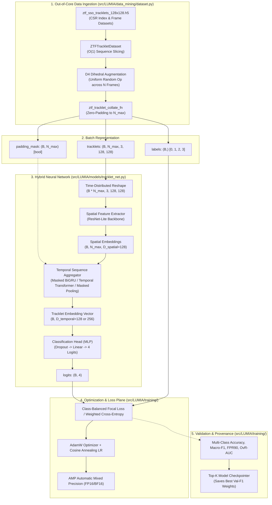

# Project LUMIA Multi-Epoch Tracklet Training Subsystem
## Architectural Blueprint & Technical Specification

> **Governance Artifact:** Technical Specification for Project LUMIA Model Training Subsystem  
> **Status:** APPROVED & READY FOR IMPLEMENTATION  
> **Target Subsystem:** `src/LUMIA/models/` and `src/LUMIA/training/`  
> **Dataset Source:** `data/ground_truth/ztf_sso_tracklets_128x128.h5`  
> **Related Documents:**  
> - [`docs/data_mining/architecture_blueprint.md`](file:///D:/Programming/Python/ProjectLUMIA/docs/data_mining/architecture_blueprint.md)  
> - [`docs/adr/0001-module-boundaries-and-numbering.md`](file:///D:/Programming/Python/ProjectLUMIA/docs/adr/0001-module-boundaries-and-numbering.md)  
> - [`docs/adr/0002-strict-pydantic-contracts.md`](file:///D:/Programming/Python/ProjectLUMIA/docs/adr/0002-strict-pydantic-contracts.md)  

---

## 1. Executive Context & System Goal

Project LUMIA's data-mining pipeline harvests multi-epoch astronomical tracklets of solar system objects (NEOs, MBAs, Comets, TNOs, ISOs) from the Zwicky Transient Facility (ZTF). 
Single-epoch transient classifiers (such as traditional Real/Bogus CNNs) evaluate static cutout triplets independently. Consequently, they cannot differentiate between:
1. Fast-moving asteroids traversing the sky with coherent linear velocity.
2. Stationary subtraction artifacts (e.g. unmasked diffraction spikes, imperfect PSF subtraction residuals).
3. Transient false positives (e.g. cosmic rays, optical ghost reflections, tumbling satellite glints).

The **Multi-Epoch Tracklet Training Subsystem** addresses this fundamental limitation. It trains a deep neural network on variable-length tracklet sequences ($N \ge 2$), fusing spatial feature extraction across individual epochs with temporal sequence aggregation across epochs. The resulting model reliably classifies celestial candidates across four astrophysical and operational categories:
- **Class 0 (`BOGUS_ARTIFACT`):** Satellites, airplanes, cosmic rays, optical ghost reflections.
- **Class 1 (`REAL_POINT_SOURCE`):** Compact moving asteroids (MBAs, TNOs, slow NEOs, Centaurs, ISOs).
- **Class 2 (`REAL_STREAK`):** Fast NEOs and hyper-velocity ISOs exhibiting intra-exposure streaks.
- **Class 3 (`REAL_COMET_COMA`):** Active comets exhibiting diffuse, extended non-stellar comae or tails.

---

## 2. Existing Data Infrastructure & Pipeline Assets

The training subsystem interfaces directly with the out-of-core pipeline established in `src/LUMIA/data_mining/`:

| Dimension / Asset | Specification in Pipeline |
| :--- | :--- |
| **Archive Location** | `data/ground_truth/ztf_sso_tracklets_128x128.h5` |
| **Storage Indexing** | Compressed Sparse Row (CSR) offset indexing (`tracklet_offsets`, `tracklet_lengths`) enabling $O(1)$ random-access slicing of variable sequences without disk padding. |
| **Input Channels** | $C = 3$ channels: `[0: Science, 1: Reference, 2: Difference]`. |
| **Spatial Dimensions** | Fixed $H = 128, W = 128$ pixels ($\sim 130'' \times 130''$ at $1.012''/\text{px}$). |
| **Sequence Length** | Variable $N \ge 2$ frames (typically $3 \le N \le 8$, supporting up to $N = 20+$). |
| **PyTorch Dataset** | [`ZTFTrackletDataset`](file:///D:/Programming/Python/ProjectLUMIA/src/LUMIA/data_mining/dataset.py) streaming native `(N, 3, 128, 128)` tensors. |
| **Collate Function** | [`ztf_tracklet_collate_fn`](file:///D:/Programming/Python/ProjectLUMIA/src/LUMIA/data_mining/dataset.py) generating padded batch tensors `(B, N_max, 3, 128, 128)` accompanied by boolean `padding_mask` of shape `(B, N_max)`. |
| **Data Augmentation** | On-the-fly in-memory $D_4$ dihedral group operations ($8\times$ rotations/flips) with rigorous target coordinate updates (`apply_d4_transform_with_coords`). |
| **Data Partitioning** | Leakage-free cryptographic object-keyed hashing via BLAKE2b (80% Train, 10% Validation, 10% Test). |

---

## 3. High-Level Subsystem Architecture



---

## 4. Model Architecture: Time-Distributed Tracklet Classifier

The network architecture, designated **`TrackletClassifierNet`**, consists of three decoupled components:
1. **Spatial Feature Extractor (Backbone):** Extracts localized visual features from each 3-channel cutout triplet.
2. **Temporal Sequence Aggregator:** Fuses representations across consecutive observation epochs while masking padded frames.
3. **Multi-Class Classification Head:** Maps aggregated tracklet embeddings to categorical class logits.

### 4.1 Spatial Backbone: ResNet-Lite Feature Extractor

To preserve architectural consistency with Project LUMIA's Tomo-e gatekeeper, the spatial backbone adapts the verified `ResNetLite` topology:
- **Input per frame:** $x_{b, n} \in \mathbb{R}^{3 \times 128 \times 128}$
- **Initial Conv-BN-ReLU:** $3 \to 32$ channels, kernel $3 \times 3$, stride 1, padding 1.
- **Residual Stage 1:** 1 BasicBlock ($32 \to 32$, stride 1). Output resolution: $128 \times 128$.
- **Residual Stage 2:** 1 BasicBlock ($32 \to 64$, stride 2). Output resolution: $64 \times 64$.
- **Residual Stage 3:** 1 BasicBlock ($64 \to 128$, stride 2). Output resolution: $32 \times 32$.
- **Global Spatial Pooling:** `nn.AdaptiveAvgPool2d((1, 1))` followed by `nn.Flatten()`.
- **Output embedding dimension:** $D_{\text{spatial}} = 128$.

#### Time-Distributed Ingestion
Given a batch of padded sequences $\mathbf{X} \in \mathbb{R}^{B \times N_{\max} \times 3 \times 128 \times 128}$:
1. Collapse sequence and batch dimensions:
   $$\mathbf{X}_{\text{flat}} = \text{reshape}(\mathbf{X}, \, (B \cdot N_{\max}, \, 3, \, 128, \, 128))$$
2. Execute spatial convolution forward pass:
   $$\mathbf{Z}_{\text{flat}} = \text{Backbone}(\mathbf{X}_{\text{flat}}) \in \mathbb{R}^{(B \cdot N_{\max}) \times D_{\text{spatial}}}$$
3. Restore sequence dimension:
   $$\mathbf{Z} = \text{reshape}(\mathbf{Z}_{\text{flat}}, \, (B, \, N_{\max}, \, D_{\text{spatial}}))$$

### 4.2 Temporal Sequence Aggregation

We specify three swappable aggregation backends configured via a common interface:

#### Option A: Masked Global Temporal Pooling (Baseline / Lightweight)
Computes masked mean and masked max pooling across valid sequence steps:
$$\mathbf{z}_{\text{mean}}^{(b)} = \frac{\sum_{n=1}^{N_{\max}} M_{b, n} \mathbf{Z}_{b, n}}{\sum_{n=1}^{N_{\max}} M_{b, n} + \epsilon}$$
$$\mathbf{z}_{\text{max}}^{(b)} = \max_{n: M_{b, n} = 1} \mathbf{Z}_{b, n}$$
$$\mathbf{h}^{(b)} = \left[ \mathbf{z}_{\text{mean}}^{(b)} \,\|\, \mathbf{z}_{\text{max}}^{(b)} \right] \in \mathbb{R}^{2 D_{\text{spatial}}}$$
- **Advantages:** Zero additional parameters, completely invariant to cadence irregularity, fast execution.

#### Option B: Masked Bidirectional GRU (Recommended Standard)
Processes sequence tokens sequentially while handling variable sequence lengths via packed sequences:
1. Pack padded sequence using PyTorch `torch.nn.utils.rnn.pack_padded_sequence(Z, lengths, batch_first=True, enforce_sorted=False)`.
2. Pass through a 2-layer Bidirectional GRU with hidden size $H_{\text{gru}} = 128$:
   $$(\mathbf{h}_f, \mathbf{h}_b) = \text{BiGRU}(\mathbf{Z}_{\text{packed}})$$
3. Extract final forward and backward hidden states from the valid last frame of each sequence:
   $$\mathbf{h}^{(b)} = \left[ \mathbf{h}_{f, N_b}^{(b)} \,\|\, \mathbf{h}_{b, 1}^{(b)} \right] \in \mathbb{R}^{256}$$
- **Advantages:** Explicitly models monotonic physical motion, directional velocity, and changes in brightness across epochs.

#### Option C: Temporal Transformer Encoder (High-Capacity)
Treats each epoch as a temporal token:
1. Add 1D learned temporal positional encodings or sinusoidal encodings $\mathbf{P} \in \mathbb{R}^{N_{\max} \times D_{\text{spatial}}}$.
2. Ingest into a 2-layer Transformer Encoder ($4$ heads, feedforward dimension $512$, dropout $0.1$).
3. Mask padding using `src_key_padding_mask = ~padding_mask` ($M_{b, n} = 0 \implies \text{masked}$).
4. Aggregate via masked temporal average pooling or a prepended `[CLS]` token.
- **Advantages:** Captures arbitrary non-local temporal interactions and varying cadences without recurrent bottlenecking.

### 4.3 Classification Head

The aggregated tracklet embedding $\mathbf{h} \in \mathbb{R}^{D_{\text{agg}}}$ is projected to the 4 target class logits:

$$\mathbf{y}_{\text{logits}} = \mathbf{W}_2 \cdot \text{ReLU}\left(\mathbf{W}_1 \cdot \text{Dropout}(\mathbf{h}, \, p=0.3) + \mathbf{b}_1\right) + \mathbf{b}_2$$

Where:
- $\mathbf{W}_1 \in \mathbb{R}^{D_{\text{head}} \times D_{\text{agg}}}$ (with $D_{\text{head}} = 128$)
- $\mathbf{W}_2 \in \mathbb{R}^{4 \times D_{\text{head}}}$
- Output: $\mathbf{y}_{\text{logits}} \in \mathbb{R}^{B \times 4}$

```text
Detailed Shape Flow:
Input Batch:         (B, N_max, 3, 128, 128)
Padding Mask:        (B, N_max) [bool]
Flattened Frames:    (B * N_max, 3, 128, 128)
Spatial Conv/ResNet: (B * N_max, 128)
Reshaped Tokens:     (B, N_max, 128)
Temporal Aggregator: (B, 256)
Classification MLP:  (B, 4)
Softmax / Prob:      (B, 4) -> [P_bogus, P_point, P_streak, P_coma]
```

---

## 5. Training Loop & Optimization Strategy

### 5.1 Loss Function Formulation

Astronomical sky surveys feature substantial class imbalances:
- `REAL_POINT_SOURCE` (MBAs, TNOs) dominates real detections (~70–80%).
- `BOGUS_ARTIFACT` represents bounded hard negatives (~15–25%).
- `REAL_STREAK` (Fast NEOs) and `REAL_COMET_COMA` (Active comets) are rare (~2–5%).

To ensure reliable gradient contributions across rare classes, the system provides two loss formulations:

#### Formula 1: Class-Balanced Cross-Entropy (CB-CE)
Weights each class by its inverse effective number of samples (Cui et al.):
$$E_c = \frac{1 - \beta^{n_c}}{1 - \beta}, \quad w_c = \frac{1}{E_c} \Bigg/ \sum_{k=0}^{3} \frac{1}{E_k}$$
Where $n_c$ is the total count of class $c$ in the training partition, and $\beta \in [0.99, 0.9999]$ (default $\beta = 0.999$).
$$\mathcal{L}_{\text{CB-CE}} = - \sum_{c=0}^{3} w_c \cdot y_c \log\left(\frac{\exp(z_c)}{\sum_{j} \exp(z_j)}\right)$$

#### Formula 2: Multi-Class Focal Loss (Recommended)
Down-weights easily classified samples, directing model focus to ambiguous tracklets:
$$\mathcal{L}_{\text{Focal}} = - \sum_{c=0}^{3} \alpha_c \left(1 - p_c\right)^\gamma \log(p_c)$$
Where $p_c = \text{Softmax}(\mathbf{z})_c$, focusing parameter $\gamma = 2.0$, and $\alpha_c$ matches the normalized inverse frequency weights.

### 5.2 Optimizer & Learning Rate Schedule

- **Optimizer:** `torch.optim.AdamW`
  - Base Learning Rate: $\eta_{\text{base}} = 3 \times 10^{-4}$
  - Weight Decay: $\lambda = 1 \times 10^{-3}$ (excluding BatchNorm and bias parameters)
  - Betas: $(\beta_1, \beta_2) = (0.9, 0.999)$
  - Epsilon: $\epsilon = 1 \times 10^{-8}$
- **Learning Rate Scheduler:** Cosine Annealing with Linear Warmup
  - Warmup Phase: 3 epochs linear ramp from $0.1 \times \eta_{\text{base}}$ to $\eta_{\text{base}}$.
  - Cosine Decay Phase: Decays monotonically to $\eta_{\min} = 1 \times 10^{-6}$ at $E_{\max} = 30$ epochs.
- **Gradient Clipping:** Maximum gradient $L_2$ norm clipped to $1.0$ (`torch.nn.utils.clip_grad_norm_`) to prevent exploding gradients during recurrent/attention sequence processing.
- **Automatic Mixed Precision (AMP):** Full `torch.amp.autocast('cuda')` support with `GradScaler` to accelerate training on modern NVIDIA Tensor Cores without float16 underflow.

---

## 6. Evaluation Metrics & Validation Pipeline

Evaluation occurs at the end of each training epoch on the isolated validation split (`val`).

### 6.1 Performance Metrics

1. **Overall Multiclass Accuracy:**
   $$\text{Acc} = \frac{1}{B} \sum_{i=1}^{B} \mathbb{I}\left(\hat{y}_i = y_i\right)$$
2. **Per-Class & Macro F1-Score:**
   $$\text{Precision}_c = \frac{\text{TP}_c}{\text{TP}_c + \text{FP}_c}, \quad \text{Recall}_c = \frac{\text{TP}_c}{\text{TP}_c + \text{FN}_c}$$
   $$\text{F1}_c = 2 \cdot \frac{\text{Precision}_c \cdot \text{Recall}_c}{\text{Precision}_c + \text{Recall}_c}$$
   $$\text{Macro-F1} = \frac{1}{4} \sum_{c=0}^{3} \text{F1}_c$$
3. **Operational False Positive Rate at 90% Recall (FPR90):**
   Grouping all real classes (`Point`, `Streak`, `Coma` as Real $= 1$) vs. `BOGUS_ARTIFACT` ($= 0$):
   $$\text{FPR90} = \frac{\text{FP}}{\text{FP} + \text{TN}} \quad \text{at the threshold where } \text{TPR} \ge 0.90$$
   *Target Operational Threshold:* $\text{FPR90} \le 0.015$ ($\le 1.5\%$ bogus leakage into scientific alert stream).
4. **Macro One-vs-Rest ROC-AUC:**
   Area under the Receiver Operating Characteristic curve computed per class and averaged unweighted across the 4 classes.

### 6.2 Checkpointing Strategy

The checkpointer tracks the validation `Macro-F1`:
- Retains top $K = 3$ model weights: `best_tracklet_net_rank1.pth`, `best_tracklet_net_rank2.pth`, `best_tracklet_net_rank3.pth`.
- Each checkpoint contains:
  ```python
  {
      "epoch": epoch,
      "model_state_dict": model.state_dict(),
      "optimizer_state_dict": optimizer.state_dict(),
      "scheduler_state_dict": scheduler.state_dict(),
      "metrics": {
          "val_loss": val_loss,
          "val_macro_f1": val_macro_f1,
          "val_fpr90": val_fpr90,
          "per_class_f1": per_class_f1_dict,
      },
      "config": config.model_dump(),
      "lumia_version": "1.0.0",
  }
  ```
- Symlinks / copies the highest-scoring model to `data/models/tracklet_net_best.pth`.

---

## 7. Implementation Blueprint for the Coding Agent

### 7.1 Proposed Module File Structure

```text
src/LUMIA/
├── models/
│   ├── __init__.py                # Export TrackletClassifierNet, TemporalBackbone
│   ├── backbones.py               # TimeDistributedResNetLite, SpatialFeatureExtractor
│   └── tracklet_net.py            # TrackletClassifierNet (Spatial + Temporal Aggregator + Head)
│
├── training/
│   ├── __init__.py                # Export Trainer, Configs, Metrics
│   ├── config.py                  # TrackletTrainingConfig (Pydantic v2 strict schema)
│   ├── loss.py                    # ClassBalancedFocalLoss, WeightedCrossEntropyLoss
│   ├── metrics.py                 # TrackletMetricsTracker (Accuracy, F1, FPR90, AUC)
│   ├── checkpoint.py              # TopKModelCheckpointer
│   └── trainer.py                 # TrackletTrainer coordinator
│
scripts/
└── train_tracklets.py             # CLI execution script with argparse and logging
```

### 7.2 Strict Pydantic v2 Configuration Schema

The training configuration must strictly adhere to ADR-0002 (`LumiaBaseModel`):

```python
# src/LUMIA/training/config.py
from pathlib import Path
from typing import Literal
from pydantic import Field
from LUMIA.core.schemas import LumiaBaseModel

TemporalAggregatorType = Literal["masked_pool", "gru", "transformer"]
LossFunctionType = Literal["cross_entropy", "focal", "class_balanced_focal"]

class TrackletModelConfig(LumiaBaseModel):
    """Configuration for TrackletClassifierNet architecture."""
    spatial_backbone: str = Field(default="resnet_lite")
    spatial_embed_dim: int = Field(default=128, ge=32, le=512)
    temporal_aggregator: TemporalAggregatorType = Field(default="gru")
    temporal_hidden_dim: int = Field(default=128, ge=32, le=512)
    temporal_layers: int = Field(default=2, ge=1, le=6)
    dropout_rate: float = Field(default=0.25, ge=0.0, le=0.8)
    num_classes: int = Field(default=4, frozen=True)

class TrackletTrainingConfig(LumiaBaseModel):
    """Configuration for training run execution and hyperparameters."""
    dataset_path: Path = Field(default=Path("data/ground_truth/ztf_sso_tracklets_128x128.h5"))
    model_output_dir: Path = Field(default=Path("data/models"))
    batch_size: int = Field(default=32, ge=1, le=512)
    epochs: int = Field(default=30, ge=1, le=200)
    learning_rate: float = Field(default=3e-4, gt=0.0, le=1e-1)
    weight_decay: float = Field(default=1e-3, ge=0.0)
    loss_function: LossFunctionType = Field(default="class_balanced_focal")
    focal_gamma: float = Field(default=2.0, ge=0.0, le=5.0)
    warmup_epochs: int = Field(default=3, ge=0, le=20)
    grad_clip_norm: float = Field(default=1.0, gt=0.0)
    use_amp: bool = Field(default=True)
    num_workers: int = Field(default=4, ge=0)
    seed: int = Field(default=42, ge=0)
    model: TrackletModelConfig = Field(default_factory=TrackletModelConfig)
```

### 7.3 Model Class Interface Specifications

```python
# src/LUMIA/models/tracklet_net.py
import torch
import torch.nn as nn
from LUMIA.training.config import TrackletModelConfig

class TrackletClassifierNet(nn.Module):
    """Time-distributed spatial-temporal tracklet sequence classification network."""

    def __init__(self, config: TrackletModelConfig) -> None:
        super().__init__()
        self.config = config
        self.spatial_backbone: nn.Module = self._build_spatial_backbone()
        self.temporal_aggregator: nn.Module = self._build_temporal_aggregator()
        self.head: nn.Module = self._build_head()

    def forward(
        self,
        tracklets: torch.Tensor,     # Shape: (B, N_max, 3, 128, 128)
        padding_mask: torch.Tensor,  # Shape: (B, N_max) [bool, True = real frame]
    ) -> torch.Tensor:              # Returns: (B, 4) logits
        """Forward pass over variable-length sequence batch."""
        ...
```

### 7.4 CLI Script Interface Specification

The CLI script `scripts/train_tracklets.py` must support the following arguments:

```bash
python scripts/train_tracklets.py \
    --dataset data/ground_truth/ztf_sso_tracklets_128x128.h5 \
    --output-dir data/models \
    --aggregator gru \
    --batch-size 32 \
    --epochs 30 \
    --lr 0.0003 \
    --loss class_balanced_focal \
    --workers 4 \
    --amp
```

---

## 8. Summary of Coding Agent Deliverables

When the Coding Agent executes this blueprint, the following deliverables are required:
1. Implement spatial backbone extraction in `src/LUMIA/models/backbones.py`.
2. Implement masked temporal sequence aggregators (Masked Pooling, BiGRU, Temporal Transformer) and `TrackletClassifierNet` in `src/LUMIA/models/tracklet_net.py`.
3. Implement loss functions (CrossEntropy, Class-Balanced Focal) in `src/LUMIA/training/loss.py`.
4. Implement evaluation metrics (Accuracy, Macro-F1, FPR90, OvR-AUC) in `src/LUMIA/training/metrics.py`.
5. Implement checkpointer and trainer coordinator in `src/LUMIA/training/checkpoint.py` and `src/LUMIA/training/trainer.py`.
6. Implement CLI coordinator script in `scripts/train_tracklets.py`.
7. Implement unit tests in `tests/test_training/` validating forward pass shapes, padding mask handling, loss backpropagation, and metric computations.
